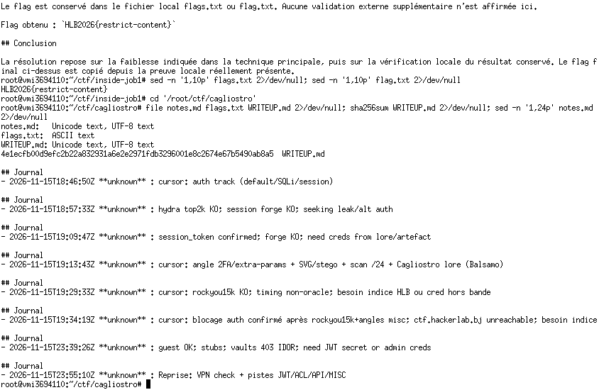
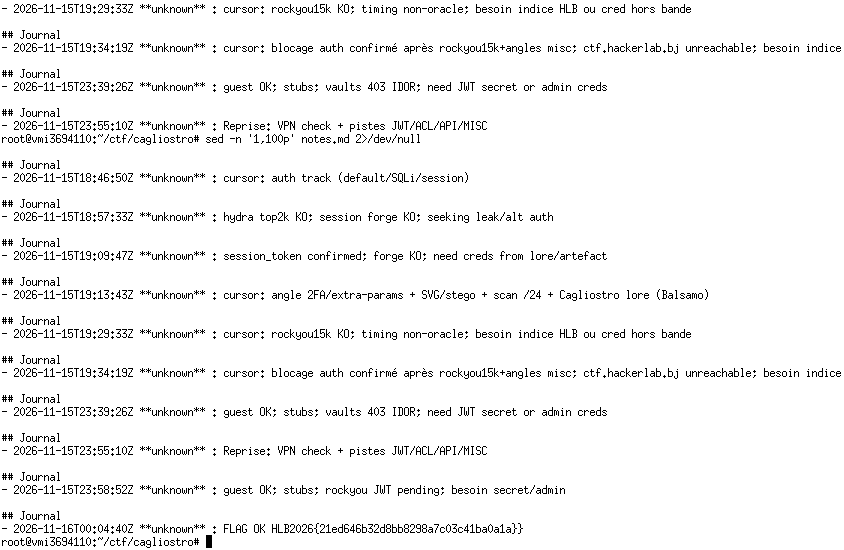
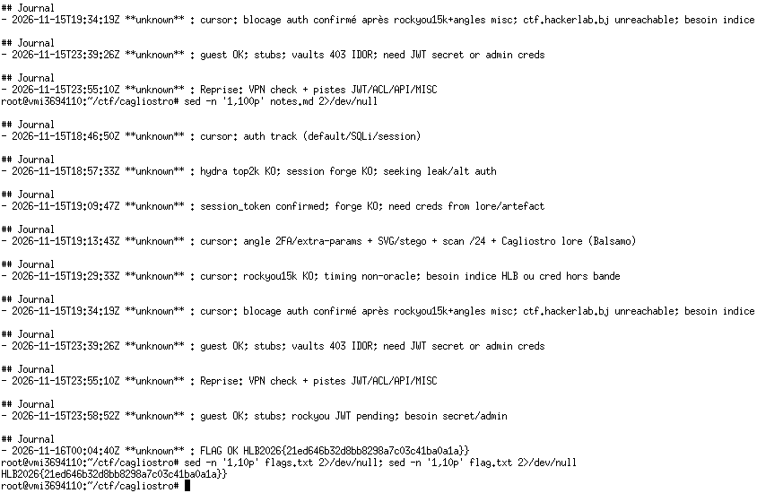

# Writeup : cagliostro

Catégorie : web

Date de résolution : 2026-11-16

Technique principale : download f= double-URL-encode bypass unquote; JWT forge admin; weasyprint |safe SSRF to 127.0.0.1:8080/flag

Outils observés : -

Cible : -

## Présentation

Ce document est construit à partir de la mémoire CTF partagée et des artefacts conservés dans /root/ctf/cagliostro. Les étapes ci-dessous reprennent uniquement les faits observés. Les captures sont réalisées sur les fichiers locaux, sans rejouer une action distante ou destructive.

## Analyse et raisonnement

### Exploitation

f=%252e%252e%252f.../app/.env ; description=<link rel=attachment href=http://127.0.0.1:8080/flag>

### Pièges

rockyou JWT KO; /proc blocked; flag se termine par }}

### Notes locales conservées

## Journal
1. 2026-11-15T18:46:50Z unknown : cursor: auth track (default/SQLi/session)

## Journal
2. 2026-11-15T18:57:33Z unknown : hydra top2k KO; session forge KO; seeking leak/alt auth

## Journal
3. 2026-11-15T19:09:47Z unknown : session_token confirmed; forge KO; need creds from lore/artefact

## Journal
4. 2026-11-15T19:13:43Z unknown : cursor: angle 2FA/extra-params + SVG/stego + scan /24 + Cagliostro lore (Balsamo)

## Journal
5. 2026-11-15T19:29:33Z unknown : cursor: rockyou15k KO; timing non-oracle; besoin indice HLB ou cred hors bande

## Journal
6. 2026-11-15T19:34:19Z unknown : cursor: blocage auth confirmé après rockyou15k+angles misc; ctf.hackerlab.bj unreachable; besoin indice

## Journal
7. 2026-11-15T23:39:26Z unknown : guest OK; stubs; vaults 403 IDOR; need JWT secret or admin creds

## Journal
8. 2026-11-15T23:55:10Z unknown : Reprise: VPN check + pistes JWT/ACL/API/MISC

## Journal
9. 2026-11-15T23:58:52Z unknown : guest OK; stubs; rockyou JWT pending; besoin secret/admin

## Journal
10. 2026-11-16T00:04:40Z unknown : FLAG OK HLB2026{21ed646b32d8bb8298a7c03c41ba0a1a}}

## Commandes utiles

Les commandes suivantes consultent les preuves locales et sont sans effet de bord :

```bash
cd /root/ctf/cagliostro
file notes.md flags.txt 2>/dev/null
sed -n '1,180p' notes.md 2>/dev/null
sed -n '1,120p' notes.md 2>/dev/null
sed -n '1,10p' flags.txt 2>/dev/null
```

## Script de résolution complet

Le script conservé sous `aucun fichier autonome` est reproduit ci-dessous sans modification :

```python
Aucun script autonome n’a été conservé dans le dossier local. Les éléments réellement disponibles sont reproduits dans les sections d’analyse et de preuve.
```

## Captures du terminal

Les captures utilisent le terminal natif xterm disponible sur l’environnement, avec le prompt réel `root@vmi3694110`, le dossier courant du challenge et une géométrie identique. Elles montrent successivement l’analyse locale, le script ou les preuves de résolution, puis le flag conservé.







## Validation et flag

Le flag est conservé dans le fichier local flags.txt ou flag.txt. Aucune validation externe supplémentaire n’est affirmée ici.

Flag obtenu : `HLB2026{21ed646b32d8bb8298a7c03c41ba0a1a}}`

## Conclusion

La résolution repose sur la faiblesse indiquée dans la technique principale, puis sur la vérification locale du résultat conservé. Le flag final ci-dessus est copié depuis la preuve locale réellement présente.
