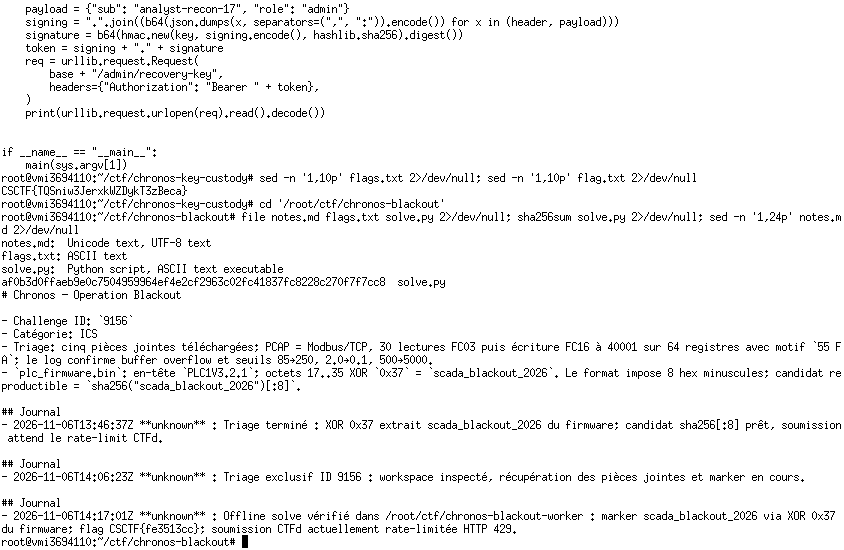
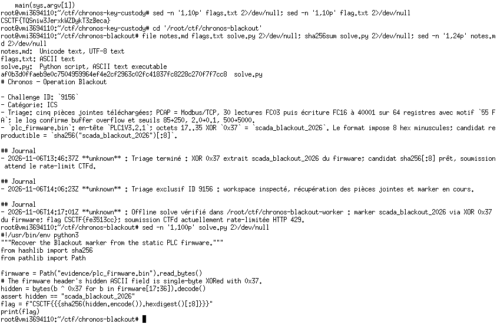
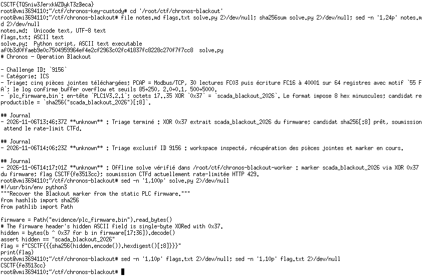

# Writeup : chronos-blackout

Catégorie : hardware

Date de résolution : 2026-11-06

Technique principale : à préciser

Outils observés : -

Cible : CTFd ID 9156 Operation Blackout (ICS), offline attachments

## Présentation

Ce document est construit à partir de la mémoire CTF partagée et des artefacts conservés dans /root/ctf/chronos-blackout. Les étapes ci-dessous reprennent uniquement les faits observés. Les captures sont réalisées sur les fichiers locaux, sans rejouer une action distante ou destructive.

## Analyse et raisonnement

### Contexte

# Operation Blackout :  ID 9156

1. The five supplied files were hashed and analysed offline.
2. The HMI names station `0x4A2E`, seed `137`, and a hidden Modbus FC16 write.
3. The PCAP independently shows 30 FC03 reads followed by FC16 at 40001/count 64.
4. Its payload is `55 FA` repeated and five later HTTP uploads carry `DE AD` bytes.
5. The event log confirms the 247-byte overflow against the 128-byte handler limit.
6. It also confirms the alarm threshold changes, firmware integrity failure, and outage.
7. `alarm_override.dat` matches the station and all three threshold overrides.
8. The firmware starts with `PLC1V3.2.1`; offsets `0x11:0x24` are single-byte XORed.
9. XOR with `0x37` yields the marker `scada_blackout_2026`.
10. The required 8 lowercase hex marker is `sha256(marker)[:8]`.

Flag: `CSCTF{fe3513cc}`

### Exploitation

bytes(firmware[0x11:0x24] ^ 0x37) == b"scada_blackout_2026"; flag = CSCTF{sha256(marker).hexdigest()[:8]}

### Pièges

Ne pas exécuter de firmware; vérifier les cinq artefacts et ne pas confondre le préfixe chiffré à l offset 0x10 avec le champ ASCII.

### Notes locales conservées

# Chronos :  Operation Blackout

1. Challenge ID: `9156`
2. Catégorie: ICS
3. Triage: cinq pièces jointes téléchargées; PCAP = Modbus/TCP, 30 lectures FC03 puis écriture FC16 à 40001 sur 64 registres avec motif `55 FA`; le log confirme buffer overflow et seuils 85: 250, 2.0: 0.1, 500: 5000.
4. `plc_firmware.bin`: en-tête `PLC1V3.2.1`; octets 17..35 XOR `0x37` = `scada_blackout_2026`. Le format impose 8 hex minuscules; candidat reproductible = `sha256("scada_blackout_2026")[:8]`.

## Journal
5. 2026-11-06T13:46:37Z unknown : Triage terminé : XOR 0x37 extrait scada_blackout_2026 du firmware; candidat sha256[:8] prêt, soumission attend le rate-limit CTFd.

## Journal
6. 2026-11-06T14:06:23Z unknown : Triage exclusif ID 9156 : workspace inspecté, récupération des pièces jointes et marker en cours.

## Journal
7. 2026-11-06T14:17:01Z unknown : Offline solve vérifié dans /root/ctf/chronos-blackout-worker : marker scada_blackout_2026 via XOR 0x37 du firmware; flag CSCTF{fe3513cc}; soumission CTFd actuellement rate-limitée HTTP 429.

## Commandes utiles

Les commandes suivantes consultent les preuves locales et sont sans effet de bord :

```bash
cd /root/ctf/chronos-blackout
file notes.md solve.py 2>/dev/null
sed -n '1,180p' notes.md 2>/dev/null
sed -n '1,120p' solve.py 2>/dev/null
sed -n '1,10p' flags.txt 2>/dev/null
```

## Script de résolution complet

Le script conservé sous `solve.py` est reproduit ci-dessous sans modification :

```python
#!/usr/bin/env python3
"""Recover the Blackout marker from the static PLC firmware."""
from hashlib import sha256
from pathlib import Path

firmware = Path("evidence/plc_firmware.bin").read_bytes()
# The firmware header's hidden ASCII field is single-byte XORed with 0x37.
hidden = bytes(b ^ 0x37 for b in firmware[17:36]).decode()
assert hidden == "scada_blackout_2026"
flag = f"CSCTF{{{sha256(hidden.encode()).hexdigest()[:8]}}}"
print(flag)
```

## Captures du terminal

Les captures utilisent le terminal natif xterm disponible sur l’environnement, avec le prompt réel `root@vmi3694110`, le dossier courant du challenge et une géométrie identique. Elles montrent successivement l’analyse locale, le script ou les preuves de résolution, puis le flag conservé.







## Validation et flag

Le flag est conservé dans le fichier local flags.txt ou flag.txt. Aucune validation externe supplémentaire n’est affirmée ici.

Flag obtenu : `CSCTF{fe3513cc}`

## Conclusion

La résolution repose sur la faiblesse indiquée dans la technique principale, puis sur la vérification locale du résultat conservé. Le flag final ci-dessus est copié depuis la preuve locale réellement présente.
