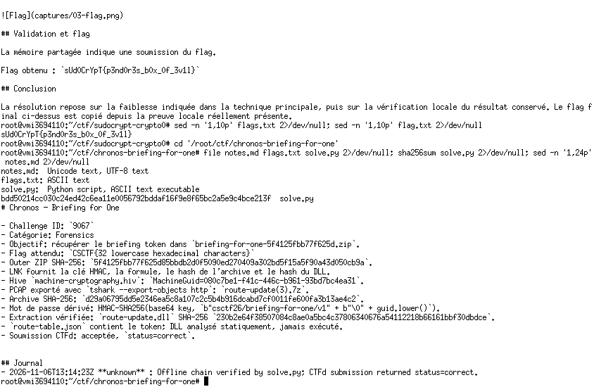
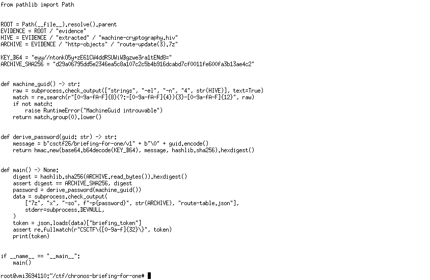
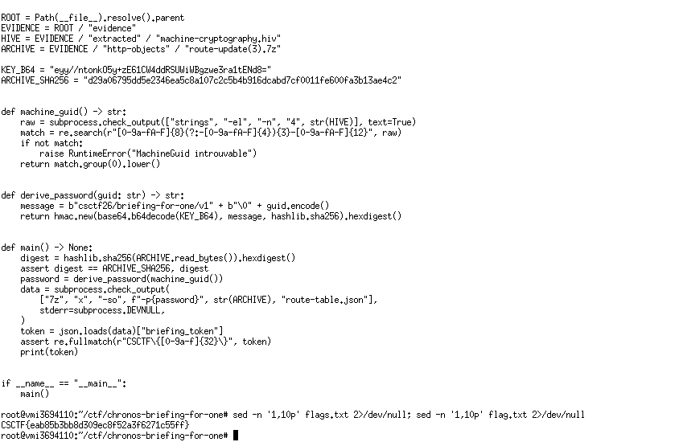

# Writeup : chronos-briefing-for-one

Catégorie : forensics

Date de résolution : 2026-11-06

Technique principale : LNK statique + Registry saved-root + export HTTP PCAP + 7z AES HMAC

Outils observés : exiftool,strings,tshark,7z,jq

Cible : https://2026.chronos-security.ro/api/v1/challenges/9067

## Présentation

Ce document est construit à partir de la mémoire CTF partagée et des artefacts conservés dans /root/ctf/chronos-briefing-for-one. Les étapes ci-dessous reprennent uniquement les faits observés. Les captures sont réalisées sur les fichiers locaux, sans rejouer une action distante ou destructive.

## Analyse et raisonnement

### Exploitation

HMAC-SHA256(base64_key, csctf26/briefing-for-one/v1 || NUL || lowercase(MachineGuid)); 7z AES avec le digest hexadécimal

### Pourquoi ça marche

Le LNK révèle la dérivation; strings -el suffit ici sur la ruche Registry native sauvegardée; tshark --export-objects récupère le bon objet HTTP.

### Pièges

Ne pas prendre les premiers objets XML du PCAP: route-update(3).7z est le flux GET reassemblé de 5359 octets.

### Notes locales conservées

# Chronos :  Briefing for One

1. Challenge ID: `9067`
2. Catégorie: Forensics
3. Objectif: récupérer le briefing token dans `briefing-for-one-5f4125fbb77f625d.zip`.
4. Flag attendu: `CSCTF{32 lowercase hexadecimal characters}`
5. Outer ZIP SHA-256: `5f4125fbb77f625d85bbdb2d0f5090ed270409a302bd5f15a5f90a43d050cb9a`.
6. LNK fournit la clé HMAC, la formule, le hash de l’archive et le hash du DLL.
7. Hive `machine-cryptography.hiv`: `MachineGuid=080c7be1-f41c-446c-b961-93bd7bc4ea31`.
8. PCAP exporté avec `tshark --export-objects http`: `route-update(3).7z`.
9. Archive SHA-256: `d29a06795dd5e2346ea5c8a107c2c5b4b916dcabd7cf0011fe600fa3b13ae4c2`.
10. Mot de passe dérivé: HMAC-SHA256(base64 key, `b"csctf26/briefing-for-one/v1" + b"\0" + guid.lower()`).
11. Extraction vérifiée: `route-update.dll` SHA-256 `230b2e64f38507084c8ae0a5bc4c37806340676a54112218b66161bbf30dbdce`.
12. `route-table.json` contient le token; DLL analysé statiquement, jamais exécuté.
13. Soumission CTFd: acceptée, `status=correct`.


## Journal
14. 2026-11-06T13:14:23Z unknown : Offline chain verified by solve.py; CTFd submission returned status=correct.

## Commandes utiles

Les commandes suivantes consultent les preuves locales et sont sans effet de bord :

```bash
cd /root/ctf/chronos-briefing-for-one
file notes.md solve.py 2>/dev/null
sed -n '1,180p' notes.md 2>/dev/null
sed -n '1,120p' solve.py 2>/dev/null
sed -n '1,10p' flags.txt 2>/dev/null
```

## Script de résolution complet

Le script conservé sous `solve.py` est reproduit ci-dessous sans modification :

```python
#!/usr/bin/env python3
"""Extraction/triage reproductible pour Briefing for One."""

from __future__ import annotations

import base64
import hashlib
import hmac
import json
import re
import subprocess
from pathlib import Path


ROOT = Path(__file__).resolve().parent
EVIDENCE = ROOT / "evidence"
HIVE = EVIDENCE / "extracted" / "machine-cryptography.hiv"
ARCHIVE = EVIDENCE / "http-objects" / "route-update(3).7z"

KEY_B64 = "eyy//ntonkO5y+zE61CW4ddRSUWiWBgzwe3ra1tENd8="
ARCHIVE_SHA256 = "d29a06795dd5e2346ea5c8a107c2c5b4b916dcabd7cf0011fe600fa3b13ae4c2"


def machine_guid() -> str:
    raw = subprocess.check_output(["strings", "-el", "-n", "4", str(HIVE)], text=True)
    match = re.search(r"[0-9a-fA-F]{8}(?:-[0-9a-fA-F]{4}){3}-[0-9a-fA-F]{12}", raw)
    if not match:
        raise RuntimeError("MachineGuid introuvable")
    return match.group(0).lower()


def derive_password(guid: str) -> str:
    message = b"csctf26/briefing-for-one/v1" + b"\0" + guid.encode()
    return hmac.new(base64.b64decode(KEY_B64), message, hashlib.sha256).hexdigest()


def main() -> None:
    digest = hashlib.sha256(ARCHIVE.read_bytes()).hexdigest()
    assert digest == ARCHIVE_SHA256, digest
    password = derive_password(machine_guid())
    data = subprocess.check_output(
        ["7z", "x", "-so", f"-p{password}", str(ARCHIVE), "route-table.json"],
        stderr=subprocess.DEVNULL,
    )
    token = json.loads(data)["briefing_token"]
    assert re.fullmatch(r"CSCTF\{[0-9a-f]{32}\}", token)
    print(token)


if __name__ == "__main__":
    main()
```

## Captures du terminal

Les captures utilisent le terminal natif xterm disponible sur l’environnement, avec le prompt réel `root@vmi3694110`, le dossier courant du challenge et une géométrie identique. Elles montrent successivement l’analyse locale, le script ou les preuves de résolution, puis le flag conservé.







## Validation et flag

Le flag est conservé dans le fichier local flags.txt ou flag.txt. Aucune validation externe supplémentaire n’est affirmée ici.

Flag obtenu : `CSCTF{eab85b3bb8d309ec8f52a3f6271c55ff}`

## Conclusion

La résolution repose sur la faiblesse indiquée dans la technique principale, puis sur la vérification locale du résultat conservé. Le flag final ci-dessus est copié depuis la preuve locale réellement présente.
