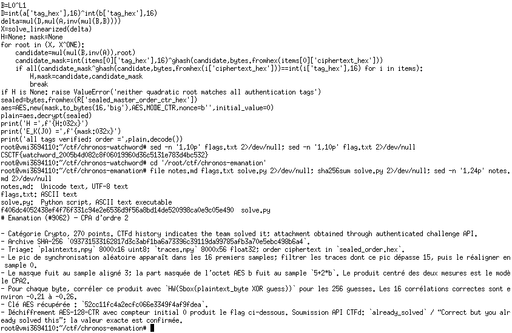
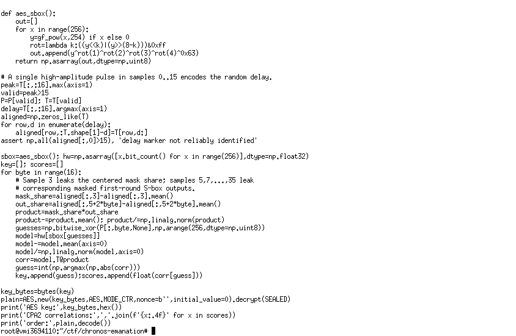
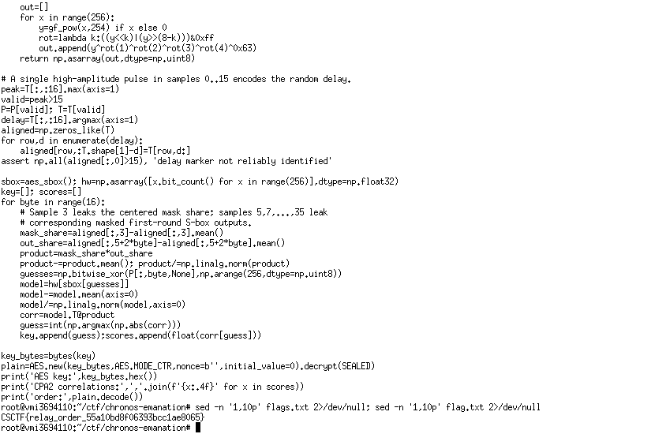

# Writeup : chronos-emanation

Catégorie : crypto

Date de résolution : 2026-11-07

Technique principale : second-order CPA on randomly delayed masked AES first-round leakage

Outils observés : python,numpy,pycryptodome

Cible : CSCTF 2026 #9062

## Présentation

Ce document est construit à partir de la mémoire CTF partagée et des artefacts conservés dans /root/ctf/chronos-emanation. Les étapes ci-dessous reprennent uniquement les faits observés. Les captures sont réalisées sur les fichiers locaux, sans rejouer une action distante ou destructive.

## Analyse et raisonnement

### Exploitation

Filter rows with sync peak >15; align peak to sample 0; use sample3 × sample(5+2*b); 256-way CPA per AES byte; decrypt AES-CTR with counter 0.

### Pourquoi ça marche

Align a synthetic acquisition using its high-amplitude sync pulse; multiply centered mask/output-share leakage and correlate with HW(Sbox(P XOR k)).

### Pièges

First-order CPA is ineffective under the fresh byte mask; preserve row alignment before second-order CPA.

### Notes locales conservées

# Emanation (#9062) :  CPA d’ordre 2

1. Catégorie Crypto, 270 points. CTFd history indicates the team solved it; attachment obtained through authenticated challenge API.
2. Archive SHA-256 `093731533162817d3c3abf1ba6a73396c39119da99785afb3a70e5ebc498b6a4`.
3. Triage: `plaintexts.npy` 8000x16 uint8; `traces.npy` 8000x56 float32; order ciphertext in `sealed_order.hex`.
4. Le pic de synchronisation aléatoire apparaît dans les 16 premiers samples; filtrer les traces dont ce pic dépasse 15, puis le réaligner en sample 0.
5. Le masque fuit au sample aligné 3; la part masquée de l’octet AES b fuit au sample `5+2*b`. Le produit centré des deux mesures est le modèle CPA2.
6. Pour chaque byte, corréler ce produit avec `HW(Sbox(plaintext_byte XOR guess))` pour les 256 guesses. Les 16 corrélations correctes sont environ −0.21 à −0.26.
7. Clé AES récupérée : `52cc11fc4a2ecfc066e3349f4af9fdea`.
8. Déchiffrement AES-128-CTR avec compteur initial 0 produit le flag ci-dessous. Soumission API CTFd: `already_solved` / “Correct but you already solved this”; la valeur exacte est confirmée.

## Commandes utiles

Les commandes suivantes consultent les preuves locales et sont sans effet de bord :

```bash
cd /root/ctf/chronos-emanation
file notes.md solve.py 2>/dev/null
sed -n '1,180p' notes.md 2>/dev/null
sed -n '1,120p' solve.py 2>/dev/null
sed -n '1,10p' flags.txt 2>/dev/null
```

## Script de résolution complet

Le script conservé sous `solve.py` est reproduit ci-dessous sans modification :

```python
#!/usr/bin/env python3
"""Second-order CPA for the masked synthetic QARVETH-73 traces."""
import json
from pathlib import Path
import numpy as np
from Crypto.Cipher import AES

ROOT=Path(__file__).parent/'evidence/extracted/emanation'
P=np.load(ROOT/'plaintexts.npy')
T=np.load(ROOT/'traces.npy')
SEALED=bytes.fromhex((ROOT/'sealed_order.hex').read_text().strip())

def gf_mul(a,b):
    r=0
    for _ in range(8):
        if b&1:r^=a
        a=((a<<1)^0x11b) if a&0x80 else a<<1
        b>>=1
    return r&0xff

def gf_pow(a,n):
    r=1
    while n:
        if n&1:r=gf_mul(r,a)
        a=gf_mul(a,a);n>>=1
    return r

def aes_sbox():
    out=[]
    for x in range(256):
        y=gf_pow(x,254) if x else 0
        rot=lambda k:((y<<k)|(y>>(8-k)))&0xff
        out.append(y^rot(1)^rot(2)^rot(3)^rot(4)^0x63)
    return np.asarray(out,dtype=np.uint8)

# A single high-amplitude pulse in samples 0..15 encodes the random delay.
peak=T[:,:16].max(axis=1)
valid=peak>15
P=P[valid]; T=T[valid]
delay=T[:,:16].argmax(axis=1)
aligned=np.zeros_like(T)
for row,d in enumerate(delay):
    aligned[row,:T.shape[1]-d]=T[row,d:]
assert np.all(aligned[:,0]>15), 'delay marker not reliably identified'

sbox=aes_sbox(); hw=np.asarray([x.bit_count() for x in range(256)],dtype=np.float32)
key=[]; scores=[]
for byte in range(16):
    # Sample 3 leaks the centered mask share; samples 5,7,...,35 leak
    # corresponding masked first-round S-box outputs.
    mask_share=aligned[:,3]-aligned[:,3].mean()
    out_share=aligned[:,5+2*byte]-aligned[:,5+2*byte].mean()
    product=mask_share*out_share
    product-=product.mean(); product/=np.linalg.norm(product)
    guesses=np.bitwise_xor(P[:,byte,None],np.arange(256,dtype=np.uint8))
    model=hw[sbox[guesses]]
    model-=model.mean(axis=0)
    model/=np.linalg.norm(model,axis=0)
    corr=model.T@product
    guess=int(np.argmax(np.abs(corr)))
    key.append(guess);scores.append(float(corr[guess]))

key_bytes=bytes(key)
plain=AES.new(key_bytes,AES.MODE_CTR,nonce=b'',initial_value=0).decrypt(SEALED)
print('AES key:',key_bytes.hex())
print('CPA2 correlations:',','.join(f'{x:.4f}' for x in scores))
print('order:',plain.decode())
```

## Captures du terminal

Les captures utilisent le terminal natif xterm disponible sur l’environnement, avec le prompt réel `root@vmi3694110`, le dossier courant du challenge et une géométrie identique. Elles montrent successivement l’analyse locale, le script ou les preuves de résolution, puis le flag conservé.







## Validation et flag

La mémoire partagée indique une validation CTFd correcte ou déjà validée.

Flag obtenu : `CSCTF{relay_order_55a10bd8f06393bcc1ae8065}`

## Conclusion

La résolution repose sur la faiblesse indiquée dans la technique principale, puis sur la vérification locale du résultat conservé. Le flag final ci-dessus est copié depuis la preuve locale réellement présente.
