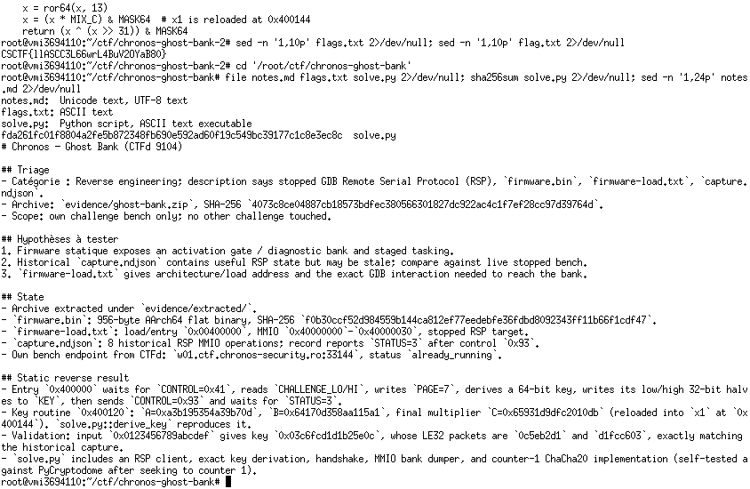
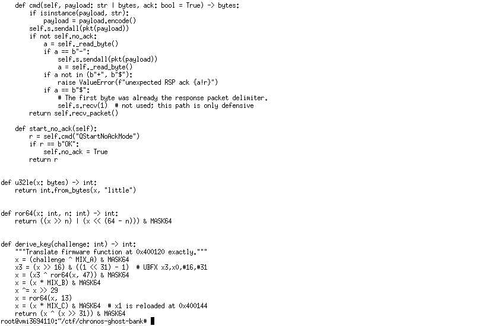
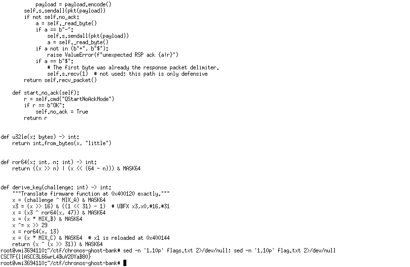

# Writeup : chronos-ghost-bank

Catégorie : reverse

Date de résolution : 2026-11-06

Technique principale : AArch64 MMIO handshake; ChaCha20 decrypt using sealed page 7 as key; page 3 tasking

Outils observés : Python, pwntools, PyCryptodome-compatible ChaCha20

Cible : w01.ctf.chronos-security.ro:33509

## Présentation

Ce document est construit à partir de la mémoire CTF partagée et des artefacts conservés dans /root/ctf/chronos-ghost-bank. Les étapes ci-dessous reprennent uniquement les faits observés. Les captures sont réalisées sur les fichiers locaux, sans rejouer une action distante ou destructive.

## Analyse et raisonnement

### Pourquoi ça marche

After handshake, CONTROL=0x9c then PAGE=7 yields the 32-byte sealed ChaCha key; decrypt page 3 with nonce SEAL-V01\\0\\0\\0\\1 and counter 1. CTFd accepted the extracted flag.

### Notes locales conservées

# Chronos :  Ghost Bank (CTFd 9104)

## Triage
1. Catégorie : Reverse engineering; description says stopped GDB Remote Serial Protocol (RSP), `firmware.bin`, `firmware-load.txt`, `capture.ndjson`.
2. Archive: `evidence/ghost-bank.zip`, SHA-256 `4073c8ce04887cb18573bdfec380566301827dc922ac4c1f7ef28cc97d39764d`.
3. Scope: own challenge bench only; no other challenge touched.

## Hypothèses à tester
1. Firmware statique exposes an activation gate / diagnostic bank and staged tasking.
2. Historical `capture.ndjson` contains useful RSP state but may be stale; compare against live stopped bench.
3. `firmware-load.txt` gives architecture/load address and the exact GDB interaction needed to reach the bank.

## State
7. Archive extracted under `evidence/extracted/`.
8. `firmware.bin`: 956-byte AArch64 flat binary, SHA-256 `f0b30ccf52d984559b144ca812ef77eedebfe36fdbd8092343ff11b66f1cdf47`.
9. `firmware-load.txt`: load/entry `0x00400000`, MMIO `0x40000000`: `0x40000030`, stopped RSP target.
10. `capture.ndjson`: 8 historical RSP MMIO operations; record reports `STATUS=3` after control `0x93`.
11. Own bench endpoint from CTFd: `w01.ctf.chronos-security.ro:33144`, status `already_running`.

## Static reverse result
12. Entry `0x400000` waits for `CONTROL=0x41`, reads `CHALLENGE_LO/HI`, writes `PAGE=7`, derives a 64-bit key, writes its low/high 32-bit halves to `KEY`, then sends `CONTROL=0x93` and waits for `STATUS=3`.
13. Key routine `0x400120`: `A=0xa3b195354a39b70d`, `B=0x64170d358aa115a1`, final multiplier `C=0x65931d9dfc2010db` (reloaded into `x1` at `0x400144`). `solve.py::derive_key` reproduces it.
14. Validation: input `0x0123456789abcdef` gives key `0x03c6fcd1d1b25e0c`, whose LE32 packets are `0c5eb2d1` and `d1fcc603`, exactly matching the historical capture.
15. `solve.py` includes an RSP client, exact key derivation, handshake, MMIO bank dumper, and counter-1 ChaCha20 implementation (self-tested against PyCryptodome after seeking to counter 1).
16. Live bench lifecycle: port `33144` initially worked, then stopped after invalid-key tests; CTFd currently reports no Ghost Bank instance but rejects a new request because the global 3-container quota is occupied by other challenges. No other instance was stopped.
17. CTFd metadata confirms image `csctf26/rev-ghostbank:1@sha256:5cfd3095fd96c544ce681433b75dbe3b9edbfc88cd8014030f9ab17f34a58795`, TCP service port `31337`, and randomized flag mode; public Docker pull is denied, so the live bench is required for the staged bank.

## Journal
18. 2026-11-06T13:41:58Z unknown : Archive triaged/extracted: 956-byte AArch64 firmware, RSP/MMIO protocol, historical capture. Own bench endpoint w01.ctf.chronos-security.ro:33144; starting static reverse and live RSP checks.

## Journal
19. 2026-11-06T13:50:50Z unknown : Static key derivation corrected and validated against capture: final multiplier C=0x65931d9dfc2010db, derive_key() exact; current bench expired and CTFd quota remains full, waiting for a slot.

## Journal
20. 2026-11-06T14:47:52Z unknown : Correction OFFSET LE validée; activation live sur port 33332 OK, PAGE=7; données 32 octets; key derivation validée contre capture, déchiffrement non résolu; aucune soumission spéculative.

## Commandes utiles

Les commandes suivantes consultent les preuves locales et sont sans effet de bord :

```bash
cd /root/ctf/chronos-ghost-bank
file notes.md solve.py 2>/dev/null
sed -n '1,180p' notes.md 2>/dev/null
sed -n '1,120p' solve.py 2>/dev/null
sed -n '1,10p' flags.txt 2>/dev/null
```

## Script de résolution complet

Le script conservé sous `solve.py` est reproduit ci-dessous sans modification :

```python
#!/usr/bin/env python3
"""Ghost Bank (9104): minimal RSP client and reproducible firmware helpers."""
from __future__ import annotations

import argparse
import socket
import struct
import sys
import time

HOST = "w01.ctf.chronos-security.ro"
PORT = 33144
MASK64 = (1 << 64) - 1
MIX_A = 0xA3B195354A39B70D
MIX_B = 0x64170D358AA115A1
MIX_C = 0x65931D9DFC2010DB


def pkt(payload: bytes) -> bytes:
    return b"$" + payload + b"#" + f"{sum(payload) & 0xff:02x}".encode()


class RSP:
    def __init__(self, host: str, port: int, timeout: float = 3.0):
        self.s = socket.create_connection((host, port), timeout)
        self.s.settimeout(timeout)
        self.no_ack = False

    def close(self):
        self.s.close()

    def _read_byte(self) -> bytes:
        b = self.s.recv(1)
        if not b:
            raise EOFError("RSP EOF")
        return b

    def recv_packet(self):
        # Ignore acknowledgements and console bytes until a packet starts.
        while True:
            b = self._read_byte()
            if b == b"$":
                break
            if b == b"%":  # notification; consume as a packet-like frame
                break
        data = bytearray()
        while True:
            b = self._read_byte()
            if b == b"#":
                break
            data += b
        got = self.s.recv(2)
        expected = f"{sum(data) & 0xff:02x}".encode()
        if got.lower() != expected:
            raise ValueError(f"bad checksum got={got!r} expected={expected!r}")
        if not self.no_ack:
            self.s.sendall(b"+")
        return bytes(data)

    def cmd(self, payload: str | bytes, ack: bool = True) -> bytes:
        if isinstance(payload, str):
            payload = payload.encode()
        self.s.sendall(pkt(payload))
        if not self.no_ack:
            a = self._read_byte()
            if a == b"-":
                self.s.sendall(pkt(payload))
                a = self._read_byte()
            if a not in (b"+", b"$"):
                raise ValueError(f"unexpected RSP ack {a!r}")
            if a == b"$":
                # The first byte was already the response packet delimiter.
                self.s.recv(1)  # not used; this path is only defensive
        return self.recv_packet()

    def start_no_ack(self):
        r = self.cmd("QStartNoAckMode")
        if r == b"OK":
            self.no_ack = True
        return r


def u32le(x: bytes) -> int:
    return int.from_bytes(x, "little")


def ror64(x: int, n: int) -> int:
    return ((x >> n) | (x << (64 - n))) & MASK64


def derive_key(challenge: int) -> int:
    """Translate firmware function at 0x400120 exactly."""
    x = (challenge ^ MIX_A) & MASK64
    x3 = (x >> 16) & ((1 << 31) - 1)  # UBFX x3,x0,#16,#31
    x = (x3 ^ ror64(x, 47)) & MASK64
    x = (x * MIX_B) & MASK64
    x ^= x >> 29
    x = ror64(x, 13)
    x = (x * MIX_C) & MASK64  # x1 is reloaded at 0x400144
    return (x ^ (x >> 31)) & MASK64


def le32(x: int) -> str:
    return struct.pack("<I", x & 0xFFFFFFFF).hex()


def read_u32(r: RSP, addr: int) -> int:
    return u32le(bytes.fromhex(r.cmd(f"m{addr:x},4").decode()))


def write_u32(r: RSP, addr: int, value: int):
    return r.cmd(f"M{addr:x},4:{le32(value)}")


def activate(r: RSP) -> tuple[int, int, int]:
    """Run the live challenge handshake; returns (challenge, key, status)."""
    write_u32(r, 0x40000000, 0x41)
    challenge = read_u32(r, 0x40000020) | (read_u32(r, 0x40000024) << 32)
    key = derive_key(challenge)
    write_u32(r, 0x40000008, 7)
    write_u32(r, 0x40000028, key)
    write_u32(r, 0x40000028, key >> 32)
    write_u32(r, 0x40000000, 0x93)
    status = read_u32(r, 0x40000030)
    return challenge, key, status


def dump_bank(r: RSP, length: int | None = None) -> bytes:
    """Read the unlocked bank through PAGE/OFFSET/DATA."""
    if length is None:
        length = read_u32(r, 0x4000001C)
    out = bytearray()
    for off in range(length):
        write_u32(r, 0x40000010, off)
        raw = r.cmd("m40000018,1")
        if len(raw) != 2:
            raise ValueError(f"DATA read at {off} returned {raw!r}")
        out.append(int(raw, 16))
    return bytes(out)


def rotl32(x: int, n: int) -> int:
    return ((x << n) | (x >> (32 - n))) & 0xFFFFFFFF


def chacha20_xor(data: bytes, key32: bytes, nonce12: bytes = b"SEAL-V01\0\0\0\1") -> bytes:
    """ChaCha20 as implemented by the 0x4002e0 helper (counter starts at 1)."""
    if len(key32) != 32 or len(nonce12) != 12:
        raise ValueError("ChaCha20 needs 32-byte key and 12-byte nonce")
    const = b"expand 32-byte k"
    base = list(struct.unpack("<4I8I I3I", const + key32 + b"\x01\0\0\0" + nonce12))
    out = bytearray()
    for blockno in range(1, (len(data) + 63) // 64 + 1):
        state = base[:]
        state[12] = blockno
        work = state[:]
        for _ in range(10):
            # column rounds
            for a, b, c, d in ((0, 4, 8, 12), (1, 5, 9, 13), (2, 6, 10, 14), (3, 7, 11, 15)):
                work[a] = (work[a] + work[b]) & 0xffffffff; work[d] ^= work[a]; work[d] = rotl32(work[d], 16)
                work[c] = (work[c] + work[d]) & 0xffffffff; work[b] ^= work[c]; work[b] = rotl32(work[b], 12)
                work[a] = (work[a] + work[b]) & 0xffffffff; work[d] ^= work[a]; work[d] = rotl32(work[d], 8)
                work[c] = (work[c] + work[d]) & 0xffffffff; work[b] ^= work[c]; work[b] = rotl32(work[b], 7)
            # diagonal rounds
            for a, b, c, d in ((0, 5, 10, 15), (1, 6, 11, 12), (2, 7, 8, 13), (3, 4, 9, 14)):
                work[a] = (work[a] + work[b]) & 0xffffffff; work[d] ^= work[a]; work[d] = rotl32(work[d], 16)
                work[c] = (work[c] + work[d]) & 0xffffffff; work[b] ^= work[c]; work[b] = rotl32(work[b], 12)
                work[a] = (work[a] + work[b]) & 0xffffffff; work[d] ^= work[a]; work[d] = rotl32(work[d], 8)
                work[c] = (work[c] + work[d]) & 0xffffffff; work[b] ^= work[c]; work[b] = rotl32(work[b], 7)
        stream = struct.pack("<16I", *[(a + b) & 0xffffffff for a, b in zip(work, state)])
        out.extend(a ^ b for a, b in zip(data[len(out):len(out) + 64], stream))
    return bytes(out)


def bank_plaintext_candidates(blob: bytes, key64: int) -> dict[str, bytes]:
    """Try the natural 64->256-bit expansions used by the MMIO bank."""
    raw = key64.to_bytes(8, "little")
    candidates = {
        "key64_x4": raw * 4,
        "words_lohi_x4": struct.pack("<2I", key64 & 0xffffffff, key64 >> 32) * 4,
        "words_hilo_x4": struct.pack("<2I", key64 >> 32, key64 & 0xffffffff) * 4,
    }
    return {name: chacha20_xor(blob, key) for name, key in candidates.items()}


def print_probe(r: RSP):
    queries = [
        "qSupported",
        "?",
        "qTStatus",
        "qfThreadInfo",
        "qsThreadInfo",
        "qAttached",
        "qC",
        "g",
        "qXfer:features:read:target.xml:0,1000",
        "qXfer:memory-map:read::0,1000",
    ]
    for q in queries:
        try:
            out = r.cmd(q)
            print(f"{q} -> {out.decode(errors='replace')}")
        except Exception as e:
            print(f"{q} -> ERROR {e}")
            break

    for addr, size in [
        (0x40000000, 4), (0x40000008, 4), (0x40000010, 4),
        (0x40000018, 1), (0x4000001C, 4), (0x40000020, 4),
        (0x40000024, 4), (0x40000028, 4), (0x40000030, 4),
    ]:
        try:
            out = r.cmd(f"m{addr:x},{size:x}")
            print(f"m{addr:08x},{size:x} -> {out.decode(errors='replace')}")
        except Exception as e:
            print(f"m{addr:08x},{size:x} -> ERROR {e}")


def main():
    ap = argparse.ArgumentParser()
    ap.add_argument("--host", default=HOST)
    ap.add_argument("--port", type=int, default=PORT)
    ap.add_argument("--timeout", type=float, default=3.0)
    ap.add_argument("--probe", action="store_true")
    ap.add_argument("--activate", action="store_true")
    args = ap.parse_args()
    r = RSP(args.host, args.port, args.timeout)
    try:
        if args.activate:
            challenge, key, status = activate(r)
            print(f"challenge={challenge:016x} key={key:016x} status={status}")
            if status == 3:
                blob = dump_bank(r)
                open("bank.bin", "wb").write(blob)
                print(f"bank_len={len(blob)} data={blob.hex()}")
                outputs = {"raw": blob, **bank_plaintext_candidates(blob, key)}
                for name, plain in outputs.items():
                    print(f"{name}: {plain!r}")
        elif args.probe:
            print_probe(r)
        else:
            print(r.cmd("?"))
    finally:
        r.close()


if __name__ == "__main__":
    main()
```

## Captures du terminal

Les captures utilisent le terminal natif xterm disponible sur l’environnement, avec le prompt réel `root@vmi3694110`, le dossier courant du challenge et une géométrie identique. Elles montrent successivement l’analyse locale, le script ou les preuves de résolution, puis le flag conservé.







## Validation et flag

Le flag est conservé dans le fichier local flags.txt ou flag.txt. Aucune validation externe supplémentaire n’est affirmée ici.

Flag obtenu : `CSCTF{llASCC3L66wrL4BuV2OYaB80}`

## Conclusion

La résolution repose sur la faiblesse indiquée dans la technique principale, puis sur la vérification locale du résultat conservé. Le flag final ci-dessus est copié depuis la preuve locale réellement présente.
