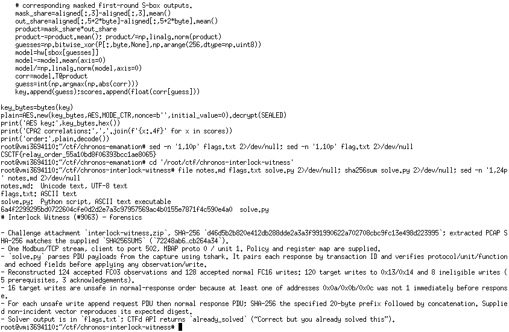
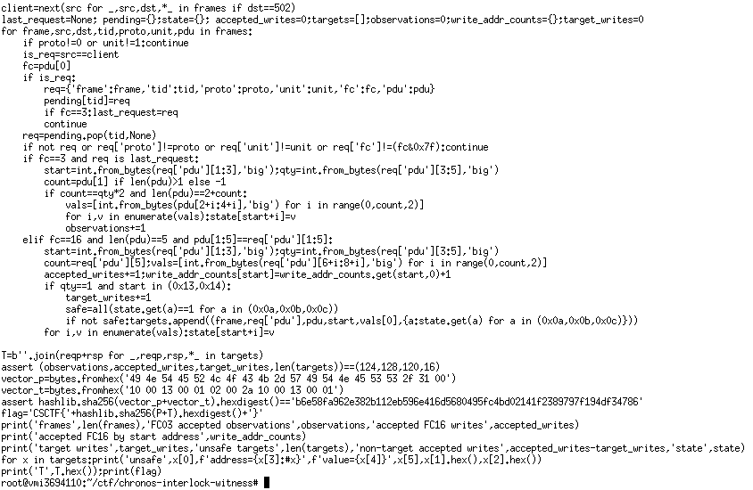
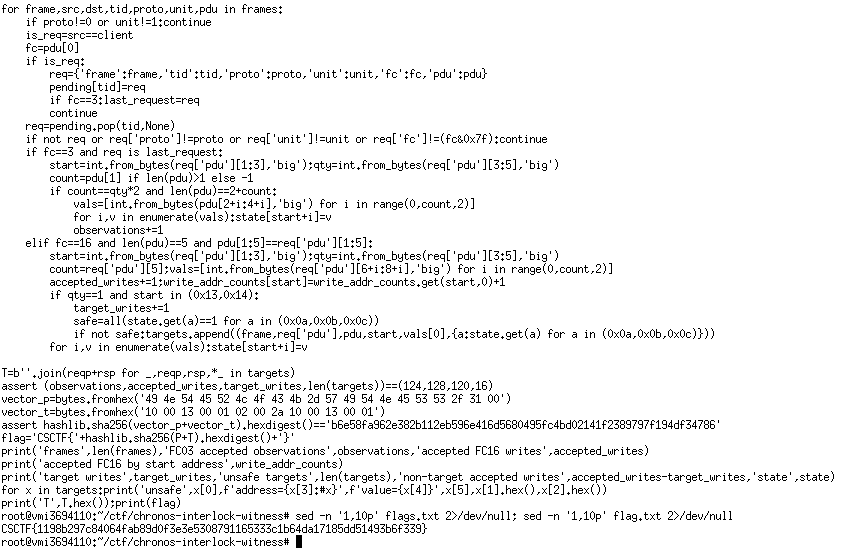

# Writeup : chronos-interlock-witness

Catégorie : forensics

Date de résolution : 2026-11-07

Technique principale : Modbus/TCP transaction correlation and policy-state replay

Outils observés : tshark,python

Cible : CSCTF 2026 #9063

## Présentation

Ce document est construit à partir de la mémoire CTF partagée et des artefacts conservés dans /root/ctf/chronos-interlock-witness. Les étapes ci-dessous reprennent uniquement les faits observés. Les captures sont réalisées sur les fichiers locaux, sans rejouer une action distante ou destructive.

## Analyse et raisonnement

### Exploitation

Correlate request/response by transaction/protocol/unit/function, replay FC03 observations and FC16 writes, serialize unsafe target PDUs in response order, SHA-256 domain prefix + transcript.

### Pourquoi ça marche

Only apply observations and writes after matching normal responses; response order determines policy state.

### Pièges

Count only normal responses; exception responses and mismatched echo fields do not update the reconstructed state.

### Notes locales conservées

# Interlock Witness (#9063) :  forensics

1. Challenge attachment `interlock-witness.zip`, SHA-256 `d46d5b2b820e412db288dde2a3a3f991990622a702708cbc9fc13e498d223995`; extracted PCAP SHA-256 matches the supplied `SHA256SUMS` (`72248ab6...cb264a34`).
2. One Modbus/TCP stream, client to port 502, MBAP proto 0 / unit 1. Policy and register map are supplied.
3. `solve.py` parses PDU payloads from the capture using tshark. It pairs each response by transaction ID and verifies protocol/unit/function and echoed fields before applying any observation/write.
4. Reconstructed 124 accepted FC03 observations and 128 accepted normal FC16 writes: 120 target writes to 0x13/0x14 and 8 ineligible writes (5 prerequisites, 3 acknowledgements).
5. 16 target writes are unsafe in normal-response order because at least one of addresses 0x0a/0x0b/0x0c was not 1 immediately before response.
6. For each unsafe write append request PDU then normal response PDU; SHA-256 the specified 20-byte prefix followed by concatenation. Supplied non-incident vector reproduces its expected digest.
7. Solver output is in `flags.txt`; CTFd API returns `already_solved` (“Correct but you already solved this”).

## Commandes utiles

Les commandes suivantes consultent les preuves locales et sont sans effet de bord :

```bash
cd /root/ctf/chronos-interlock-witness
file notes.md solve.py 2>/dev/null
sed -n '1,180p' notes.md 2>/dev/null
sed -n '1,120p' solve.py 2>/dev/null
sed -n '1,10p' flags.txt 2>/dev/null
```

## Script de résolution complet

Le script conservé sous `solve.py` est reproduit ci-dessous sans modification :

```python
#!/usr/bin/env python3
"""Reconstruct accepted Modbus writes that violate the response-cell rule."""
import hashlib, subprocess
from pathlib import Path
PCAP=Path(__file__).parent/'evidence/extracted/interlock.pcapng'
P=bytes.fromhex('49 4e 54 45 52 4c 4f 43 4b 2d 57 49 54 4e 45 53 53 2f 31 00')
cmd=['tshark','-r',str(PCAP),'-Y','tcp.port==502 && tcp.len>0','-T','fields','-E','separator=|','-e','frame.number','-e','tcp.srcport','-e','tcp.dstport','-e','tcp.payload']
out=subprocess.check_output(cmd,text=True,stderr=subprocess.DEVNULL)
frames=[]
for line in out.splitlines():
    f=line.split('|')
    if len(f)!=4 or not f[3]:continue
    raw=bytes.fromhex(f[3]);
    if len(raw)<8:continue
    tid=int.from_bytes(raw[:2],'big');proto=int.from_bytes(raw[2:4],'big');n=int.from_bytes(raw[4:6],'big');unit=raw[6];pdu=raw[7:]
    if len(pdu)!=n-1:continue
    frames.append((int(f[0]),int(f[1]),int(f[2]),tid,proto,unit,pdu))
client=next(src for _,src,dst,*_ in frames if dst==502)
last_request=None; pending={};state={}; accepted_writes=0;targets=[];observations=0;write_addr_counts={};target_writes=0
for frame,src,dst,tid,proto,unit,pdu in frames:
    if proto!=0 or unit!=1:continue
    is_req=src==client
    fc=pdu[0]
    if is_req:
        req={'frame':frame,'tid':tid,'proto':proto,'unit':unit,'fc':fc,'pdu':pdu}
        pending[tid]=req
        if fc==3:last_request=req
        continue
    req=pending.pop(tid,None)
    if not req or req['proto']!=proto or req['unit']!=unit or req['fc']!=(fc&0x7f):continue
    if fc==3 and req is last_request:
        start=int.from_bytes(req['pdu'][1:3],'big');qty=int.from_bytes(req['pdu'][3:5],'big')
        count=pdu[1] if len(pdu)>1 else -1
        if count==qty*2 and len(pdu)==2+count:
            vals=[int.from_bytes(pdu[2+i:4+i],'big') for i in range(0,count,2)]
            for i,v in enumerate(vals):state[start+i]=v
            observations+=1
    elif fc==16 and len(pdu)==5 and pdu[1:5]==req['pdu'][1:5]:
        start=int.from_bytes(req['pdu'][1:3],'big');qty=int.from_bytes(req['pdu'][3:5],'big')
        count=req['pdu'][5];vals=[int.from_bytes(req['pdu'][6+i:8+i],'big') for i in range(0,count,2)]
        accepted_writes+=1;write_addr_counts[start]=write_addr_counts.get(start,0)+1
        if qty==1 and start in (0x13,0x14):
            target_writes+=1
            safe=all(state.get(a)==1 for a in (0x0a,0x0b,0x0c))
            if not safe:targets.append((frame,req['pdu'],pdu,start,vals[0],{a:state.get(a) for a in (0x0a,0x0b,0x0c)}))
        for i,v in enumerate(vals):state[start+i]=v

T=b''.join(reqp+rsp for _,reqp,rsp,*_ in targets)
assert (observations,accepted_writes,target_writes,len(targets))==(124,128,120,16)
vector_p=bytes.fromhex('49 4e 54 45 52 4c 4f 43 4b 2d 57 49 54 4e 45 53 53 2f 31 00')
vector_t=bytes.fromhex('10 00 13 00 01 02 00 2a 10 00 13 00 01')
assert hashlib.sha256(vector_p+vector_t).hexdigest()=='b6e58fa962e382b112eb596e416d5680495fc4bd02141f2389797f194df34786'
flag='CSCTF{'+hashlib.sha256(P+T).hexdigest()+'}'
print('frames',len(frames),'FC03 accepted observations',observations,'accepted FC16 writes',accepted_writes)
print('accepted FC16 by start address',write_addr_counts)
print('target writes',target_writes,'unsafe targets',len(targets),'non-target accepted writes',accepted_writes-target_writes,'state',state)
for x in targets:print('unsafe',x[0],f'address={x[3]:#x}',f'value={x[4]}',x[5],x[1].hex(),x[2].hex())
print('T',T.hex());print(flag)
```

## Captures du terminal

Les captures utilisent le terminal natif xterm disponible sur l’environnement, avec le prompt réel `root@vmi3694110`, le dossier courant du challenge et une géométrie identique. Elles montrent successivement l’analyse locale, le script ou les preuves de résolution, puis le flag conservé.







## Validation et flag

La mémoire partagée indique une validation CTFd correcte ou déjà validée.

Flag obtenu : `CSCTF{1198b297c84064fab89d0f3e3e5308791165333c1b64da17185dd51493b6f339}`

## Conclusion

La résolution repose sur la faiblesse indiquée dans la technique principale, puis sur la vérification locale du résultat conservé. Le flag final ci-dessus est copié depuis la preuve locale réellement présente.
