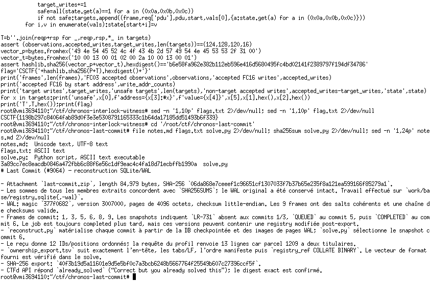
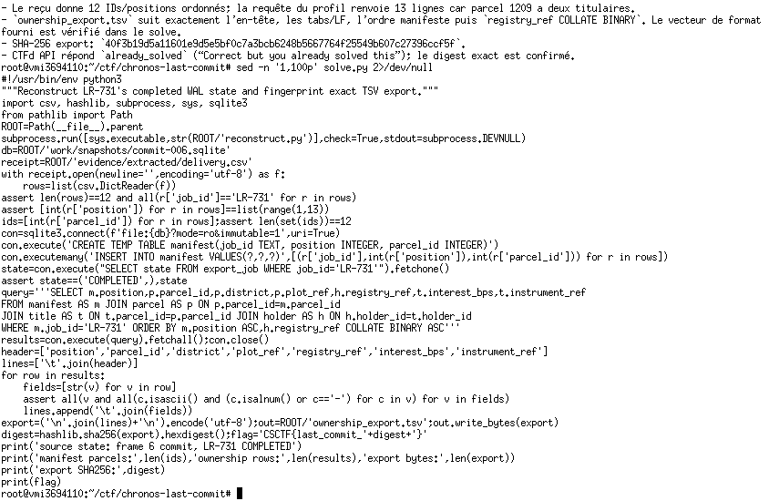
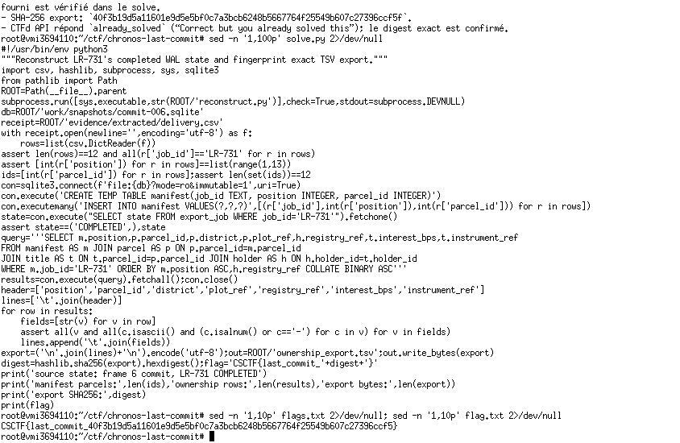

# Writeup : chronos-last-commit

Catégorie : forensics

Date de résolution : 2026-11-07

Technique principale : SQLite WAL commit reconstruction and historical export replay

Outils observés : python,sqlite3,tshark

Cible : CSCTF 2026 #9064

## Présentation

Ce document est construit à partir de la mémoire CTF partagée et des artefacts conservés dans /root/ctf/chronos-last-commit. Les étapes ci-dessous reprennent uniquement les faits observés. Les captures sont réalisées sur les fichiers locaux, sans rejouer une action distante ou destructive.

## Analyse et raisonnement

### Exploitation

Validate WAL salts/rolling checksums; replay page frames over checkpointed DB; select commit 6 (QUEUED at 5, COMPLETED at 6); load receipt manifest; serialize exact TSV; SHA-256.

### Pourquoi ça marche

A persisted COMPLETED row is not necessarily the state that produced an export; materialize each valid WAL commit and select the transition commit.

### Pièges

Do not query the acquired DB/WAL directly or use later commits; work on matching disposable copies and preserve original WAL.

### Notes locales conservées

# Last Commit (#9064) :  reconstruction SQLite/WAL

1. Attachment `last-commit.zip`, length 84,979 bytes, SHA-256 `06da868e7ceeef1c96651cf1307033f7b37b65e235f8a121ea599166f85279a1`.
2. Les sommes de tous les membres extraits concordent avec `SHA256SUMS`; le WAL original a été conservé intact. Travail effectué sur `work/base/registry.sqlite{,-wal}`.
3. WAL: magic `377f0682`, version 3007000, pages de 4096 octets, checksum little-endian. Les 9 frames ont des salts cohérents et une chaîne de checksums valide.
4. Frames de commit: 1, 3, 5, 6, 8, 9. Les snapshots indiquent `LR-731` absent aux commits 1/3, `QUEUED` au commit 5, puis `COMPLETED` au commit 6. Le job est toujours completed plus tard, mais ces versions peuvent contenir une registry modifiée post-export.
5. `reconstruct.py` matérialise chaque commit à partir de la DB checkpointée et des images de pages WAL; `solve.py` sélectionne le snapshot commit 6.
6. Le reçu donne 12 IDs/positions ordonnés; la requête du profil renvoie 13 lignes car parcel 1209 a deux titulaires.
7. `ownership_export.tsv` suit exactement l’en-tête, les tabs/LF, l’ordre manifeste puis `registry_ref COLLATE BINARY`. Le vecteur de format fourni est vérifié dans le solve.
8. SHA-256 export: `40f3b19d5a11601e9d5e5bf0c7a3bcb6248b5667764f25549b607c27396ccf5f`.
9. CTFd API répond `already_solved` (“Correct but you already solved this”); le digest exact est confirmé.

## Commandes utiles

Les commandes suivantes consultent les preuves locales et sont sans effet de bord :

```bash
cd /root/ctf/chronos-last-commit
file notes.md solve.py 2>/dev/null
sed -n '1,180p' notes.md 2>/dev/null
sed -n '1,120p' solve.py 2>/dev/null
sed -n '1,10p' flags.txt 2>/dev/null
```

## Script de résolution complet

Le script conservé sous `solve.py` est reproduit ci-dessous sans modification :

```python
#!/usr/bin/env python3
"""Reconstruct LR-731's completed WAL state and fingerprint exact TSV export."""
import csv, hashlib, subprocess, sys, sqlite3
from pathlib import Path
ROOT=Path(__file__).parent
subprocess.run([sys.executable,str(ROOT/'reconstruct.py')],check=True,stdout=subprocess.DEVNULL)
db=ROOT/'work/snapshots/commit-006.sqlite'
receipt=ROOT/'evidence/extracted/delivery.csv'
with receipt.open(newline='',encoding='utf-8') as f:
    rows=list(csv.DictReader(f))
assert len(rows)==12 and all(r['job_id']=='LR-731' for r in rows)
assert [int(r['position']) for r in rows]==list(range(1,13))
ids=[int(r['parcel_id']) for r in rows];assert len(set(ids))==12
con=sqlite3.connect(f'file:{db}?mode=ro&immutable=1',uri=True)
con.execute('CREATE TEMP TABLE manifest(job_id TEXT, position INTEGER, parcel_id INTEGER)')
con.executemany('INSERT INTO manifest VALUES(?,?,?)',[(r['job_id'],int(r['position']),int(r['parcel_id'])) for r in rows])
state=con.execute("SELECT state FROM export_job WHERE job_id='LR-731'").fetchone()
assert state==('COMPLETED',),state
query='''SELECT m.position,p.parcel_id,p.district,p.plot_ref,h.registry_ref,t.interest_bps,t.instrument_ref
FROM manifest AS m JOIN parcel AS p ON p.parcel_id=m.parcel_id
JOIN title AS t ON t.parcel_id=p.parcel_id JOIN holder AS h ON h.holder_id=t.holder_id
WHERE m.job_id='LR-731' ORDER BY m.position ASC,h.registry_ref COLLATE BINARY ASC'''
results=con.execute(query).fetchall();con.close()
header=['position','parcel_id','district','plot_ref','registry_ref','interest_bps','instrument_ref']
lines=['\t'.join(header)]
for row in results:
    fields=[str(v) for v in row]
    assert all(v and all(c.isascii() and (c.isalnum() or c=='-') for c in v) for v in fields)
    lines.append('\t'.join(fields))
export=('\n'.join(lines)+'\n').encode('utf-8');out=ROOT/'ownership_export.tsv';out.write_bytes(export)
digest=hashlib.sha256(export).hexdigest();flag='CSCTF{last_commit_'+digest+'}'
print('source state: frame 6 commit, LR-731 COMPLETED')
print('manifest parcels:',len(ids),'ownership rows:',len(results),'export bytes:',len(export))
print('export SHA256:',digest)
print(flag)
```

## Captures du terminal

Les captures utilisent le terminal natif xterm disponible sur l’environnement, avec le prompt réel `root@vmi3694110`, le dossier courant du challenge et une géométrie identique. Elles montrent successivement l’analyse locale, le script ou les preuves de résolution, puis le flag conservé.







## Validation et flag

La mémoire partagée indique une validation CTFd correcte ou déjà validée.

Flag obtenu : `CSCTF{last_commit_40f3b19d5a11601e9d5e5bf0c7a3bcb6248b5667764f25549b607c27396ccf5}`

## Conclusion

La résolution repose sur la faiblesse indiquée dans la technique principale, puis sur la vérification locale du résultat conservé. Le flag final ci-dessus est copié depuis la preuve locale réellement présente.
