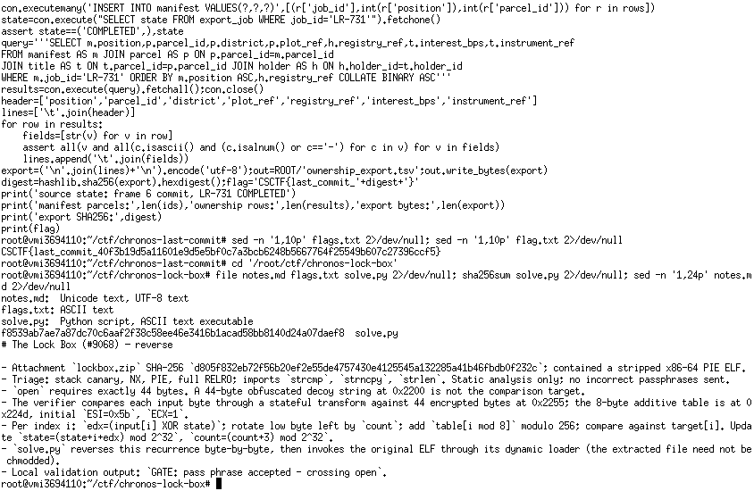
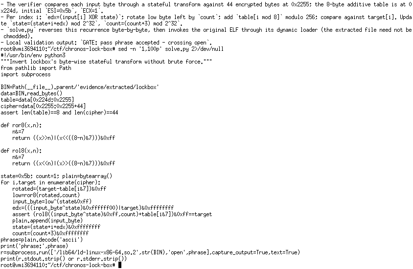
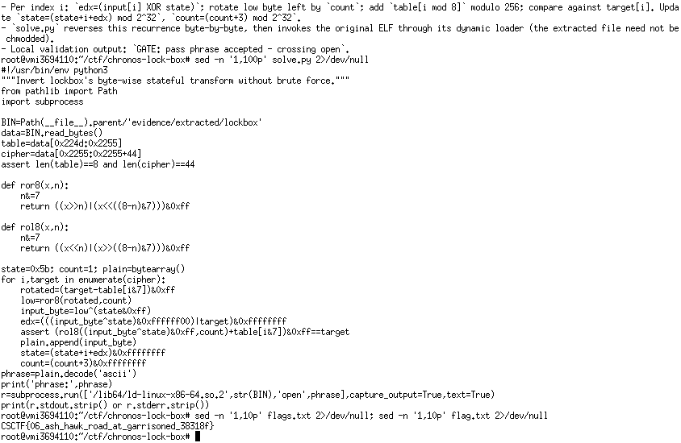

# Writeup : chronos-lock-box

Catégorie : reverse

Date de résolution : 2026-11-07

Technique principale : Invert per-byte stateful transform with rotating XOR and additive table

Outils observés : r2,objdump,python

Cible : CSCTF 2026 #9068

## Présentation

Ce document est construit à partir de la mémoire CTF partagée et des artefacts conservés dans /root/ctf/chronos-lock-box. Les étapes ci-dessous reprennent uniquement les faits observés. Les captures sont réalisées sur les fichiers locaux, sans rejouer une action distante ou destructive.

## Analyse et raisonnement

### Exploitation

At each index reverse target-table, ROR low byte by count, XOR state low byte; update state with full EDX and index.

### Pourquoi ça marche

Track the full 32-bit register state, not just the transformed low byte, when reversing bytewise verifier recurrences.

### Pièges

An encoded decoy string is separate from the actual lookup table and target bytes.

### Notes locales conservées

# The Lock Box (#9068) :  reverse

1. Attachment `lockbox.zip` SHA-256 `d805f832eb72f56b20ef2e55de4757430e4125545a132285a41b46fbdb0f232c`; contained a stripped x86-64 PIE ELF.
2. Triage: stack canary, NX, PIE, full RELRO; imports `strcmp`, `strncpy`, `strlen`. Static analysis only; no incorrect passphrases sent.
3. `open` requires exactly 44 bytes. A 44-byte obfuscated decoy string at 0x2200 is not the comparison target.
4. The verifier compares each input byte through a stateful transform against 44 encrypted bytes at 0x2255; the 8-byte additive table is at 0x224d, initial `ESI=0x5b`, `ECX=1`.
5. Per index i: `edx=(input[i] XOR state)`; rotate low byte left by `count`; add `table[i mod 8]` modulo 256; compare against target[i]. Update `state=(state+i+edx) mod 2^32`, `count=(count+3) mod 2^32`.
6. `solve.py` reverses this recurrence byte-by-byte, then invokes the original ELF through its dynamic loader (the extracted file need not be chmodded).
7. Local validation output: `GATE: pass phrase accepted - crossing open`.

## Commandes utiles

Les commandes suivantes consultent les preuves locales et sont sans effet de bord :

```bash
cd /root/ctf/chronos-lock-box
file notes.md solve.py 2>/dev/null
sed -n '1,180p' notes.md 2>/dev/null
sed -n '1,120p' solve.py 2>/dev/null
sed -n '1,10p' flags.txt 2>/dev/null
```

## Script de résolution complet

Le script conservé sous `solve.py` est reproduit ci-dessous sans modification :

```python
#!/usr/bin/env python3
"""Invert lockbox's byte-wise stateful transform without brute force."""
from pathlib import Path
import subprocess

BIN=Path(__file__).parent/'evidence/extracted/lockbox'
data=BIN.read_bytes()
table=data[0x224d:0x2255]
cipher=data[0x2255:0x2255+44]
assert len(table)==8 and len(cipher)==44

def ror8(x,n):
    n&=7
    return ((x>>n)|(x<<((8-n)&7)))&0xff

def rol8(x,n):
    n&=7
    return ((x<<n)|(x>>((8-n)&7)))&0xff

state=0x5b; count=1; plain=bytearray()
for i,target in enumerate(cipher):
    rotated=(target-table[i&7])&0xff
    low=ror8(rotated,count)
    input_byte=low^(state&0xff)
    edx=(((input_byte^state)&0xffffff00)|target)&0xffffffff
    assert (rol8((input_byte^state)&0xff,count)+table[i&7])&0xff==target
    plain.append(input_byte)
    state=(state+i+edx)&0xffffffff
    count=(count+3)&0xffffffff
phrase=plain.decode('ascii')
print('phrase:',phrase)
r=subprocess.run(['/lib64/ld-linux-x86-64.so.2',str(BIN),'open',phrase],capture_output=True,text=True)
print(r.stdout.strip() or r.stderr.strip())
```

## Captures du terminal

Les captures utilisent le terminal natif xterm disponible sur l’environnement, avec le prompt réel `root@vmi3694110`, le dossier courant du challenge et une géométrie identique. Elles montrent successivement l’analyse locale, le script ou les preuves de résolution, puis le flag conservé.







## Validation et flag

La mémoire partagée indique une validation CTFd correcte ou déjà validée.

Flag obtenu : `CSCTF{06_ash_hawk_road_at_garrisoned_38318f}`

## Conclusion

La résolution repose sur la faiblesse indiquée dans la technique principale, puis sur la vérification locale du résultat conservé. Le flag final ci-dessus est copié depuis la preuve locale réellement présente.
