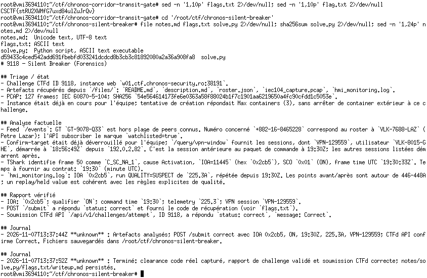
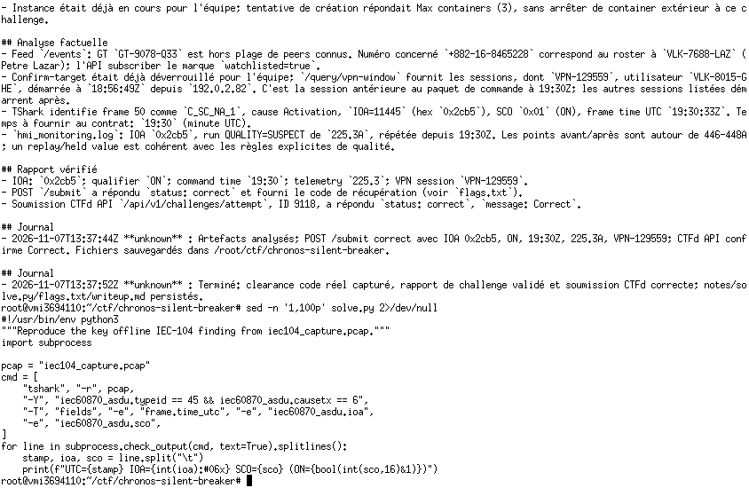
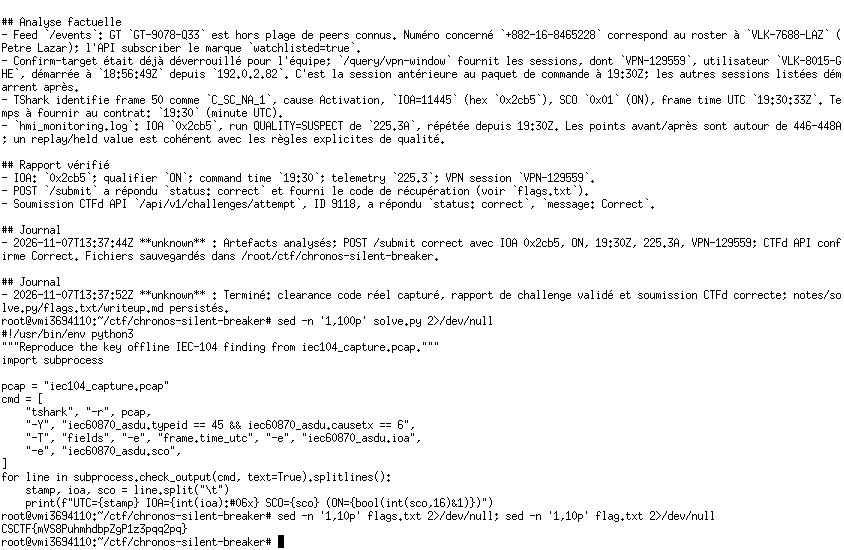

# Writeup : chronos-silent-breaker

Catégorie : forensics

Date de résolution : 2026-11-07

Technique principale : IEC-104 command correlation; historian replay; VPN-window correlation

Outils observés : tshark,curl

Cible : Chronos Security CTF 2026 challenge 9118

## Présentation

Ce document est construit à partir de la mémoire CTF partagée et des artefacts conservés dans /root/ctf/chronos-silent-breaker. Les étapes ci-dessous reprennent uniquement les faits observés. Les captures sont réalisées sur les fichiers locaux, sans rejouer une action distante ou destructive.

## Analyse et raisonnement

### Contexte

Offline: frame 50 PCAP C_SC_NA_1 Activation at 19:30:33Z, IOA 11445=0x2cb5, SCO 0x01 ON. HMI marks repeated 225.3A suspect while live values around 446-448A. VPN window gives pre-command session VPN-129559 for VLK-8015-GHE. Report accepted by /submit; CTFd attempt endpoint returned status correct.

### Notes locales conservées

# 9118 :  Silent Breaker (Forensics)

## Triage / état
1. Challenge CTFd ID 9118, instance web `w01.ctf.chronos-security.ro:38191`.
2. Artefacts récupérés depuis `/files/`: `README.md`, `description.md`, `roster.json`, `iec104_capture.pcap`, `hmi_monitoring.log`.
3. PCAP: 127 frames; IEC 60870-5-104; SHA256 `54e564614173fe6e0363a58f88024b1f7c1901aa6219650a4fc90cfdd1c5053e`.
4. Instance était déjà en cours pour l'équipe; tentative de création répondait Max containers (3), sans arrêter de container extérieur à ce challenge.

## Analyse factuelle
5. Feed `/events`: GT `GT-9078-Q33` est hors plage de peers connus. Numéro concerné `+882-16-8465228` correspond au roster à `VLK-7688-LAZ` (Petre Lazar); l'API subscriber le marque `watchlisted=true`.
6. Confirm-target était déjà déverrouillé pour l'équipe; `/query/vpn-window` fournit les sessions, dont `VPN-129559`, utilisateur `VLK-8015-GHE`, démarrée à `18:56:49Z` depuis `192.0.2.82`. C'est la session antérieure au paquet de commande à 19:30Z; les autres sessions listées démarrent après.
7. TShark identifie frame 50 comme `C_SC_NA_1`, cause Activation, `IOA=11445` (hex `0x2cb5`), SCO `0x01` (ON), frame time UTC `19:30:33Z`. Temps à fournir au contrat: `19:30` (minute UTC).
8. `hmi_monitoring.log`: IOA `0x2cb5`, run QUALITY=SUSPECT de `225.3A`, répétée depuis 19:30Z. Les points avant/après sont autour de 446: 448A; un replay/held value est cohérent avec les règles explicites de qualité.

## Rapport vérifié
9. IOA: `0x2cb5`; qualifier `ON`; command time `19:30`; telemetry `225.3`; VPN session `VPN-129559`.
10. POST `/submit` a répondu `status: correct` et fourni le code de récupération (voir `flags.txt`).
11. Soumission CTFd API `/api/v1/challenges/attempt`, ID 9118, a répondu `status: correct`, `message: Correct`.

## Journal
12. 2026-11-07T13:37:44Z unknown : Artefacts analysés; POST /submit correct avec IOA 0x2cb5, ON, 19:30Z, 225.3A, VPN-129559; CTFd API confirme Correct. Fichiers sauvegardés dans /root/ctf/chronos-silent-breaker.

## Journal
13. 2026-11-07T13:37:52Z unknown : Terminé: clearance code réel capturé, rapport de challenge validé et soumission CTFd correcte; notes/solve.py/flags.txt/writeup.md persistés.

## Commandes utiles

Les commandes suivantes consultent les preuves locales et sont sans effet de bord :

```bash
cd /root/ctf/chronos-silent-breaker
file notes.md solve.py 2>/dev/null
sed -n '1,180p' notes.md 2>/dev/null
sed -n '1,120p' solve.py 2>/dev/null
sed -n '1,10p' flags.txt 2>/dev/null
```

## Script de résolution complet

Le script conservé sous `solve.py` est reproduit ci-dessous sans modification :

```python
#!/usr/bin/env python3
"""Reproduce the key offline IEC-104 finding from iec104_capture.pcap."""
import subprocess

pcap = "iec104_capture.pcap"
cmd = [
    "tshark", "-r", pcap,
    "-Y", "iec60870_asdu.typeid == 45 && iec60870_asdu.causetx == 6",
    "-T", "fields", "-e", "frame.time_utc", "-e", "iec60870_asdu.ioa",
    "-e", "iec60870_asdu.sco",
]
for line in subprocess.check_output(cmd, text=True).splitlines():
    stamp, ioa, sco = line.split("\t")
    print(f"UTC={stamp} IOA={int(ioa):#06x} SCO={sco} (ON={bool(int(sco,16)&1)})")
```

## Captures du terminal

Les captures utilisent le terminal natif xterm disponible sur l’environnement, avec le prompt réel `root@vmi3694110`, le dossier courant du challenge et une géométrie identique. Elles montrent successivement l’analyse locale, le script ou les preuves de résolution, puis le flag conservé.







## Validation et flag

La mémoire partagée indique une validation CTFd correcte ou déjà validée.

Flag obtenu : `CSCTF{mVS8PuhmhdbpZgP1z3pqq2pq}`

## Conclusion

La résolution repose sur la faiblesse indiquée dans la technique principale, puis sur la vérification locale du résultat conservé. Le flag final ci-dessus est copié depuis la preuve locale réellement présente.
