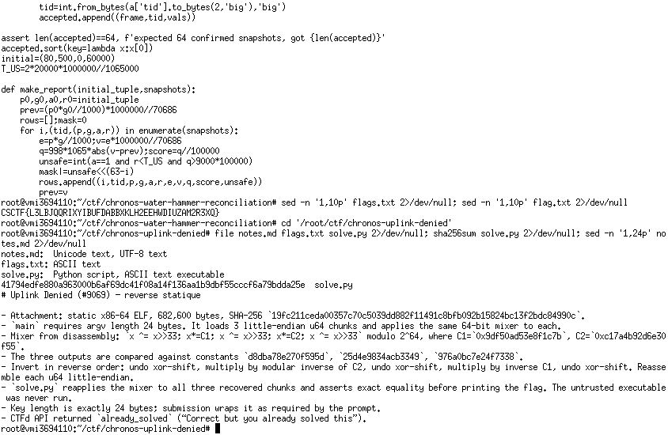
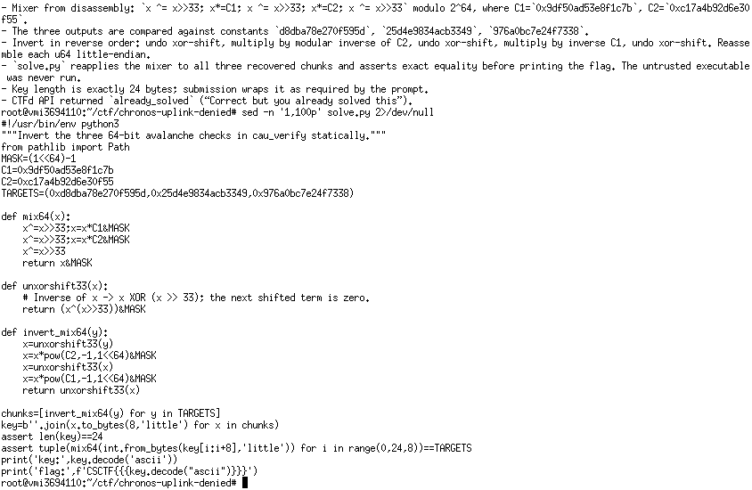
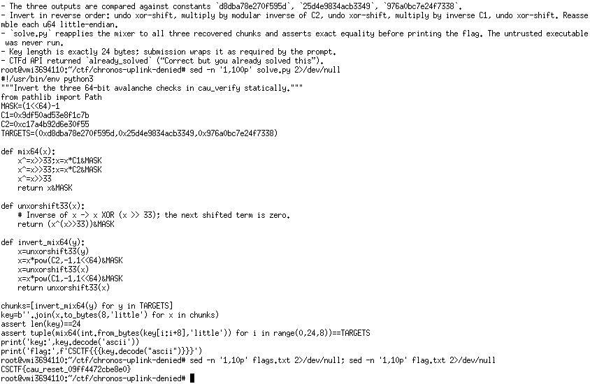

# Writeup : chronos-uplink-denied

Catégorie : reverse

Date de résolution : 2026-11-07

Technique principale : Invert 64-bit xor-shift/multiply avalanche modulo 2^64

Outils observés : objdump,r2,python

Cible : CSCTF 2026 #9069

## Présentation

Ce document est construit à partir de la mémoire CTF partagée et des artefacts conservés dans /root/ctf/chronos-uplink-denied. Les étapes ci-dessous reprennent uniquement les faits observés. Les captures sont réalisées sur les fichiers locaux, sans rejouer une action distante ou destructive.

## Analyse et raisonnement

### Exploitation

Invert x^=x>>33, multiply inverse C2, invert xor-shift, multiply inverse C1, invert xor-shift; reconstruct three u64 little-endian words.

### Pourquoi ça marche

Odd multiplication constants have inverses modulo 2^64; undo operations in reverse order and preserve little-endian chunk layout.

### Pièges

Recover the exact fixed 24-byte key, not a null-terminated or hex-encoded variant; binary need not be executed.

### Notes locales conservées

# Uplink Denied (#9069) :  reverse statique

1. Attachment: static x86-64 ELF, 682,600 bytes, SHA-256 `19fc211ceda00357c70c5039dd882f11491c8bfb092b15824bc13f2bdc84990c`.
2. `main` requires argv length 24 bytes. It loads 3 little-endian u64 chunks and applies the same 64-bit mixer to each.
3. Mixer from disassembly: `x ^= x>>33; x*=C1; x ^= x>>33; x*=C2; x ^= x>>33` modulo 2^64, where C1=`0x9df50ad53e8f1c7b`, C2=`0xc17a4b92d6e30f55`.
4. The three outputs are compared against constants `d8dba78e270f595d`, `25d4e9834acb3349`, `976a0bc7e24f7338`.
5. Invert in reverse order: undo xor-shift, multiply by modular inverse of C2, undo xor-shift, multiply by inverse C1, undo xor-shift. Reassemble each u64 little-endian.
6. `solve.py` reapplies the mixer to all three recovered chunks and asserts exact equality before printing the flag. The untrusted executable was never run.
7. Key length is exactly 24 bytes; submission wraps it as required by the prompt.
8. CTFd API returned `already_solved` (“Correct but you already solved this”).

## Commandes utiles

Les commandes suivantes consultent les preuves locales et sont sans effet de bord :

```bash
cd /root/ctf/chronos-uplink-denied
file notes.md solve.py 2>/dev/null
sed -n '1,180p' notes.md 2>/dev/null
sed -n '1,120p' solve.py 2>/dev/null
sed -n '1,10p' flags.txt 2>/dev/null
```

## Script de résolution complet

Le script conservé sous `solve.py` est reproduit ci-dessous sans modification :

```python
#!/usr/bin/env python3
"""Invert the three 64-bit avalanche checks in cau_verify statically."""
from pathlib import Path
MASK=(1<<64)-1
C1=0x9df50ad53e8f1c7b
C2=0xc17a4b92d6e30f55
TARGETS=(0xd8dba78e270f595d,0x25d4e9834acb3349,0x976a0bc7e24f7338)

def mix64(x):
    x^=x>>33;x=x*C1&MASK
    x^=x>>33;x=x*C2&MASK
    x^=x>>33
    return x&MASK

def unxorshift33(x):
    # Inverse of x -> x XOR (x >> 33); the next shifted term is zero.
    return (x^(x>>33))&MASK

def invert_mix64(y):
    x=unxorshift33(y)
    x=x*pow(C2,-1,1<<64)&MASK
    x=unxorshift33(x)
    x=x*pow(C1,-1,1<<64)&MASK
    return unxorshift33(x)

chunks=[invert_mix64(y) for y in TARGETS]
key=b''.join(x.to_bytes(8,'little') for x in chunks)
assert len(key)==24
assert tuple(mix64(int.from_bytes(key[i:i+8],'little')) for i in range(0,24,8))==TARGETS
print('key:',key.decode('ascii'))
print('flag:',f'CSCTF{{{key.decode("ascii")}}}')
```

## Captures du terminal

Les captures utilisent le terminal natif xterm disponible sur l’environnement, avec le prompt réel `root@vmi3694110`, le dossier courant du challenge et une géométrie identique. Elles montrent successivement l’analyse locale, le script ou les preuves de résolution, puis le flag conservé.







## Validation et flag

La mémoire partagée indique une validation CTFd correcte ou déjà validée.

Flag obtenu : `CSCTF{cau_reset_09ff4472cbe8e0}`

## Conclusion

La résolution repose sur la faiblesse indiquée dans la technique principale, puis sur la vérification locale du résultat conservé. Le flag final ci-dessus est copié depuis la preuve locale réellement présente.
