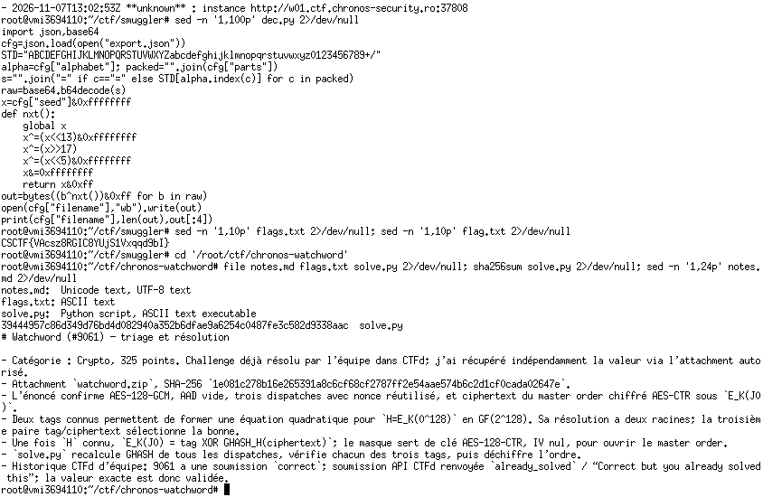
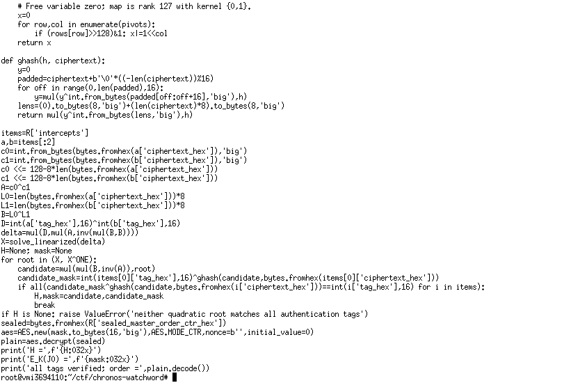
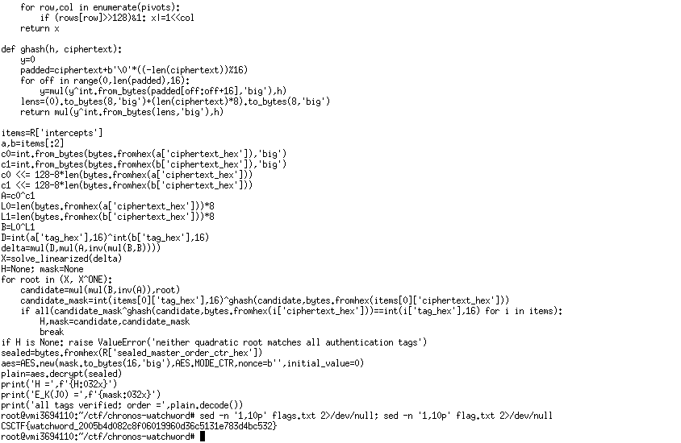

# Writeup : chronos-watchword

Catégorie : crypto

Date de résolution : 2026-11-07

Technique principale : AES-GCM nonce reuse; quadratic recovery of GHASH subkey H in GF(2^128)

Outils observés : python,pycryptodome

Cible : CSCTF 2026 #9061

## Présentation

Ce document est construit à partir de la mémoire CTF partagée et des artefacts conservés dans /root/ctf/chronos-watchword. Les étapes ci-dessous reprennent uniquement les faits observés. Les captures sont réalisées sur les fichiers locaux, sans rejouer une action distante ou destructive.

## Analyse et raisonnement

### Exploitation

Recover H from two known plaintext/ciphertext/tag records; verify the third tag; derive E_K(J0); AES-CTR decrypt master order.

### Pourquoi ça marche

Cancel the repeated GCM tag mask by XORing tags; use a third known pair to select the quadratic root.

### Pièges

GHASH bit representation has multiplicative identity 1<<127 in this reflected representation; using integer 1 breaks field inversion.

### Notes locales conservées

# Watchword (#9061) :  triage et résolution

1. Catégorie : Crypto, 325 points. Challenge déjà résolu par l’équipe dans CTFd; j’ai récupéré indépendamment la valeur via l’attachment autorisé.
2. Attachment `watchword.zip`, SHA-256 `1e081c278b16e265391a8c6cf68cf2787ff2e54aae574b6c2d1cf0cada02647e`.
3. L’énoncé confirme AES-128-GCM, AAD vide, trois dispatches avec nonce réutilisé, et ciphertext du master order chiffré AES-CTR sous `E_K(J0)`.
4. Deux tags connus permettent de former une équation quadratique pour `H=E_K(0^128)` en GF(2^128). Sa résolution a deux racines; la troisième paire tag/ciphertext sélectionne la bonne.
5. Une fois `H` connu, `E_K(J0) = tag XOR GHASH_H(ciphertext)`; le masque sert de clé AES-128-CTR, IV nul, pour ouvrir le master order.
6. `solve.py` recalcule GHASH de tous les dispatches, vérifie chacun des trois tags, puis déchiffre l’ordre.
7. Historique CTFd d’équipe: 9061 a une soumission `correct`; soumission API CTFd renvoyée `already_solved` / “Correct but you already solved this”; la valeur exacte est donc validée.

## Commandes utiles

Les commandes suivantes consultent les preuves locales et sont sans effet de bord :

```bash
cd /root/ctf/chronos-watchword
file notes.md solve.py 2>/dev/null
sed -n '1,180p' notes.md 2>/dev/null
sed -n '1,120p' solve.py 2>/dev/null
sed -n '1,10p' flags.txt 2>/dev/null
```

## Script de résolution complet

Le script conservé sous `solve.py` est reproduit ci-dessous sans modification :

```python
#!/usr/bin/env python3
"""Recover AES-GCM nonce-reuse tag mask and decrypt Watchword order."""
import json
from pathlib import Path
from Crypto.Cipher import AES

P = Path(__file__).parent / 'evidence/extracted/watchword/intercepts.json'
R = json.loads(P.read_text())
MASK = (1 << 128) - 1
RED = 0xE1000000000000000000000000000000
ONE = 1 << 127

def mul(x, y):
    z = 0
    v = y
    for i in range(128):
        if (x >> (127-i)) & 1: z ^= v
        v = (v >> 1) ^ (RED if v & 1 else 0)
    return z

def inv(x):
    if not x: raise ZeroDivisionError
    # Fermat inverse in GF(2^128): x^(2^128-2)
    y=ONE
    for bit in range(127,-1,-1):
        y=mul(y,y)
        if (( (1<<128)-2) >> bit) & 1: y=mul(y,x)
    return y

def solve_linearized(delta):
    # Solve X^2 + X = delta as a 128x128 binary linear system.
    cols=[]
    for i in range(128):
        x=1<<i; cols.append(mul(x,x)^x)
    rows=[]
    for r in range(128):
        coeff=sum(((cols[c]>>r)&1)<<c for c in range(128))
        rows.append(coeff | (((delta>>r)&1)<<128))
    pivot=0; pivots=[]
    for col in range(128):
        k=next((k for k in range(pivot,128) if (rows[k]>>col)&1),None)
        if k is None: continue
        rows[pivot],rows[k]=rows[k],rows[pivot]
        for j in range(128):
            if j!=pivot and ((rows[j]>>col)&1): rows[j]^=rows[pivot]
        pivots.append(col);pivot+=1
    if any((r & MASK)==0 and (r>>128) for r in rows): raise ValueError('quadratic has no solution')
    # Free variable zero; map is rank 127 with kernel {0,1}.
    x=0
    for row,col in enumerate(pivots):
        if (rows[row]>>128)&1: x|=1<<col
    return x

def ghash(h, ciphertext):
    y=0
    padded=ciphertext+b'\0'*((-len(ciphertext))%16)
    for off in range(0,len(padded),16):
        y=mul(y^int.from_bytes(padded[off:off+16],'big'),h)
    lens=(0).to_bytes(8,'big')+(len(ciphertext)*8).to_bytes(8,'big')
    return mul(y^int.from_bytes(lens,'big'),h)

items=R['intercepts']
a,b=items[:2]
c0=int.from_bytes(bytes.fromhex(a['ciphertext_hex']),'big')
c1=int.from_bytes(bytes.fromhex(b['ciphertext_hex']),'big')
c0 <<= 128-8*len(bytes.fromhex(a['ciphertext_hex']))
c1 <<= 128-8*len(bytes.fromhex(b['ciphertext_hex']))
A=c0^c1
L0=len(bytes.fromhex(a['ciphertext_hex']))*8
L1=len(bytes.fromhex(b['ciphertext_hex']))*8
B=L0^L1
D=int(a['tag_hex'],16)^int(b['tag_hex'],16)
delta=mul(D,mul(A,inv(mul(B,B))))
X=solve_linearized(delta)
H=None; mask=None
for root in (X, X^ONE):
    candidate=mul(mul(B,inv(A)),root)
    candidate_mask=int(items[0]['tag_hex'],16)^ghash(candidate,bytes.fromhex(items[0]['ciphertext_hex']))
    if all(candidate_mask^ghash(candidate,bytes.fromhex(i['ciphertext_hex']))==int(i['tag_hex'],16) for i in items):
        H,mask=candidate,candidate_mask
        break
if H is None: raise ValueError('neither quadratic root matches all authentication tags')
sealed=bytes.fromhex(R['sealed_master_order_ctr_hex'])
aes=AES.new(mask.to_bytes(16,'big'),AES.MODE_CTR,nonce=b'',initial_value=0)
plain=aes.decrypt(sealed)
print('H =',f'{H:032x}')
print('E_K(J0) =',f'{mask:032x}')
print('all tags verified; order =',plain.decode())
```

## Captures du terminal

Les captures utilisent le terminal natif xterm disponible sur l’environnement, avec le prompt réel `root@vmi3694110`, le dossier courant du challenge et une géométrie identique. Elles montrent successivement l’analyse locale, le script ou les preuves de résolution, puis le flag conservé.







## Validation et flag

Le flag est conservé dans le fichier local flags.txt ou flag.txt. Aucune validation externe supplémentaire n’est affirmée ici.

Flag obtenu : `CSCTF{watchword_2005b4d082c8f06019960d36c5131e783d4bc532}`

## Conclusion

La résolution repose sur la faiblesse indiquée dans la technique principale, puis sur la vérification locale du résultat conservé. Le flag final ci-dessus est copié depuis la preuve locale réellement présente.
