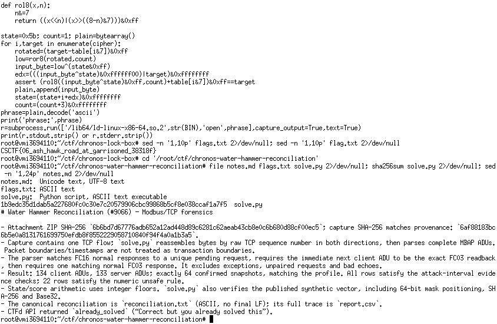
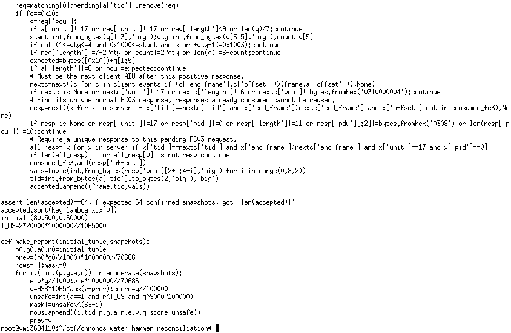
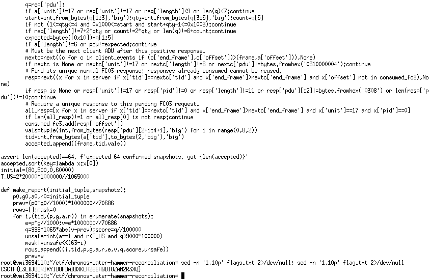

# Writeup : chronos-water-hammer-reconciliation

Catégorie : forensics

Date de résolution : 2026-11-07

Technique principale : TCP stream reassembly and request-response correlated Modbus/TCP state capture

Outils observés : tshark,python

Cible : CSCTF 2026 #9066

## Présentation

Ce document est construit à partir de la mémoire CTF partagée et des artefacts conservés dans /root/ctf/chronos-water-hammer-reconciliation. Les étapes ci-dessous reprennent uniquement les faits observés. Les captures sont réalisées sur les fichiers locaux, sans rejouer une action distante ou destructive.

## Analyse et raisonnement

### Exploitation

Reassemble c2s/s2c streams, parse ADUs, pair FC16 responses and immediate FC03 readbacks, compute integer safety screen, serialize canonical transcript then SHA-256/Base32.

### Pourquoi ça marche

Reassemble by sequence number; apply protocol semantics only after strict MBAP and echoed-response matching.

### Pièges

Do not equate TCP segments/timestamps with Modbus ADUs; serialize FC16 response TID, not the readback TID; mask positions are fixed 63-i.

### Notes locales conservées

# Water Hammer Reconciliation (#9066) :  Modbus/TCP forensics

1. Attachment ZIP SHA-256 `6b6bd7d67776adb652a12ad448d89c6281c62aeab43cb8e0c6b680d88cf00ec5`; capture SHA-256 matches provenance: `6af88183bc6b5e0a8131761699750efdb8f8552229058710840f94f4a0a1b3a5`.
2. Capture contains one TCP flow; `solve.py` reassembles bytes by raw TCP sequence number in both directions, then parses complete MBAP ADUs. Packet boundaries/timestamps are not treated as transaction boundaries.
3. The parser matches FC16 normal responses to a unique pending request, requires the immediate next client ADU to be the exact FC03 readback, then requires one matching normal FC03 response. It excludes exceptions, unpaired requests and bad echoes.
4. Result: 134 client ADUs, 133 server ADUs; exactly 64 confirmed snapshots, matching the profile. All rows satisfy the attack-interval evidence checks; 22 rows satisfy the numeric unsafe rule.
5. State/score arithmetic uses integer floors. `solve.py` also verifies the published synthetic vector, including 64-bit mask positioning, SHA-256 and Base32.
6. The canonical reconciliation is `reconciliation.txt` (ASCII, no final LF); its full trace is `report.csv`.
7. CTFd API returned `already_solved` (“Correct but you already solved this”).

## Commandes utiles

Les commandes suivantes consultent les preuves locales et sont sans effet de bord :

```bash
cd /root/ctf/chronos-water-hammer-reconciliation
file notes.md solve.py 2>/dev/null
sed -n '1,180p' notes.md 2>/dev/null
sed -n '1,120p' solve.py 2>/dev/null
sed -n '1,10p' flags.txt 2>/dev/null
```

## Script de résolution complet

Le script conservé sous `solve.py` est reproduit ci-dessous sans modification :

```python
#!/usr/bin/env python3
"""Reassemble Modbus/TCP, confirm FC16+FC3 snapshots, and build reconciliation."""
import base64, hashlib, subprocess
from collections import defaultdict
from pathlib import Path

ROOT=Path(__file__).parent
PCAP=ROOT/'evidence/extracted/reserve-header.pcapng'
cmd=['tshark','-r',str(PCAP),'-o','tcp.relative_sequence_numbers:FALSE','-Y','tcp.port==502 && tcp.len>0','-T','fields','-E','separator=|','-e','frame.number','-e','ip.src','-e','tcp.srcport','-e','tcp.seq_raw','-e','tcp.payload']
text=subprocess.check_output(cmd,text=True,stderr=subprocess.DEVNULL)
segments=defaultdict(list)
for line in text.splitlines():
    f=line.split('|')
    if len(f)!=5 or not f[4]:continue
    frame,ip,port,seq,payload=f
    direction='c2s' if ip=='192.0.2.10' and int(port)!=502 else 's2c' if ip=='192.0.2.20' and int(port)==502 else None
    if direction is None:continue
    segments[direction].append((int(seq),int(frame),bytes.fromhex(payload)))

def stream_adus(direction):
    segs=segments[direction]
    assert segs
    start=min(s for s,_,_ in segs); byte_map={}
    for seq,frame,payload in segs:
        off=seq-start
        for j,b in enumerate(payload):
            k=off+j
            if k in byte_map:
                assert byte_map[k][0]==b,'conflicting TCP overlap'
                byte_map[k]=(b,min(frame,byte_map[k][1]))
            else:byte_map[k]=(b,frame)
    end=max(byte_map)+1
    assert len(byte_map)==end, f'TCP gap in {direction}'
    stream=bytes(byte_map[i][0] for i in range(end)); frames=[byte_map[i][1] for i in range(end)]
    adus=[];off=0
    while off<len(stream):
        assert len(stream)-off>=6,'truncated MBAP'
        tid=int.from_bytes(stream[off:off+2],'big');pid=int.from_bytes(stream[off+2:off+4],'big');length=int.from_bytes(stream[off+4:off+6],'big')
        total=6+length
        assert length>=2 and off+total<=len(stream),'malformed/truncated ADU'
        unit=stream[off+6];pdu=stream[off+7:off+total]
        assert pid==0 and len(pdu)==length-1,'bad protocol/PDU length'
        adus.append({'tid':tid,'pid':pid,'length':length,'unit':unit,'pdu':pdu,'offset':off,'end_frame':max(frames[off:off+total]),'direction':direction})
        off+=total
    return adus

client=stream_adus('c2s');server=stream_adus('s2c')
# Keep stream order within each direction; event ordinal is the capture frame where
# the ADU became complete, with stream offset as a deterministic same-frame tiebreak.
events=[]
for a in client+server:events.append((a['end_frame'],0 if a['direction']=='c2s' else 1,a['offset'],a))
events.sort(key=lambda x:x[:3])
pending=defaultdict(list);accepted=[];last_client_pos={};consumed_fc3=set();client_events=sorted(client,key=lambda a:(a['end_frame'],a['offset']))
for frame,_,_,a in events:
    pdu=a['pdu'];fc=pdu[0]
    if a['direction']=='c2s':
        pending[a['tid']].append(a)
        continue
    reqs=pending.get(a['tid'],[])
    matching=[r for r in reqs if r['unit']==a['unit'] and r['pid']==a['pid'] and r['pdu'][0]==(fc&0x7f)]
    if len(matching)!=1:continue
    req=matching[0];pending[a['tid']].remove(req)
    if fc==0x10:
        q=req['pdu'];
        if a['unit']!=17 or req['unit']!=17 or req['length']<9 or len(q)<7:continue
        start=int.from_bytes(q[1:3],'big');qty=int.from_bytes(q[3:5],'big');count=q[5]
        if not (1<=qty<=4 and 0x1000<=start and start+qty-1<=0x1003):continue
        if req['length']!=7+2*qty or count!=2*qty or len(q)!=6+count:continue
        expected=bytes([0x10])+q[1:5]
        if a['length']!=6 or pdu!=expected:continue
        # Must be the next client ADU after this positive response.
        nextc=next((c for c in client_events if (c['end_frame'],c['offset'])>(frame,a['offset'])),None)
        if nextc is None or nextc['unit']!=17 or nextc['length']!=6 or nextc['pdu']!=bytes.fromhex('0310000004'):continue
        # Find its unique normal FC03 response; responses already consumed cannot be reused.
        resp=next((x for x in server if x['tid']==nextc['tid'] and x['end_frame']>nextc['end_frame'] and x['offset'] not in consumed_fc3),None)
        if resp is None or resp['unit']!=17 or resp['pid']!=0 or resp['length']!=11 or resp['pdu'][:2]!=bytes.fromhex('0308') or len(resp['pdu'])!=10:continue
        # Require a unique response to this pending FC03 request.
        all_resp=[x for x in server if x['tid']==nextc['tid'] and x['end_frame']>nextc['end_frame'] and x['unit']==17 and x['pid']==0]
        if len(all_resp)!=1 or all_resp[0] is not resp:continue
        consumed_fc3.add(resp['offset'])
        vals=tuple(int.from_bytes(resp['pdu'][2+i:4+i],'big') for i in range(0,8,2))
        tid=int.from_bytes(a['tid'].to_bytes(2,'big'),'big')
        accepted.append((frame,tid,vals))

assert len(accepted)==64, f'expected 64 confirmed snapshots, got {len(accepted)}'
accepted.sort(key=lambda x:x[0])
initial=(80,500,0,60000)
T_US=2*20000*1000000//1065000

def make_report(initial_tuple,snapshots):
    p0,g0,a0,r0=initial_tuple
    prev=(p0*g0//1000)*1000000//70686
    rows=[];mask=0
    for i,(tid,(p,g,a,r)) in enumerate(snapshots):
        e=p*g//1000;v=e*1000000//70686
        q=998*1065*abs(v-prev);score=q//100000
        unsafe=int(a==1 and r<T_US and q>9000*100000)
        mask|=unsafe<<(63-i)
        rows.append((i,tid,p,g,a,r,e,v,q,score,unsafe))
        prev=v
    lines=['water-hammer-reconciliation-v2',f'initial;p={p0};g={g0};a={a0};r={r0}',f'n={len(snapshots)}']
    for i,tid,p,g,a,r,*_ in rows:
        lines.append(f'i={i};tid={tid:04X};p={p};g={g};a={a};r={r}')
    lines.append(f'unsafe-mask={mask:016X}')
    return '\n'.join(lines).encode('ascii'),rows,mask

snapshots=[(tid,vals) for _,tid,vals in accepted]
report,rows,mask=make_report(initial,snapshots)
digest=hashlib.sha256(report).digest();b32=base64.b32encode(digest[:24]).decode().rstrip('=')
flag=f'CSCTF{{{b32}}}'
# Public synthetic vector from the profile validates arithmetic, ordering, and bytes.
synthetic,synthetic_rows,synthetic_mask=make_report(initial,[(0x0101,(160,1000,1,5000)),(0x0102,(160,1000,0,60000))])
assert synthetic_rows[0][8:]==(1804753260,18047,1)
assert synthetic_rows[1][8:]==(0,0,0)
assert synthetic_mask==0x8000000000000000
synthetic_hash=hashlib.sha256(synthetic).hexdigest()
assert synthetic_hash=='401df824e6d5d098751a7c7ee07ad8211f1397ee7799e838f163572033689832'
assert base64.b32encode(bytes.fromhex(synthetic_hash)[:24]).decode().rstrip('=')=='IAO7QJHG2XIJQ5I2PR7OA6WYEEPRHF7OO6M6QOA'
(ROOT/'reconciliation.txt').write_bytes(report)
(ROOT/'report.csv').write_text('i,tid,p,g,a,r,E,V,Q,S,unsafe\n'+'\n'.join(','.join(map(str,row)) for row in rows)+'\n',encoding='ascii')
print('reassembled ADUs client/server:',len(client),len(server))
print('confirmed snapshots:',len(accepted),'unsafe:',sum(x[-1] for x in rows),'T_US:',T_US)
print('report bytes:',len(report),'report SHA256:',digest.hex(),'Base32:',b32)
print(flag)
```

## Captures du terminal

Les captures utilisent le terminal natif xterm disponible sur l’environnement, avec le prompt réel `root@vmi3694110`, le dossier courant du challenge et une géométrie identique. Elles montrent successivement l’analyse locale, le script ou les preuves de résolution, puis le flag conservé.







## Validation et flag

La mémoire partagée indique une validation CTFd correcte ou déjà validée.

Flag obtenu : `CSCTF{L3LBJQQRIXYIBUFDABBXKLH2EEHWDIUZAM2R3XQ}`

## Conclusion

La résolution repose sur la faiblesse indiquée dans la technique principale, puis sur la vérification locale du résultat conservé. Le flag final ci-dessus est copié depuis la preuve locale réellement présente.
