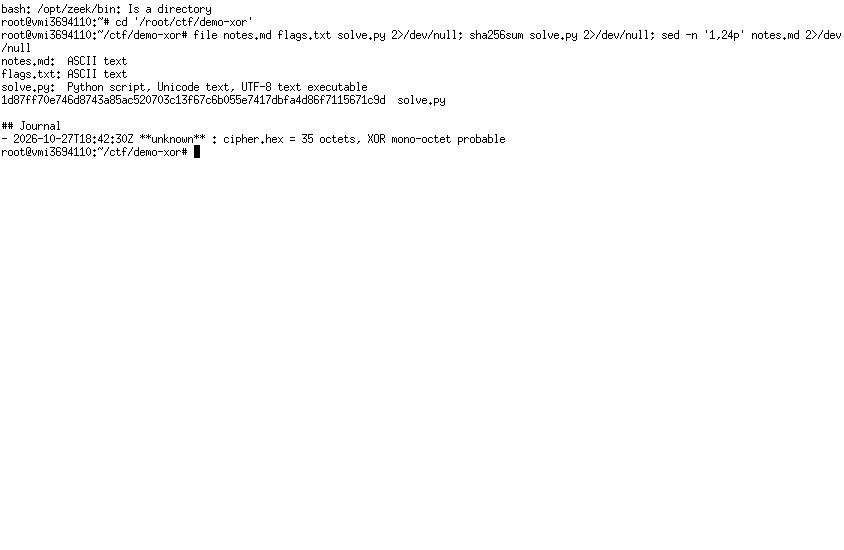
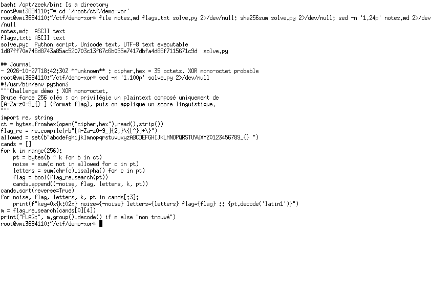
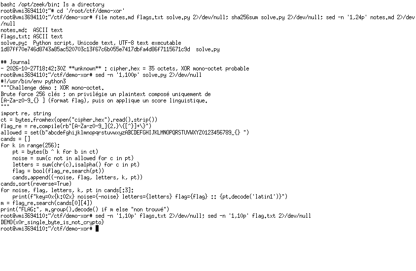

# Writeup : demo-xor

Catégorie : crypto

Date de résolution : 2026-10-27

Technique principale : XOR mono-octet, brute force 256 clés + filtrage alphabet du flag

Outils observés : python3

Cible : cipher.hex

## Présentation

Ce document est construit à partir de la mémoire CTF partagée et des artefacts conservés dans /root/ctf/demo-xor. Les étapes ci-dessous reprennent uniquement les faits observés. Les captures sont réalisées sur les fichiers locaux, sans rejouer une action distante ou destructive.

## Analyse et raisonnement

### Exploitation

python3 solve.py  # score = bruit hors [A-Za-z0-9_{} ] puis regex flag

### Pourquoi ça marche

Quand le plaintext attendu est un flag, le filtre le plus puissant n'est pas la fréquence mais l'alphabet autorisé : tout octet hors [A-Za-z0-9_{} ] élimine la clé.

### Pièges

Un score 'printable' seul garde ~10 clés valides (faux positifs) ; trier par bruit+mots avant de regex.

### Notes locales conservées

## Journal
1. 2026-10-27T18:42:30Z unknown : cipher.hex = 35 octets, XOR mono-octet probable

## Commandes utiles

Les commandes suivantes consultent les preuves locales et sont sans effet de bord :

```bash
cd /root/ctf/demo-xor
file notes.md solve.py 2>/dev/null
sed -n '1,180p' notes.md 2>/dev/null
sed -n '1,120p' solve.py 2>/dev/null
sed -n '1,10p' flags.txt 2>/dev/null
```

## Script de résolution complet

Le script conservé sous `solve.py` est reproduit ci-dessous sans modification :

```python
#!/usr/bin/env python3
"""Challenge démo : XOR mono-octet.
Brute force 256 clés ; on privilégie un plaintext composé uniquement de
[A-Za-z0-9_{} ] (format flag), puis on applique un score linguistique.
"""
import re, string
ct = bytes.fromhex(open("cipher.hex").read().strip())
flag_re = re.compile(rb"[A-Za-z0-9_]{2,}\{[^}]+\}")
allowed = set(b"abcdefghijklmnopqrstuvwxyzABCDEFGHIJKLMNOPQRSTUVWXYZ0123456789_{} ")
cands = []
for k in range(256):
    pt = bytes(b ^ k for b in ct)
    noise = sum(c not in allowed for c in pt)
    letters = sum(chr(c).isalpha() for c in pt)
    flag = bool(flag_re.search(pt))
    cands.append((-noise, flag, letters, k, pt))
cands.sort(reverse=True)
for noise, flag, letters, k, pt in cands[:3]:
    print(f"key=0x{k:02x} noise={-noise} letters={letters} flag={flag} :: {pt.decode('latin1')}")
m = flag_re.search(cands[0][4])
print("FLAG:", m.group().decode() if m else "non trouvé")
```

## Captures du terminal

Les captures utilisent le terminal natif xterm disponible sur l’environnement, avec le prompt réel `root@vmi3694110`, le dossier courant du challenge et une géométrie identique. Elles montrent successivement l’analyse locale, le script ou les preuves de résolution, puis le flag conservé.







## Validation et flag

Le flag est conservé dans le fichier local flags.txt ou flag.txt. Aucune validation externe supplémentaire n’est affirmée ici.

Flag obtenu : `DEMO{x0r_single_byte_is_not_crypto}`

## Conclusion

La résolution repose sur la faiblesse indiquée dans la technique principale, puis sur la vérification locale du résultat conservé. Le flag final ci-dessus est copié depuis la preuve locale réellement présente.
