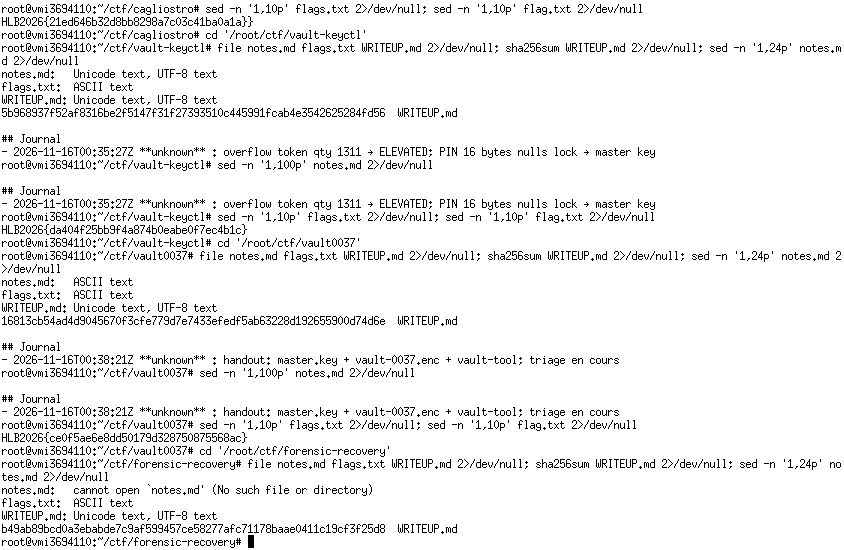
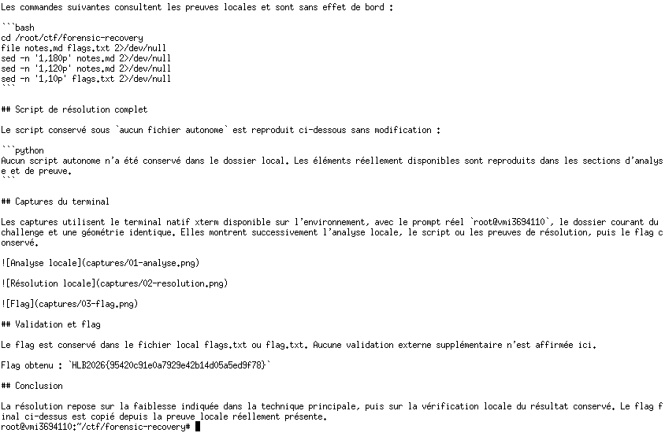
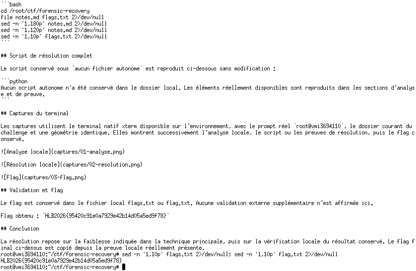

# Writeup : forensic-recovery

Catégorie : forensics

Date de résolution : 2026-11-16

Technique principale : git dangling commits + GPG symmetric passphrase in deleted .env

Outils observés : git fsck,gpg

Cible : 172.28.15.2:8080

## Présentation

Ce document est construit à partir de la mémoire CTF partagée et des artefacts conservés dans /root/ctf/forensic-recovery. Les étapes ci-dessous reprennent uniquement les faits observés. Les captures sont réalisées sur les fichiers locaux, sans rejouer une action distante ou destructive.

## Analyse et raisonnement

### Contexte

operator-ws.tar.gz. SSH ed25519 comment nrv-ops-42@borealis-ws.
dangling 16a1bec9: .env GPG_PASSPHRASE + seed-database false-flag Valdoria.
dangling 040693ab: op-briefing.gpg :  AUTH_TOKEN after decrypt.
Cover: Vantage Hosting Mirova; real: Borealis/Norvethie.

### Exploitation

GPG_PASSPHRASE=Borealis-Kaltyr-2026!

### Pourquoi ça marche

Homedir forensics: git fsck dangling commits; SSH key comments (nrv-ops-42@borealis-ws); passphrase dans .env delete puis gpg -d op-briefing.

### Flag

`HLB2026{95420c91e0a7929e42b14d05a5ed9f78}`

## Commandes utiles

Les commandes suivantes consultent les preuves locales et sont sans effet de bord :

```bash
cd /root/ctf/forensic-recovery
file notes.md flags.txt 2>/dev/null
sed -n '1,180p' notes.md 2>/dev/null
sed -n '1,120p' notes.md 2>/dev/null
sed -n '1,10p' flags.txt 2>/dev/null
```

## Script de résolution complet

Le script conservé sous `aucun fichier autonome` est reproduit ci-dessous sans modification :

```python
Aucun script autonome n’a été conservé dans le dossier local. Les éléments réellement disponibles sont reproduits dans les sections d’analyse et de preuve.
```

## Captures du terminal

Les captures utilisent le terminal natif xterm disponible sur l’environnement, avec le prompt réel `root@vmi3694110`, le dossier courant du challenge et une géométrie identique. Elles montrent successivement l’analyse locale, le script ou les preuves de résolution, puis le flag conservé.







## Validation et flag

Le flag est conservé dans le fichier local flags.txt ou flag.txt. Aucune validation externe supplémentaire n’est affirmée ici.

Flag obtenu : `HLB2026{95420c91e0a7929e42b14d05a5ed9f78}`

## Conclusion

La résolution repose sur la faiblesse indiquée dans la technique principale, puis sur la vérification locale du résultat conservé. Le flag final ci-dessus est copié depuis la preuve locale réellement présente.
