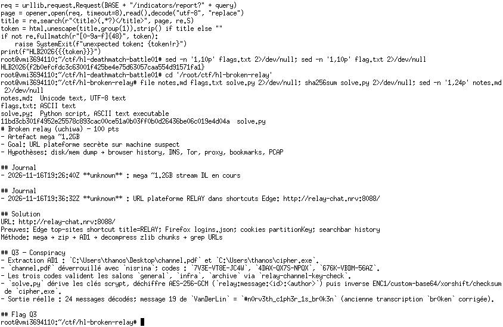
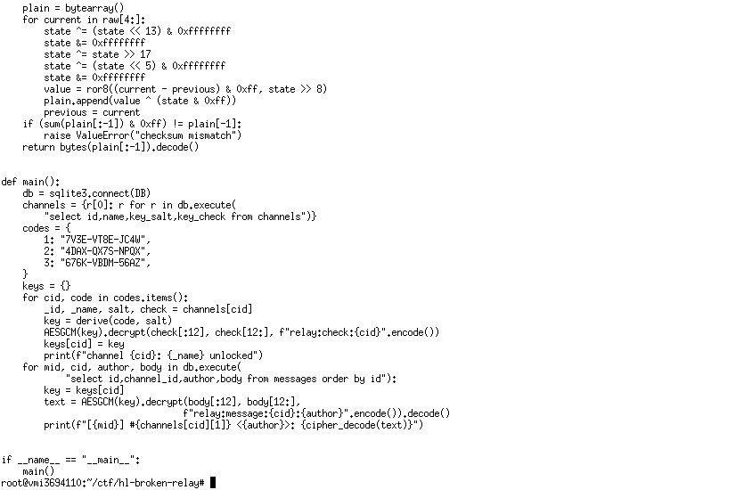
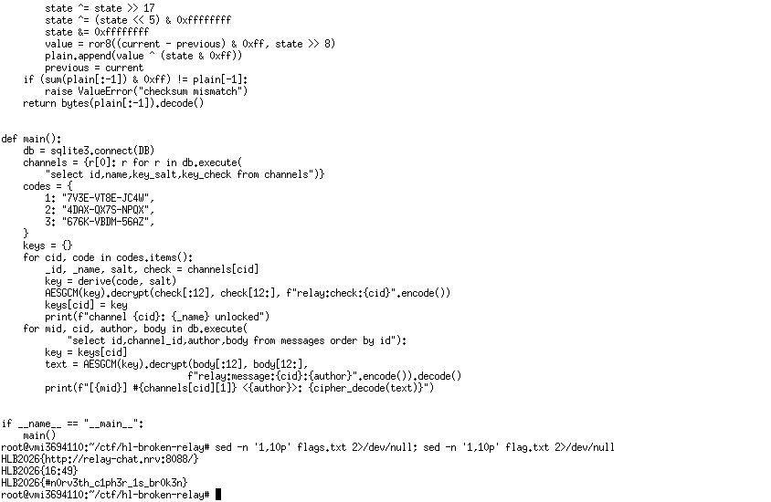

# Writeup : hl-broken-relay

Catégorie : forensics

Date de résolution : 2026-11-16

Technique principale : flag correction from raw decoded output

Outils observés : -

Cible : -

## Présentation

Ce document est construit à partir de la mémoire CTF partagée et des artefacts conservés dans /root/ctf/hl-broken-relay. Les étapes ci-dessous reprennent uniquement les faits observés. Les captures sont réalisées sur les fichiers locaux, sans rejouer une action distante ou destructive.

## Analyse et raisonnement

### Pourquoi ça marche

Correction: message 19 ends br0k3n (digit 3), not br0ken (letter e); prior transcription was wrong.

### Notes locales conservées

# Broken relay (uchiwa) :  100 pts
1. Artefact mega ~1.2GB
2. Goal: URL plateforme secrète sur machine suspect
3. Hypothèses: disk/mem dump :  browser history, DNS, Tor, proxy, bookmarks, PCAP

## Journal
4. 2026-11-16T19:26:40Z unknown : mega ~1.2GB stream DL en cours

## Journal
5. 2026-11-16T19:36:32Z unknown : URL plateforme RELAY dans shortcuts Edge: http://relay-chat.nrv:8088/

## Solution
URL: http://relay-chat.nrv:8088/
Preuves: Edge top-sites shortcut title=RELAY; Firefox logins.json; cookies partitionKey; searchbar history
Méthode: mega :  zip :  AD1 :  decompress zlib chunks :  grep URLs

## Q3 :  Conspiracy
6. Extraction AD1 : `C:\Users\thanos\Desktop\channel.pdf` et `C:\Users\thanos\cipher.exe`.
7. `channel.pdf` déverrouillé avec `nisrina`; codes : `7V3E-VT8E-JC4W`, `4DAX-QX7S-NPQX`, `676K-VBDM-56AZ`.
8. Les trois codes valident les salons `general`, `infra`, `archive` via `relay-channel-key-check`.
9. `solve.py` dérive les clés scrypt, déchiffre AES-256-GCM (`relay:message:<id>:<author>`) puis inverse ENC1/custom-base64/xorshift/checksum de `cipher.exe`.
10. Sortie réelle : 24 messages décodés; message 19 de `VanDerLin` = `#n0rv3th_c1ph3r_1s_br0k3n` (ancienne transcription `br0ken` corrigée).

## Flag Q3
`HLB2026{#n0rv3th_c1ph3r_1s_br0k3n}`

## Correction
11. La sortie brute de `decoded_messages.txt` contient `#n0rv3th_c1ph3r_1s_br0k3n` : le dernier mot est `br0k3n` avec le chiffre `3`, pas `br0ken` avec `e`.
12. Flag corrigé : `HLB2026{#n0rv3th_c1ph3r_1s_br0k3n}`.

## Journal
13. 2026-11-16T22:58:47Z unknown : Q3 terminé: PDF channel.pdf déverrouillé avec nisrina; codes des 3 salons validés; 24 messages déchiffrés par solve.py

## Commandes utiles

Les commandes suivantes consultent les preuves locales et sont sans effet de bord :

```bash
cd /root/ctf/hl-broken-relay
file notes.md solve.py 2>/dev/null
sed -n '1,180p' notes.md 2>/dev/null
sed -n '1,120p' solve.py 2>/dev/null
sed -n '1,10p' flags.txt 2>/dev/null
```

## Script de résolution complet

Le script conservé sous `solve.py` est reproduit ci-dessous sans modification :

```python
#!/usr/bin/env python3
"""Offline solver for Broken Relay / Conspiracy."""
import hashlib
import sqlite3
from pathlib import Path

from cryptography.hazmat.primitives.ciphers.aead import AESGCM

DB = Path(__file__).parent / "q3/rootfs/data/relay.db"
ALPHABET = b"Zm9Kx2QaLp7VfT0cRw4YhN1sJd8GuB3eXo6IkP5tCyAqWn-_ErSvHgMlDjUbOiFz"
HASH_TABLE = bytes.fromhex("985e20f945eadd6639e0209529d05c87")
FNV = 0x01000193
PAD = bytes.fromhex("28bf4e5e4e758a4164004e56fffa01082e2e00b6d0683e802f0ca9fe6453697a")


def derive(code, salt):
    return hashlib.scrypt(code.encode(), salt=salt, n=2**15, r=8, p=1,
                          maxmem=64 * 1024 * 1024, dklen=32)


def custom_b64_decode(s):
    vals = {c: i for i, c in enumerate(ALPHABET)}
    acc = bits = 0
    out = bytearray()
    for c in s.encode():
        acc = (acc << 6) | vals[c]
        bits += 6
        while bits >= 8:
            bits -= 8
            out.append((acc >> bits) & 0xff)
    return bytes(out)


def seed_hash(seed):
    h = 0x811C9DC5
    d = 0xFFFFFFA7
    for b in HASH_TABLE:
        h = ((h ^ ((b ^ d) & 0xff)) * FNV) & 0xffffffff
        d = (d + 0x1d) & 0xffffffff
    for b in seed:
        h = (((b ^ h) & 0xffffffff) * FNV) & 0xffffffff
    return h


def ror8(v, n):
    n %= 8
    return v if n == 0 else ((v >> n) | (v << (8 - n))) & 0xff


def cipher_decode(text):
    if text.startswith("ENC1:"):
        text = text[5:]
    raw = custom_b64_decode(text)
    state = seed_hash(raw[:4])
    previous = raw[3]
    plain = bytearray()
    for current in raw[4:]:
        state ^= (state << 13) & 0xffffffff
        state &= 0xffffffff
        state ^= state >> 17
        state ^= (state << 5) & 0xffffffff
        state &= 0xffffffff
        value = ror8((current - previous) & 0xff, state >> 8)
        plain.append(value ^ (state & 0xff))
        previous = current
    if (sum(plain[:-1]) & 0xff) != plain[-1]:
        raise ValueError("checksum mismatch")
    return bytes(plain[:-1]).decode()


def main():
    db = sqlite3.connect(DB)
    channels = {r[0]: r for r in db.execute(
        "select id,name,key_salt,key_check from channels")}
    codes = {
        1: "7V3E-VT8E-JC4W",
        2: "4DAX-QX7S-NPQX",
        3: "676K-VBDM-56AZ",
    }
    keys = {}
    for cid, code in codes.items():
        _id, _name, salt, check = channels[cid]
        key = derive(code, salt)
        AESGCM(key).decrypt(check[:12], check[12:], f"relay:check:{cid}".encode())
        keys[cid] = key
        print(f"channel {cid}: {_name} unlocked")
    for mid, cid, author, body in db.execute(
            "select id,channel_id,author,body from messages order by id"):
        key = keys[cid]
        text = AESGCM(key).decrypt(body[:12], body[12:],
                                  f"relay:message:{cid}:{author}".encode()).decode()
        print(f"[{mid}] #{channels[cid][1]} <{author}>: {cipher_decode(text)}")


if __name__ == "__main__":
    main()
```

## Captures du terminal

Les captures utilisent le terminal natif xterm disponible sur l’environnement, avec le prompt réel `root@vmi3694110`, le dossier courant du challenge et une géométrie identique. Elles montrent successivement l’analyse locale, le script ou les preuves de résolution, puis le flag conservé.







## Validation et flag

Le flag est conservé dans le fichier local flags.txt ou flag.txt. Aucune validation externe supplémentaire n’est affirmée ici.

Flag obtenu : `HLB2026{#n0rv3th_c1ph3r_1s_br0k3n}`

## Conclusion

La résolution repose sur la faiblesse indiquée dans la technique principale, puis sur la vérification locale du résultat conservé. Le flag final ci-dessus est copié depuis la preuve locale réellement présente.
