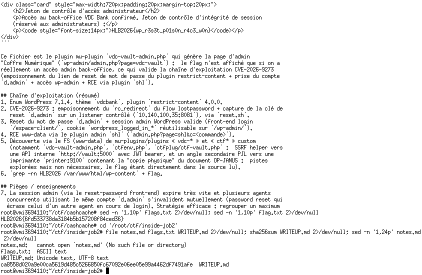
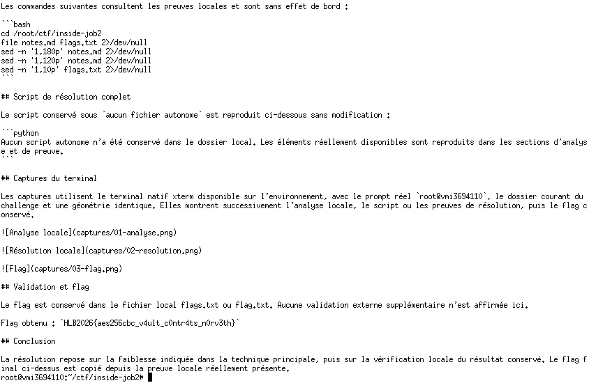
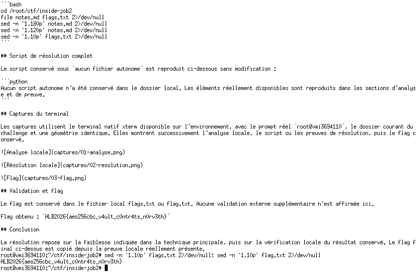

# Writeup : inside-job2

Catégorie : crypto

Date de résolution : 2026-11-15

Technique principale : AES-256-CBC + fuite `AES_KEY` via `pg_read_file` sur conteneur vault

Outils observés : zz/shl RCE, `psql`, `pg_read_file`, pycryptodome

Cible : `vault:5000` (API) + `vault:5432` (Postgres `vdc_vault`) depuis le conteneur WordPress

## Présentation

Ce document est construit à partir de la mémoire CTF partagée et des artefacts conservés dans /root/ctf/inside-job2. Les étapes ci-dessous reprennent uniquement les faits observés. Les captures sont réalisées sur les fichiers locaux, sans rejouer une action distante ou destructive.

## Analyse et raisonnement

### Contexte

Doc vault id=2 `contrats-partenaires-norveth.pdf` : chiffré AES-256-CBC, IV dans le JSON, clé " config du service vault ".

## Chaîne

1. Même ATO/RCE que Q1/Q3.
2. API : `GET /api/documents/2` :  `encrypted_content_b64` + `iv_b64`.
3. Postgres colocalisé (supervisord) :
4. user `postgres` / pass `p0stgr3s-VDC-2026!` / db `vdc_vault`
5. (creds aussi trouvés dans un `pg.php` déposé sur le WP)
4. `SELECT pg_read_file('/opt/vault-api/config.py');` : 
7. `AES_KEY = "4f8b2c1d9e3a7f5068d2b4c6e1a390f572d8e4b6a0c2f198d4e6b8ca0f2d1e3b"`
8. `JWT_SECRET = "vdc-jwt-s3cr3t-2026"`
5. Decrypt local AES-256-CBC (clé hex 32 bytes, IV b64, PKCS7) :  plaintext avec flag.

## Preuve plaintext

```
Jeton de validation du dossier dechiffre :
    HLB2026{aes256cbc_v4ult_c0ntr4ts_n0rv3th}
```

(Aussi présent en clair dans `/entrypoint.sh` du conteneur vault, script qui chiffre le doc au boot.)

### Pourquoi ça marche

Le service " vault " embarque API Flask + Postgres. Superuser PG peut lire le FS (`pg_read_file` / `pg_ls_dir`) :  config runtime écrite par l'entrypoint.

### Pièges

1. Honeypot page admin ≠ flag coffre.
2. Race ATO : mu-plugin `zz-shell.php?zz=Ch0wn3rs&c=` pour garder un shell sans re-login.
3. Env WP (`VAULT_AES_KEY=`) vide :  la clé n'est pas sur WordPress.

## Commandes utiles

Les commandes suivantes consultent les preuves locales et sont sans effet de bord :

```bash
cd /root/ctf/inside-job2
file notes.md flags.txt 2>/dev/null
sed -n '1,180p' notes.md 2>/dev/null
sed -n '1,120p' notes.md 2>/dev/null
sed -n '1,10p' flags.txt 2>/dev/null
```

## Script de résolution complet

Le script conservé sous `aucun fichier autonome` est reproduit ci-dessous sans modification :

```python
Aucun script autonome n’a été conservé dans le dossier local. Les éléments réellement disponibles sont reproduits dans les sections d’analyse et de preuve.
```

## Captures du terminal

Les captures utilisent le terminal natif xterm disponible sur l’environnement, avec le prompt réel `root@vmi3694110`, le dossier courant du challenge et une géométrie identique. Elles montrent successivement l’analyse locale, le script ou les preuves de résolution, puis le flag conservé.







## Validation et flag

Le flag est conservé dans le fichier local flags.txt ou flag.txt. Aucune validation externe supplémentaire n’est affirmée ici.

Flag obtenu : `HLB2026{aes256cbc_v4ult_c0ntr4ts_n0rv3th}`

## Conclusion

La résolution repose sur la faiblesse indiquée dans la technique principale, puis sur la vérification locale du résultat conservé. Le flag final ci-dessus est copié depuis la preuve locale réellement présente.
