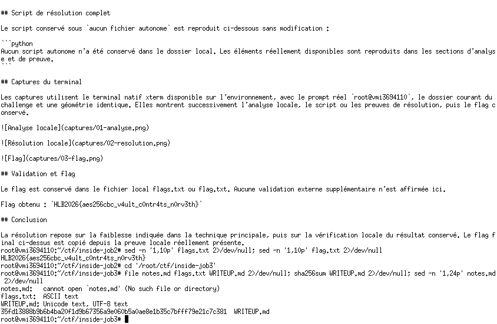
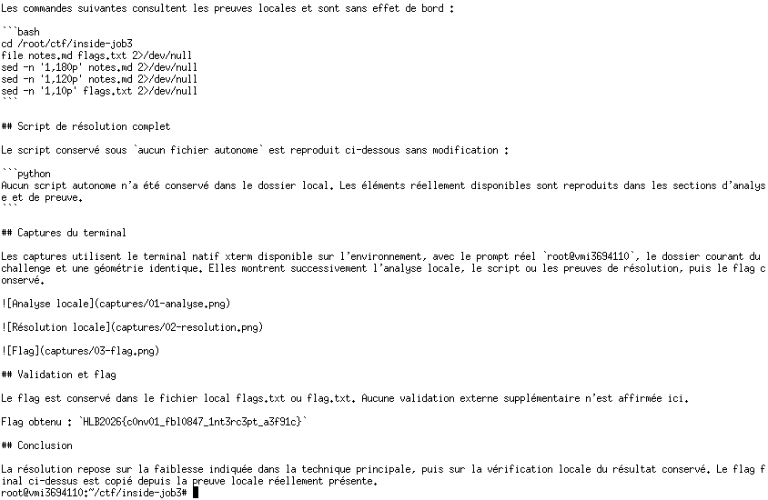
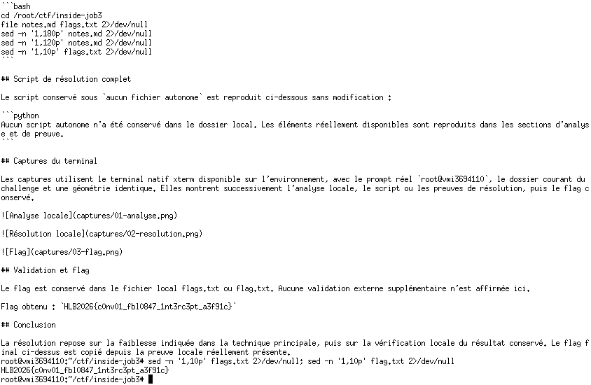

# Writeup : inside-job3

Catégorie : misc

Date de résolution : 2026-11-15

Technique principale : table SQL `convoy_route` → `payload_b64`

Outils observés : `psql`, base64

Cible : Postgres `vdc_vault` (même vault que Q2), asset `VDC-FBL-0847` id=4

## Présentation

Ce document est construit à partir de la mémoire CTF partagée et des artefacts conservés dans /root/ctf/inside-job3. Les étapes ci-dessous reprennent uniquement les faits observés. Les captures sont réalisées sur les fichiers locaux, sans rejouer une action distante ou destructive.

## Analyse et raisonnement

### Contexte

Énoncé : fourgon doit transporter les documents pour archivage :  retrouver l'itinéraire.

## Chaîne

1. `GET /api/assets` (JWT) :  véhicule `VDC-FBL-0847` :
2. `metadata.route_table = "convoy_route (SQL interne)"`
3. `transport = "Siege -> Datacenter Valmere"`
2. `GET /api/fleet/4/location` :  position garage seulement (pas le flag).
3. PG : `SELECT * FROM convoy_route WHERE vehicle_id=4 ORDER BY seq;`
4. Waypoints SECURE/EXPOSED ; seq=5 Pont-bascule Sudhafen (fenêtre radio) :
7. `payload_b64 = SExCMjAyNntjMG52MDFfZmJsMDg0N18xbnQzcmMzcHRfYTNmOTFjfQ==`
5. `base64 -d` :  flag.

## Itinéraire (coords décodées)

| seq | segment | note | coords |
|-----|---------|------|--------|
| 1 | SECURE | Départ garage | 6.3702,2.3912 |
| 2 | SECURE | Périphérique nord | 6.3661,2.4055 |
| 3 | EXPOSED | Sortie 12 | 6.3510,2.4330 |
| 4 | EXPOSED | Zone industrielle | 6.3482,2.4410 |
| 5 | EXPOSED | Pont-bascule Sudhafen   | 6.3455,2.4502 |
| 6 | EXPOSED | Corridor logistique | 6.3460,2.4610 |
| 7 | SECURE | Entrée Datacenter Valmere | 6.3530,2.4901 |

### Pièges

1. `/api/fleet/<id>/location|status` ≠ itinéraire complet ni flag.
2. Asset lookup par plaque `VDC-FBL-0847` en path :  404 ; utiliser id numérique 4.

## Commandes utiles

Les commandes suivantes consultent les preuves locales et sont sans effet de bord :

```bash
cd /root/ctf/inside-job3
file notes.md flags.txt 2>/dev/null
sed -n '1,180p' notes.md 2>/dev/null
sed -n '1,120p' notes.md 2>/dev/null
sed -n '1,10p' flags.txt 2>/dev/null
```

## Script de résolution complet

Le script conservé sous `aucun fichier autonome` est reproduit ci-dessous sans modification :

```python
Aucun script autonome n’a été conservé dans le dossier local. Les éléments réellement disponibles sont reproduits dans les sections d’analyse et de preuve.
```

## Captures du terminal

Les captures utilisent le terminal natif xterm disponible sur l’environnement, avec le prompt réel `root@vmi3694110`, le dossier courant du challenge et une géométrie identique. Elles montrent successivement l’analyse locale, le script ou les preuves de résolution, puis le flag conservé.







## Validation et flag

Le flag est conservé dans le fichier local flags.txt ou flag.txt. Aucune validation externe supplémentaire n’est affirmée ici.

Flag obtenu : `HLB2026{c0nv01_fbl0847_1nt3rc3pt_a3f91c}`

## Conclusion

La résolution repose sur la faiblesse indiquée dans la technique principale, puis sur la vérification locale du résultat conservé. Le flag final ci-dessus est copié depuis la preuve locale réellement présente.
