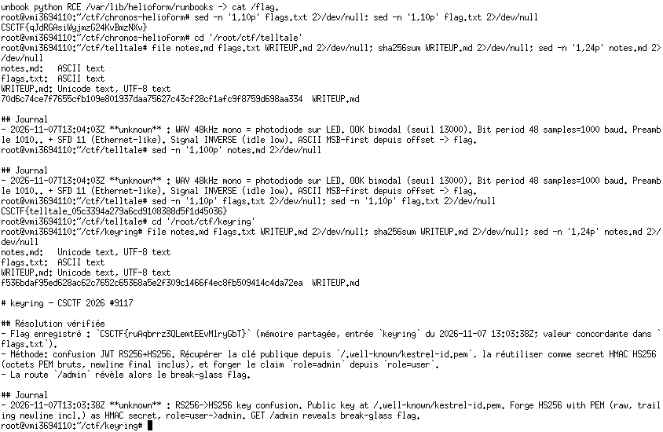
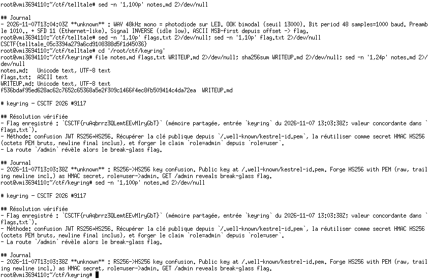
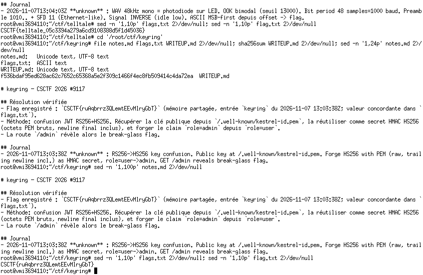

# Writeup : keyring

Catégorie : web

Date de résolution : 2026-11-07

Technique principale : RS256-to-HS256 JWT algorithm confusion using exposed PEM public key as HMAC secret

Outils observés : curl,python

Cible : CSCTF 2026 #9117

## Présentation

Ce document est construit à partir de la mémoire CTF partagée et des artefacts conservés dans /root/ctf/keyring. Les étapes ci-dessous reprennent uniquement les faits observés. Les captures sont réalisées sur les fichiers locaux, sans rejouer une action distante ou destructive.

## Analyse et raisonnement

### Pourquoi ça marche

Preserve the PEM bytes including final newline when using them as HMAC key.

### Notes locales conservées

# keyring :  CSCTF 2026 #9117

## Résolution vérifiée
1. Flag enregistré : `CSCTF{ruAqbrrz3QLemtEEvMlryGbT}` (mémoire partagée, entrée `keyring` du 2026-11-07 13:03:38Z; valeur concordante dans `flags.txt`).
2. Méthode: confusion JWT RS256: HS256. Récupérer la clé publique depuis `/.well-known/kestrel-id.pem`, la réutiliser comme secret HMAC HS256 (octets PEM bruts, newline final inclus), et forger le claim `role=admin` depuis `role=user`.
3. La route `/admin` révèle alors le break-glass flag.

## Journal
4. 2026-11-07T13:03:38Z unknown : RS256->HS256 key confusion. Public key at /.well-known/kestrel-id.pem. Forge HS256 with PEM (raw, trailing newline incl.) as HMAC secret, role=user->admin. GET /admin reveals break-glass flag.

## Commandes utiles

Les commandes suivantes consultent les preuves locales et sont sans effet de bord :

```bash
cd /root/ctf/keyring
file notes.md flags.txt 2>/dev/null
sed -n '1,180p' notes.md 2>/dev/null
sed -n '1,120p' notes.md 2>/dev/null
sed -n '1,10p' flags.txt 2>/dev/null
```

## Script de résolution complet

Le script conservé sous `aucun fichier autonome` est reproduit ci-dessous sans modification :

```python
Aucun script autonome n’a été conservé dans le dossier local. Les éléments réellement disponibles sont reproduits dans les sections d’analyse et de preuve.
```

## Captures du terminal

Les captures utilisent le terminal natif xterm disponible sur l’environnement, avec le prompt réel `root@vmi3694110`, le dossier courant du challenge et une géométrie identique. Elles montrent successivement l’analyse locale, le script ou les preuves de résolution, puis le flag conservé.







## Validation et flag

Le flag est conservé dans le fichier local flags.txt ou flag.txt. Aucune validation externe supplémentaire n’est affirmée ici.

Flag obtenu : `CSCTF{ruAqbrrz3QLemtEEvMlryGbT}`

## Conclusion

La résolution repose sur la faiblesse indiquée dans la technique principale, puis sur la vérification locale du résultat conservé. Le flag final ci-dessus est copié depuis la preuve locale réellement présente.
