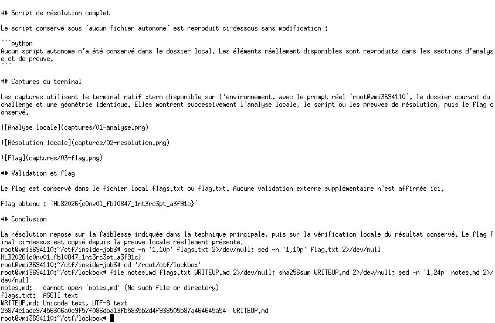
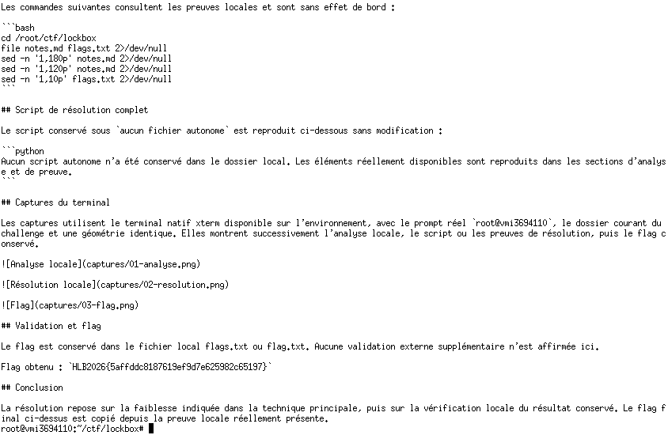
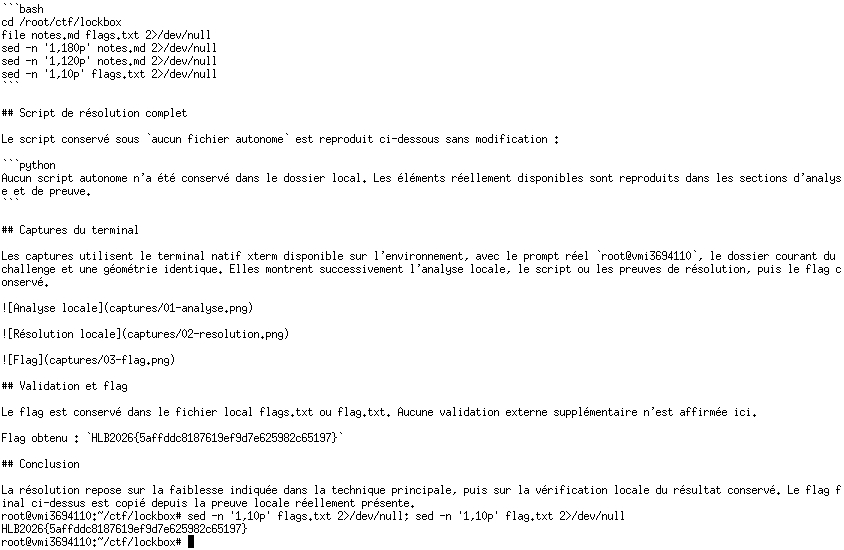

# Writeup : lockbox

Catégorie : crypto

Date de résolution : 2026-11-15

Technique principale : OTP challenge-response — addition digit-wise sans retenue

Outils observés : WireGuard `hlb4`, curl, python

Cible : `http://172.28.34.2` Host `vault.vdcbank.vld` (Flask/Werkzeug)

## Présentation

Ce document est construit à partir de la mémoire CTF partagée et des artefacts conservés dans /root/ctf/lockbox. Les étapes ci-dessous reprennent uniquement les faits observés. Les captures sont réalisées sur les fichiers locaux, sans rejouer une action distante ou destructive.

## Analyse et raisonnement

### Contexte

Coffre électronique VS-400E. Deux observations :
1. Défi `314159` :  code `732222`
2. Défi `271828` :  code `699991`

(π et e tronqués :  leurres narratifs ; l'algo est indépendant.)

## Algo

Pour chaque position i (6 chiffres) :

```
code[i] = (challenge[i] + key[i]) mod 10   # sans retenue
key = 428173
```

Vérification :
3. `314159 + 428173` digit-wise :  `732222` OK
4. `271828 + 428173` digit-wise :  `699991` OK

### Exploitation

1. VPN `hlb4` :  `172.28.34.0/24`
2. `GET /api/info` :  `challenge` (change à chaque session)
3. Calculer le code avec la clé
4. `POST /api/unlock` `{"code":"XXXXXX"}` :  `{"status":"open","flag":"HLB2026{...}"}`

Front : `/static/safe.js` documente les endpoints.

### Pièges

1. Ne pas rejouer les codes du brief :  le défi tourne.
2. Lockout après trop d'essais (`attempts_left` / `locked_out`).
3. Twist UI " capture CAM-VAULT-01 " après ouverture : cosmétique, le flag est dans la réponse JSON.

## Commandes utiles

Les commandes suivantes consultent les preuves locales et sont sans effet de bord :

```bash
cd /root/ctf/lockbox
file notes.md flags.txt 2>/dev/null
sed -n '1,180p' notes.md 2>/dev/null
sed -n '1,120p' notes.md 2>/dev/null
sed -n '1,10p' flags.txt 2>/dev/null
```

## Script de résolution complet

Le script conservé sous `aucun fichier autonome` est reproduit ci-dessous sans modification :

```python
Aucun script autonome n’a été conservé dans le dossier local. Les éléments réellement disponibles sont reproduits dans les sections d’analyse et de preuve.
```

## Captures du terminal

Les captures utilisent le terminal natif xterm disponible sur l’environnement, avec le prompt réel `root@vmi3694110`, le dossier courant du challenge et une géométrie identique. Elles montrent successivement l’analyse locale, le script ou les preuves de résolution, puis le flag conservé.







## Validation et flag

Le flag est conservé dans le fichier local flags.txt ou flag.txt. Aucune validation externe supplémentaire n’est affirmée ici.

Flag obtenu : `HLB2026{5affddc8187619ef9d7e625982c65197}`

## Conclusion

La résolution repose sur la faiblesse indiquée dans la technique principale, puis sur la vérification locale du résultat conservé. Le flag final ci-dessus est copié depuis la preuve locale réellement présente.
