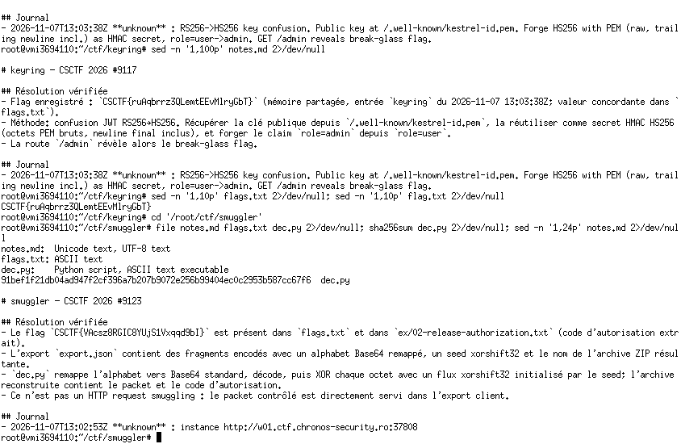
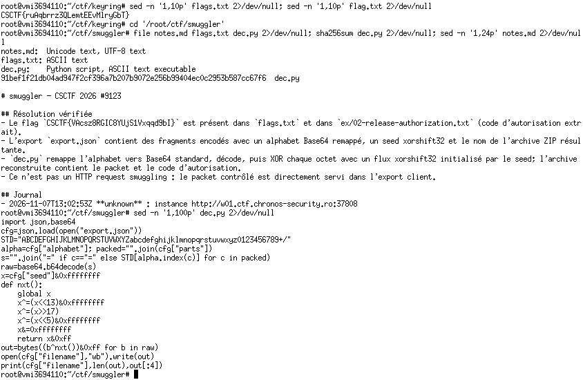
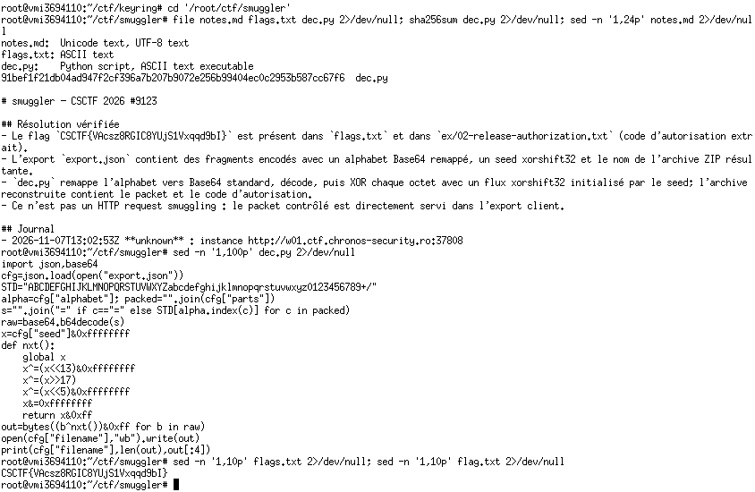

# Writeup : smuggler

Catégorie : misc

Date de résolution : 2026-11-07

Technique principale : custom Base64 alphabet plus xorshift32 stream XOR

Outils observés : python

Cible : CSCTF 2026 #9123

## Présentation

Ce document est construit à partir de la mémoire CTF partagée et des artefacts conservés dans /root/ctf/smuggler. Les étapes ci-dessous reprennent uniquement les faits observés. Les captures sont réalisées sur les fichiers locaux, sans rejouer une action distante ou destructive.

## Analyse et raisonnement

### Pourquoi ça marche

Inspect exported packet data for encoding metadata even when title suggests HTTP smuggling.

### Notes locales conservées

# smuggler :  CSCTF 2026 #9123

## Résolution vérifiée
1. Le flag `CSCTF{VAcsz8RGIC8YUjS1Vxqqd9bI}` est présent dans `flags.txt` et dans `ex/02-release-authorization.txt` (code d’autorisation extrait).
2. L’export `export.json` contient des fragments encodés avec un alphabet Base64 remappé, un seed xorshift32 et le nom de l’archive ZIP résultante.
3. `dec.py` remappe l’alphabet vers Base64 standard, décode, puis XOR chaque octet avec un flux xorshift32 initialisé par le seed; l’archive reconstruite contient le packet et le code d’autorisation.
4. Ce n’est pas un HTTP request smuggling : le packet contrôlé est directement servi dans l’export client.

## Journal
5. 2026-11-07T13:02:53Z unknown : instance http://w01.ctf.chronos-security.ro:37808

## Commandes utiles

Les commandes suivantes consultent les preuves locales et sont sans effet de bord :

```bash
cd /root/ctf/smuggler
file notes.md dec.py 2>/dev/null
sed -n '1,180p' notes.md 2>/dev/null
sed -n '1,120p' dec.py 2>/dev/null
sed -n '1,10p' flags.txt 2>/dev/null
```

## Script de résolution complet

Le script conservé sous `dec.py` est reproduit ci-dessous sans modification :

```python
import json,base64
cfg=json.load(open("export.json"))
STD="ABCDEFGHIJKLMNOPQRSTUVWXYZabcdefghijklmnopqrstuvwxyz0123456789+/"
alpha=cfg["alphabet"]; packed="".join(cfg["parts"])
s="".join("=" if c=="=" else STD[alpha.index(c)] for c in packed)
raw=base64.b64decode(s)
x=cfg["seed"]&0xffffffff
def nxt():
    global x
    x^=(x<<13)&0xffffffff
    x^=(x>>17)
    x^=(x<<5)&0xffffffff
    x&=0xffffffff
    return x&0xff
out=bytes((b^nxt())&0xff for b in raw)
open(cfg["filename"],"wb").write(out)
print(cfg["filename"],len(out),out[:4])
```

## Captures du terminal

Les captures utilisent le terminal natif xterm disponible sur l’environnement, avec le prompt réel `root@vmi3694110`, le dossier courant du challenge et une géométrie identique. Elles montrent successivement l’analyse locale, le script ou les preuves de résolution, puis le flag conservé.







## Validation et flag

Le flag est conservé dans le fichier local flags.txt ou flag.txt. Aucune validation externe supplémentaire n’est affirmée ici.

Flag obtenu : `CSCTF{VAcsz8RGIC8YUjS1Vxqqd9bI}`

## Conclusion

La résolution repose sur la faiblesse indiquée dans la technique principale, puis sur la vérification locale du résultat conservé. Le flag final ci-dessus est copié depuis la preuve locale réellement présente.
