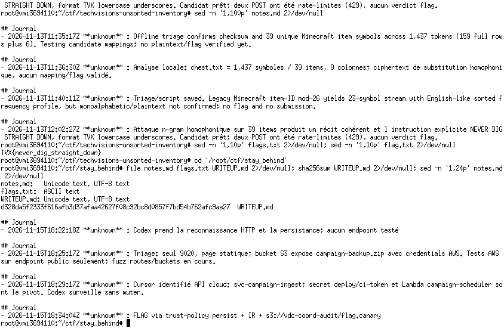
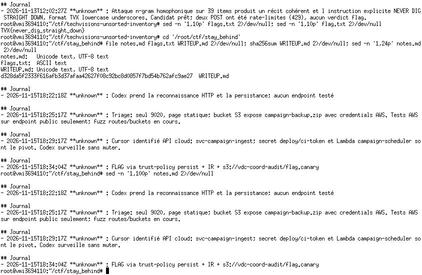
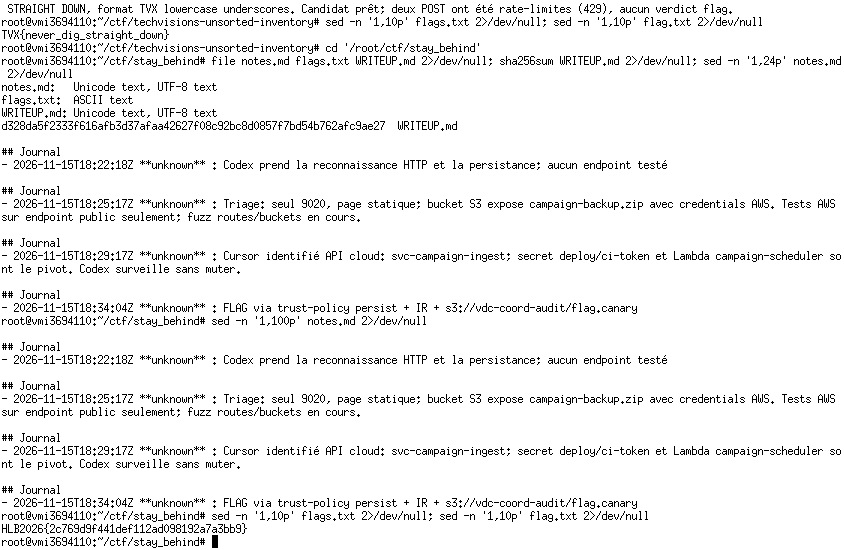

# Writeup : stay_behind

Catégorie : web

Date de résolution : 2026-11-15

Technique principale : AWS-emulated S3/IAM/Lambda; UpdateAssumeRolePolicy trust-policy persistence across IR sweep

Outils observés : aws,curl,solve.py

Cible : -

## Présentation

Ce document est construit à partir de la mémoire CTF partagée et des artefacts conservés dans /root/ctf/stay_behind. Les étapes ci-dessous reprennent uniquement les faits observés. Les captures sont réalisées sur les fichiers locaux, sans rejouer une action distante ou destructive.

## Analyse et raisonnement

### Exploitation

S3 campaign-backup.zip -> SecretsManager deploy/ci-token -> svc-deploy UpdateFunctionCode/Invoke -> role campaign-scheduler-exec; UpdateAssumeRolePolicy Principal AWS:*; POST /_ctf/run-ir; re-AssumeRole; GetObject vdc-coord-audit/flag.canary

### Pourquoi ça marche

A wildcard role trust policy survives the IR cleanup that revokes identities, created users, keys, Lambda code, and pre-sweep sessions; assume a fresh admin role session after POST_IR and read the canary object.

### Pièges

IAM users/keys created after T0 are swept; the persistence must live in the role trust policy.

### Notes locales conservées

## Journal
1. 2026-11-15T18:22:18Z unknown : Codex prend la reconnaissance HTTP et la persistance; aucun endpoint testé

## Journal
2. 2026-11-15T18:25:17Z unknown : Triage: seul 9020, page statique; bucket S3 expose campaign-backup.zip avec credentials AWS. Tests AWS sur endpoint public seulement; fuzz routes/buckets en cours.

## Journal
3. 2026-11-15T18:29:17Z unknown : Cursor identifié API cloud: svc-campaign-ingest; secret deploy/ci-token et Lambda campaign-scheduler sont le pivot. Codex surveille sans muter.

## Journal
4. 2026-11-15T18:34:04Z unknown : FLAG via trust-policy persist + IR + s3://vdc-coord-audit/flag.canary

## Commandes utiles

Les commandes suivantes consultent les preuves locales et sont sans effet de bord :

```bash
cd /root/ctf/stay_behind
file notes.md flags.txt 2>/dev/null
sed -n '1,180p' notes.md 2>/dev/null
sed -n '1,120p' notes.md 2>/dev/null
sed -n '1,10p' flags.txt 2>/dev/null
```

## Script de résolution complet

Le script conservé sous `aucun fichier autonome` est reproduit ci-dessous sans modification :

```python
Aucun script autonome n’a été conservé dans le dossier local. Les éléments réellement disponibles sont reproduits dans les sections d’analyse et de preuve.
```

## Captures du terminal

Les captures utilisent le terminal natif xterm disponible sur l’environnement, avec le prompt réel `root@vmi3694110`, le dossier courant du challenge et une géométrie identique. Elles montrent successivement l’analyse locale, le script ou les preuves de résolution, puis le flag conservé.







## Validation et flag

Le flag est conservé dans le fichier local flags.txt ou flag.txt. Aucune validation externe supplémentaire n’est affirmée ici.

Flag obtenu : `HLB2026{2c769d9f441def112ad098192a7a3bb9}`

## Conclusion

La résolution repose sur la faiblesse indiquée dans la technique principale, puis sur la vérification locale du résultat conservé. Le flag final ci-dessus est copié depuis la preuve locale réellement présente.
