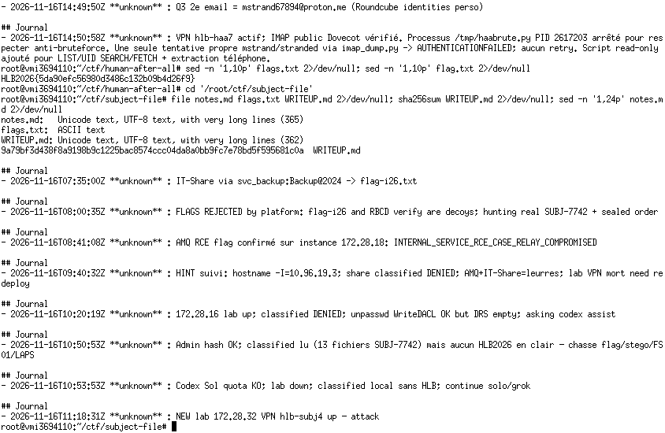
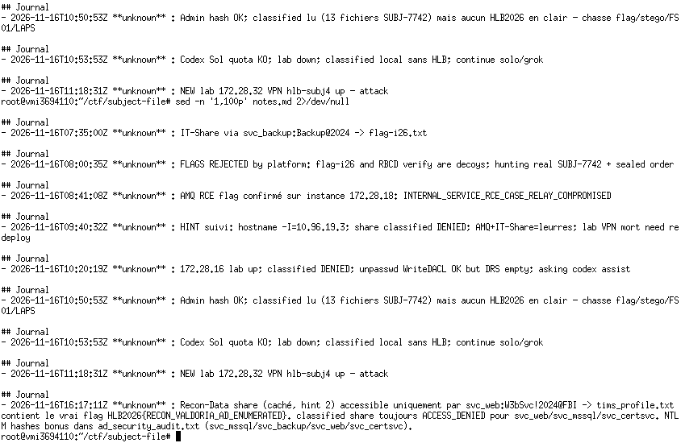
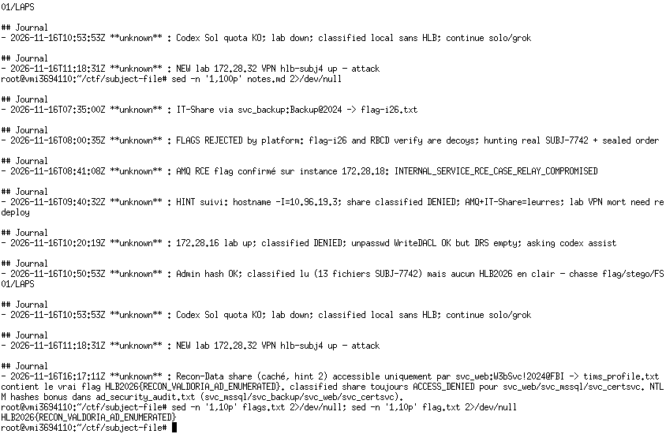

# Writeup : subject-file

Catégorie : ad

Date de résolution : 2026-11-16

Technique principale : SMB share caché Recon-Data

Outils observés : smbclient,netexec

Cible : valdoria.fbi.lab DC Samba AD

## Présentation

Ce document est construit à partir de la mémoire CTF partagée et des artefacts conservés dans /root/ctf/subject-file. Les étapes ci-dessous reprennent uniquement les faits observés. Les captures sont réalisées sur les fichiers locaux, sans rejouer une action distante ou destructive.

## Analyse et raisonnement

### Exploitation

smbclient //DC/Recon-Data -U "DOMAIN\\svc_web%PASS"

### Pourquoi ça marche

Toujours tester des noms de share devinés en plus de l'énumération listée : ACCESS_DENIED = share existe mais droits insuffisants, BAD_NETWORK_NAME = n'existe pas. Un hint platforme citant un nom de dossier = bruteforce direct de ce nom en SMB.

### Pièges

IT-Share et classified sont des leurres (flag-i26.txt, RBCD decoy) ; vrai flag dans Recon-Data, share non listé par NetShareEnum, accès réservé à svc_web uniquement

### Notes locales conservées

## Journal
1. 2026-11-16T07:35:00Z unknown : IT-Share via svc_backup:Backup@2024 -> flag-i26.txt

## Journal
2. 2026-11-16T08:00:35Z unknown : FLAGS REJECTED by platform: flag-i26 and RBCD verify are decoys; hunting real SUBJ-7742 + sealed order

## Journal
3. 2026-11-16T08:41:08Z unknown : AMQ RCE flag confirmé sur instance 172.28.18: INTERNAL_SERVICE_RCE_CASE_RELAY_COMPROMISED

## Journal
4. 2026-11-16T09:40:32Z unknown : HINT suivi: hostname -I=10.96.19.3; share classified DENIED; AMQ+IT-Share=leurres; lab VPN mort need redeploy

## Journal
5. 2026-11-16T10:20:19Z unknown : 172.28.16 lab up; classified DENIED; unpasswd WriteDACL OK but DRS empty; asking codex assist

## Journal
6. 2026-11-16T10:50:53Z unknown : Admin hash OK; classified lu (13 fichiers SUBJ-7742) mais aucun HLB2026 en clair :  chasse flag/stego/FS01/LAPS

## Journal
7. 2026-11-16T10:53:53Z unknown : Codex Sol quota KO; lab down; classified local sans HLB; continue solo/grok

## Journal
8. 2026-11-16T11:18:31Z unknown : NEW lab 172.28.32 VPN hlb-subj4 up :  attack

## Journal
9. 2026-11-16T16:17:11Z unknown : Recon-Data share (caché, hint 2) accessible uniquement par svc_web:W3bSvc!2024@FBI -> tims_profile.txt contient le vrai flag HLB2026{RECON_VALDORIA_AD_ENUMERATED}. classified share toujours ACCESS_DENIED pour svc_web/svc_mssql/svc_certsvc. NTLM hashes bonus dans ad_security_audit.txt (svc_mssql/svc_backup/svc_web/svc_certsvc).

## Commandes utiles

Les commandes suivantes consultent les preuves locales et sont sans effet de bord :

```bash
cd /root/ctf/subject-file
file notes.md flags.txt 2>/dev/null
sed -n '1,180p' notes.md 2>/dev/null
sed -n '1,120p' notes.md 2>/dev/null
sed -n '1,10p' flags.txt 2>/dev/null
```

## Script de résolution complet

Le script conservé sous `aucun fichier autonome` est reproduit ci-dessous sans modification :

```python
Aucun script autonome n’a été conservé dans le dossier local. Les éléments réellement disponibles sont reproduits dans les sections d’analyse et de preuve.
```

## Captures du terminal

Les captures utilisent le terminal natif xterm disponible sur l’environnement, avec le prompt réel `root@vmi3694110`, le dossier courant du challenge et une géométrie identique. Elles montrent successivement l’analyse locale, le script ou les preuves de résolution, puis le flag conservé.







## Validation et flag

Le flag est conservé dans le fichier local flags.txt ou flag.txt. Aucune validation externe supplémentaire n’est affirmée ici.

Flag obtenu : `HLB2026{RECON_VALDORIA_AD_ENUMERATED}`

## Conclusion

La résolution repose sur la faiblesse indiquée dans la technique principale, puis sur la vérification locale du résultat conservé. Le flag final ci-dessus est copié depuis la preuve locale réellement présente.
