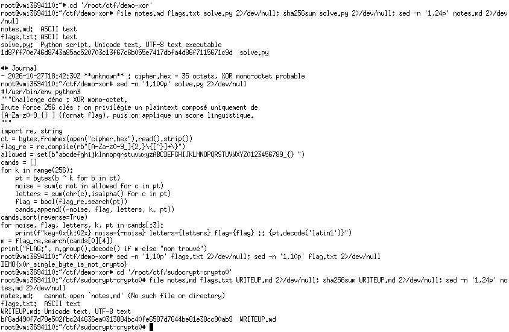
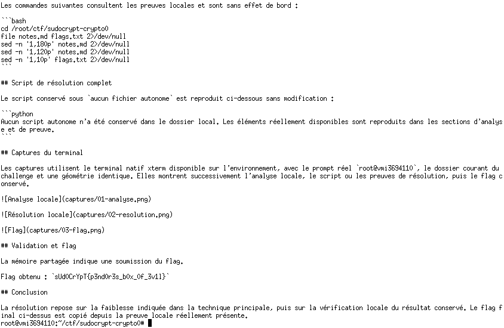
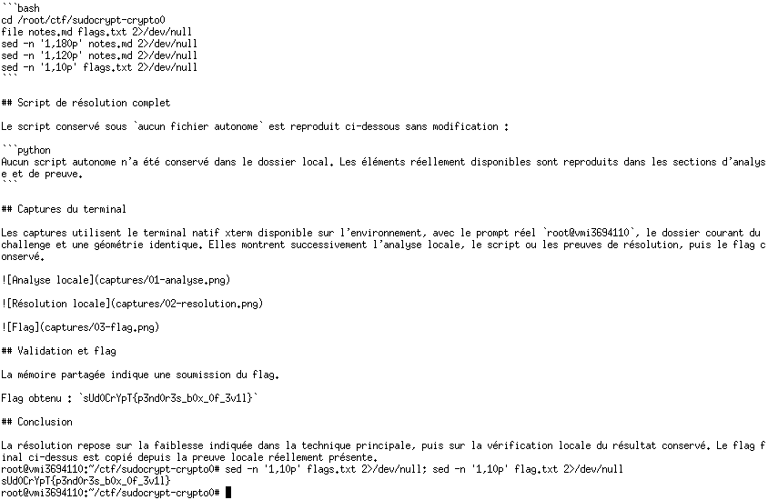

# Writeup : sudocrypt-crypto0

Catégorie : crypto

Date de résolution : 2026-10-28

Technique principale : Stage1 BDD inversion+rounding; Stage2 primal q-ary embedding BKZ-20; Stage3 pairwise multivariate HNP 5x5 with corrupt-row tolerance

Outils observés : fpylll,Python,requests

Cible : -

## Présentation

Ce document est construit à partir de la mémoire CTF partagée et des artefacts conservés dans /root/ctf/sudocrypt-crypto0. Les étapes ci-dessous reprennent uniquement les faits observés. Les captures sont réalisées sur les fichiers locaux, sans rejouer une action distante ou destructive.

## Analyse et raisonnement

### Exploitation

Stage3 private key accepted by /v1/stage3; server response saved in pandora-final.json.

### Pourquoi ça marche

Middle 128-bit nonce leak: use k_i=a_i+b_i+2^192*c_i and eliminate d by pairs; solve four small variables from four reduced lattice vectors.

## Commandes utiles

Les commandes suivantes consultent les preuves locales et sont sans effet de bord :

```bash
cd /root/ctf/sudocrypt-crypto0
file notes.md flags.txt 2>/dev/null
sed -n '1,180p' notes.md 2>/dev/null
sed -n '1,120p' notes.md 2>/dev/null
sed -n '1,10p' flags.txt 2>/dev/null
```

## Script de résolution complet

Le script conservé sous `aucun fichier autonome` est reproduit ci-dessous sans modification :

```python
Aucun script autonome n’a été conservé dans le dossier local. Les éléments réellement disponibles sont reproduits dans les sections d’analyse et de preuve.
```

## Captures du terminal

Les captures utilisent le terminal natif xterm disponible sur l’environnement, avec le prompt réel `root@vmi3694110`, le dossier courant du challenge et une géométrie identique. Elles montrent successivement l’analyse locale, le script ou les preuves de résolution, puis le flag conservé.







## Validation et flag

La mémoire partagée indique une soumission du flag.

Flag obtenu : `sUd0CrYpT{p3nd0r3s_b0x_0f_3v1l}`

## Conclusion

La résolution repose sur la faiblesse indiquée dans la technique principale, puis sur la vérification locale du résultat conservé. Le flag final ci-dessus est copié depuis la preuve locale réellement présente.
