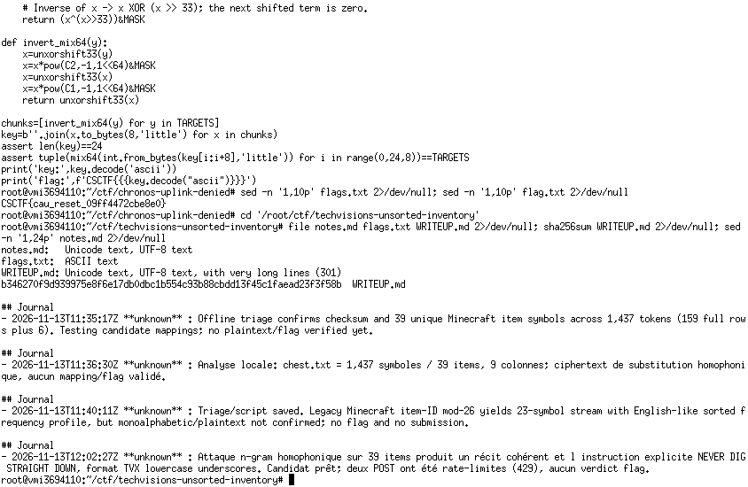
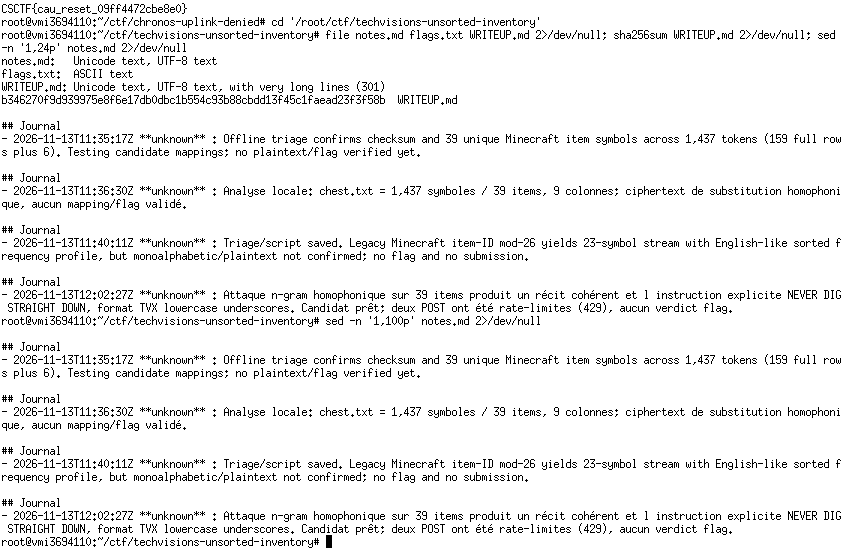
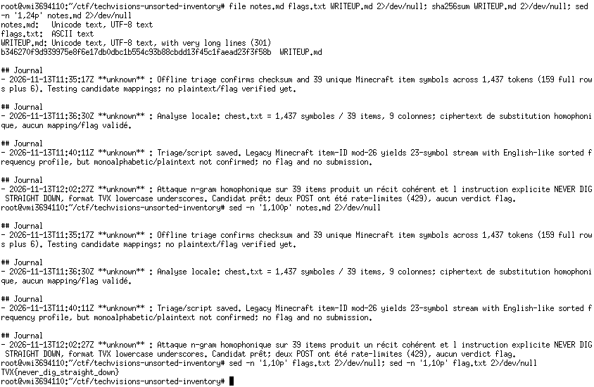

# Writeup : techvisions-unsorted-inventory

Catégorie : crypto

Date de résolution : 2026-11-13

Technique principale : Homophonic substitution via English quadgram scoring

Outils observés : C++ simulated annealing, 7z, CTF API

Cible : Tech Visions CTF challenge 36

## Présentation

Ce document est construit à partir de la mémoire CTF partagée et des artefacts conservés dans /root/ctf/techvisions-unsorted-inventory. Les étapes ci-dessous reprennent uniquement les faits observés. Les captures sont réalisées sur les fichiers locaux, sans rejouer une action distante ou destructive.

## Analyse et raisonnement

### Contexte

1,437 items and 39 types encoded an English story. Many-to-one homophonic substitution recovered the warning NEVER DIG STRAIGHT DOWN and the explicit lowercase/underscore format. Authenticated submission returned Correct; team solve confirmed.

### Pourquoi ça marche

Map each Minecraft item type as a distinct homophonic symbol and solve with n-grams before forming the flag; verify solved_by_me for the team before submission.

### Notes locales conservées

## Journal
1. 2026-11-13T11:35:17Z unknown : Offline triage confirms checksum and 39 unique Minecraft item symbols across 1,437 tokens (159 full rows plus 6). Testing candidate mappings; no plaintext/flag verified yet.

## Journal
2. 2026-11-13T11:36:30Z unknown : Analyse locale: chest.txt = 1,437 symboles / 39 items, 9 colonnes; ciphertext de substitution homophonique, aucun mapping/flag validé.

## Journal
3. 2026-11-13T11:40:11Z unknown : Triage/script saved. Legacy Minecraft item-ID mod-26 yields 23-symbol stream with English-like sorted frequency profile, but monoalphabetic/plaintext not confirmed; no flag and no submission.

## Journal
4. 2026-11-13T12:02:27Z unknown : Attaque n-gram homophonique sur 39 items produit un récit cohérent et l instruction explicite NEVER DIG STRAIGHT DOWN, format TVX lowercase underscores. Candidat prêt; deux POST ont été rate-limites (429), aucun verdict flag.

## Commandes utiles

Les commandes suivantes consultent les preuves locales et sont sans effet de bord :

```bash
cd /root/ctf/techvisions-unsorted-inventory
file notes.md flags.txt 2>/dev/null
sed -n '1,180p' notes.md 2>/dev/null
sed -n '1,120p' notes.md 2>/dev/null
sed -n '1,10p' flags.txt 2>/dev/null
```

## Script de résolution complet

Le script conservé sous `aucun fichier autonome` est reproduit ci-dessous sans modification :

```python
Aucun script autonome n’a été conservé dans le dossier local. Les éléments réellement disponibles sont reproduits dans les sections d’analyse et de preuve.
```

## Captures du terminal

Les captures utilisent le terminal natif xterm disponible sur l’environnement, avec le prompt réel `root@vmi3694110`, le dossier courant du challenge et une géométrie identique. Elles montrent successivement l’analyse locale, le script ou les preuves de résolution, puis le flag conservé.







## Validation et flag

Le flag est conservé dans le fichier local flags.txt ou flag.txt. Aucune validation externe supplémentaire n’est affirmée ici.

Flag obtenu : `TVX{never_dig_straight_down}`

## Conclusion

La résolution repose sur la faiblesse indiquée dans la technique principale, puis sur la vérification locale du résultat conservé. Le flag final ci-dessus est copié depuis la preuve locale réellement présente.
