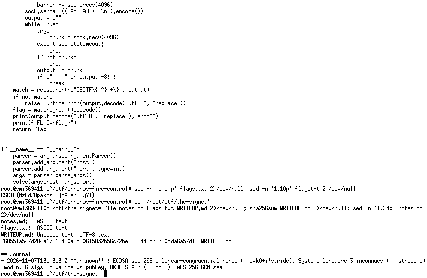
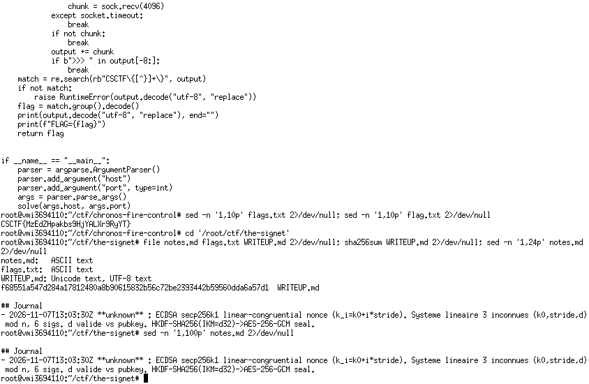
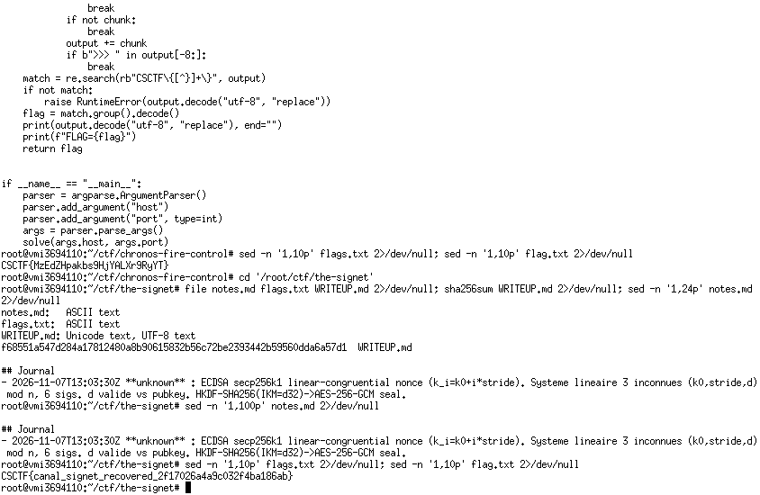

# Writeup : the-signet

Catégorie : crypto

Date de résolution : 2026-11-07

Technique principale : ECDSA secp256k1 nonce a stride additif constant k_i=k0+i*a mod n: equation s_i*k0 + i*s_i*a - r_i*d = z_i lineaire en (k0,a,d), Gauss mod n sur 3 records, verif sur les autres + match pubkey. Seal: HKDF-SHA256(IKM=I2OSP(d,32),salt,info)->AES-256-GCM.

Outils observés : python,cryptography

Cible : -

## Présentation

Ce document est construit à partir de la mémoire CTF partagée et des artefacts conservés dans /root/ctf/the-signet. Les étapes ci-dessous reprennent uniquement les faits observés. Les captures sont réalisées sur les fichiers locaux, sans rejouer une action distante ou destructive.

## Analyse et raisonnement

### Pourquoi ça marche

Entropy incident + 'same additive stride' = LCG nonce; systeme lineaire direct, pas besoin de lattice pour un stride connu-inconnu si on inclut k0 et a comme inconnues.

### Notes locales conservées

## Journal
1. 2026-11-07T13:03:30Z unknown : ECDSA secp256k1 linear-congruential nonce (k_i=k0+i*stride). Systeme lineaire 3 inconnues (k0,stride,d) mod n, 6 sigs. d valide vs pubkey. HKDF-SHA256(IKM=d32)->AES-256-GCM seal.

## Commandes utiles

Les commandes suivantes consultent les preuves locales et sont sans effet de bord :

```bash
cd /root/ctf/the-signet
file notes.md flags.txt 2>/dev/null
sed -n '1,180p' notes.md 2>/dev/null
sed -n '1,120p' notes.md 2>/dev/null
sed -n '1,10p' flags.txt 2>/dev/null
```

## Script de résolution complet

Le script conservé sous `aucun fichier autonome` est reproduit ci-dessous sans modification :

```python
Aucun script autonome n’a été conservé dans le dossier local. Les éléments réellement disponibles sont reproduits dans les sections d’analyse et de preuve.
```

## Captures du terminal

Les captures utilisent le terminal natif xterm disponible sur l’environnement, avec le prompt réel `root@vmi3694110`, le dossier courant du challenge et une géométrie identique. Elles montrent successivement l’analyse locale, le script ou les preuves de résolution, puis le flag conservé.







## Validation et flag

Le flag est conservé dans le fichier local flags.txt ou flag.txt. Aucune validation externe supplémentaire n’est affirmée ici.

Flag obtenu : `CSCTF{canal_signet_recovered_2f17026a4a9c032f4ba186ab}`

## Conclusion

La résolution repose sur la faiblesse indiquée dans la technique principale, puis sur la vérification locale du résultat conservé. Le flag final ci-dessus est copié depuis la preuve locale réellement présente.
