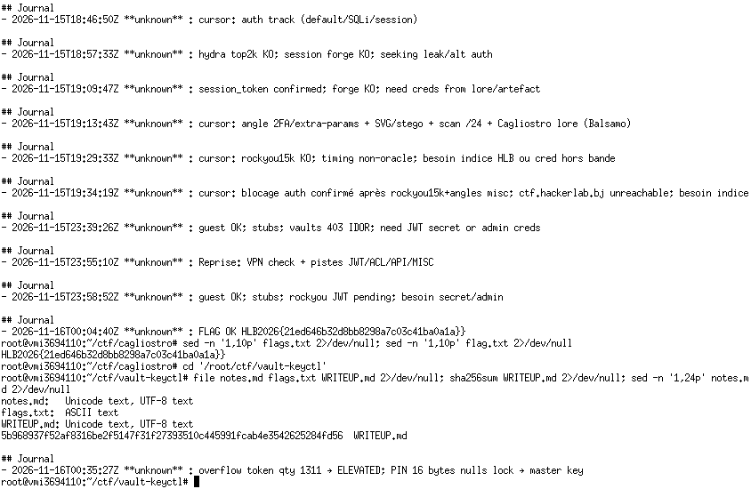
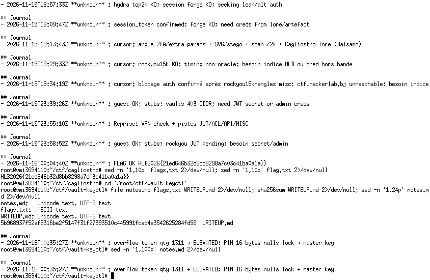
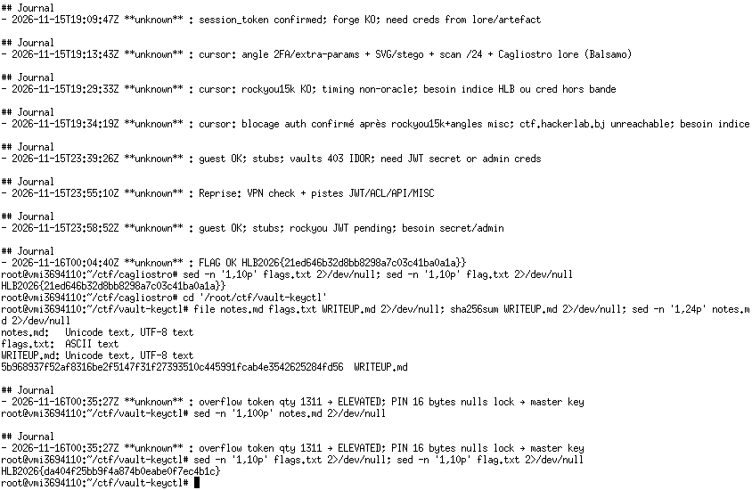

# Writeup : vault-keyctl

Catégorie : pwn

Date de résolution : 2026-11-16

Technique principale : uint16 cost truncation + PIN null OOB lock clear

Outils observés : pwntools,r2,objdump

Cible : 172.28.27.2:9000

## Présentation

Ce document est construit à partir de la mémoire CTF partagée et des artefacts conservés dans /root/ctf/vault-keyctl. Les étapes ci-dessous reprennent uniquement les faits observés. Les captures sont réalisées sur les fichiers locaux, sans rejouer une action distante ou destructive.

## Analyse et raisonnement

### Contexte

HSM CLI vault-keyctl: Token Market imul qty*50 puis cmp dx,credits (low16 only).
qty=1311 :  cost=65550 :  lo=14 ≤ 1000 crédits :  +1311 tokens ≥ 500 :  ELEVATED.
Master Key Export: lock byte @rsp+0x30; après PIN, movb 0,pin[len] :  len=16 écrase le lock.
Hash FNV-1a calculé mais jamais comparé. FLAG via getenv.

### Exploitation

buy qty=1311; export PIN=XXXXXXXXXXXXXXXX

### Pourquoi ça marche

Coût u32 checké sur low16 :  qty tel que (qty*price)&0xffff ≤ balance et qty≥seuil métier. NUL à pin[maxlen] peut clear un lock adjacent sur la stack.

### Flag

`HLB2026{da404f25bb9f4a874b0eabe0f7ec4b1c}`

### Notes locales conservées

## Journal
1. 2026-11-16T00:35:27Z unknown : overflow token qty 1311 :  ELEVATED; PIN 16 bytes nulls lock :  master key

## Commandes utiles

Les commandes suivantes consultent les preuves locales et sont sans effet de bord :

```bash
cd /root/ctf/vault-keyctl
file notes.md flags.txt 2>/dev/null
sed -n '1,180p' notes.md 2>/dev/null
sed -n '1,120p' notes.md 2>/dev/null
sed -n '1,10p' flags.txt 2>/dev/null
```

## Script de résolution complet

Le script conservé sous `aucun fichier autonome` est reproduit ci-dessous sans modification :

```python
Aucun script autonome n’a été conservé dans le dossier local. Les éléments réellement disponibles sont reproduits dans les sections d’analyse et de preuve.
```

## Captures du terminal

Les captures utilisent le terminal natif xterm disponible sur l’environnement, avec le prompt réel `root@vmi3694110`, le dossier courant du challenge et une géométrie identique. Elles montrent successivement l’analyse locale, le script ou les preuves de résolution, puis le flag conservé.







## Validation et flag

Le flag est conservé dans le fichier local flags.txt ou flag.txt. Aucune validation externe supplémentaire n’est affirmée ici.

Flag obtenu : `HLB2026{da404f25bb9f4a874b0eabe0f7ec4b1c}`

## Conclusion

La résolution repose sur la faiblesse indiquée dans la technique principale, puis sur la vérification locale du résultat conservé. Le flag final ci-dessus est copié depuis la preuve locale réellement présente.
