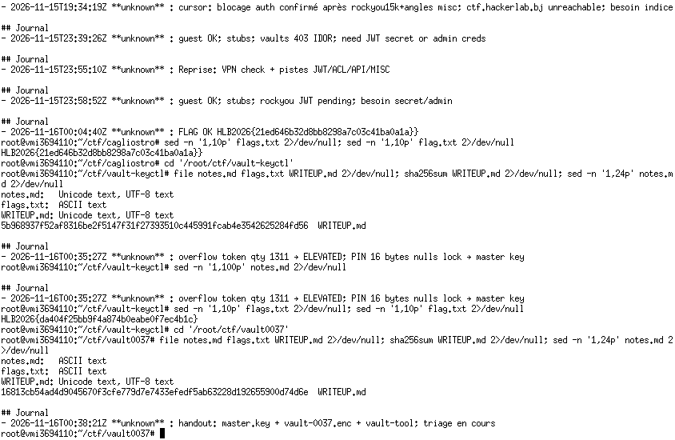
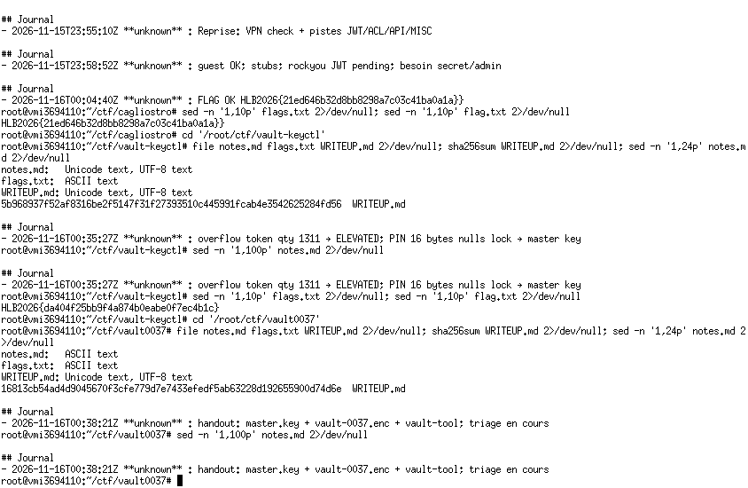
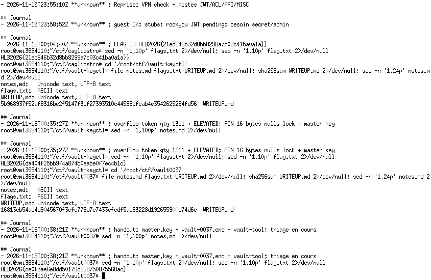

# Writeup : vault0037

Catégorie : crypto

Date de résolution : 2026-11-16

Technique principale : VH4K Feistel8 + AES-KW + AES-CBC-256 offline decrypt

Outils observés : pycryptodome,objdump

Cible : 172.28.27.2:8080

## Présentation

Ce document est construit à partir de la mémoire CTF partagée et des artefacts conservés dans /root/ctf/vault0037. Les étapes ci-dessous reprennent uniquement les faits observés. Les captures sont réalisées sur les fichiers locaux, sans rejouer une action distante ou destructive.

## Analyse et raisonnement

### Contexte

Handout master.key + vault-0037.enc + vault-tool (info/verify only).
Suite VH4K-FEISTEL8-KWRAP-CBC256. Decrypt helpers present but unreferenced.
KEK=Feistel8(master,salt); CEK=AES-KW(wrapped@0x40); PT=AES-CBC(iv@0x30): gzip: tar: ACCESS_TOKEN.

### Exploitation

Feistel8(mk,salt16)->KEK; RFC3394 unwrap wrapped40@0x40; CBC iv@0x30

### Pourquoi ça marche

vault-tool sans commande decrypt: crypto morte dans le binaire (Feistel SBOX, KW, CBC) :  réimplémenter offline. Layout: salt@0x20 iv@0x30 wrap@0x40 hmac@0x68.

### Flag

`HLB2026{ce0f5ae6e8dd50179d328750875568ac}`

### Notes locales conservées

## Journal
1. 2026-11-16T00:38:21Z unknown : handout: master.key + vault-0037.enc + vault-tool; triage en cours

## Commandes utiles

Les commandes suivantes consultent les preuves locales et sont sans effet de bord :

```bash
cd /root/ctf/vault0037
file notes.md flags.txt 2>/dev/null
sed -n '1,180p' notes.md 2>/dev/null
sed -n '1,120p' notes.md 2>/dev/null
sed -n '1,10p' flags.txt 2>/dev/null
```

## Script de résolution complet

Le script conservé sous `aucun fichier autonome` est reproduit ci-dessous sans modification :

```python
Aucun script autonome n’a été conservé dans le dossier local. Les éléments réellement disponibles sont reproduits dans les sections d’analyse et de preuve.
```

## Captures du terminal

Les captures utilisent le terminal natif xterm disponible sur l’environnement, avec le prompt réel `root@vmi3694110`, le dossier courant du challenge et une géométrie identique. Elles montrent successivement l’analyse locale, le script ou les preuves de résolution, puis le flag conservé.







## Validation et flag

Le flag est conservé dans le fichier local flags.txt ou flag.txt. Aucune validation externe supplémentaire n’est affirmée ici.

Flag obtenu : `HLB2026{ce0f5ae6e8dd50179d328750875568ac}`

## Conclusion

La résolution repose sur la faiblesse indiquée dans la technique principale, puis sur la vérification locale du résultat conservé. Le flag final ci-dessus est copié depuis la preuve locale réellement présente.
